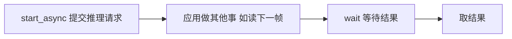

---
Title | Tools OV Optimizations
-- | --
Created @ | `2025-03-31T08:15:29Z`
Updated @| `2026-11-26T10:24:13Z`
Labels | ``
Edit @| [here](https://github.com/junxnone/aiwiki/issues/509)

---

# OpenVINO 优化

在 OpenVINO 中提升推理速度的两个常用手段：把预处理融入模型，以及使用异步推理。

- **输入预处理**: 网络通常需要预处理后的图像，模型转换 API 可高效将均值和归一化值融入模型，OpenVINO 可加速图像预处理和转换
- **OpenVINO 异步 API**: 异步 API 将推理请求分为开始异步执行和等待两步，相比同步 API 在生产代码中更具优势，异步方式能在设备忙时让应用并行做其他事

## 输入预处理

- **设置用户数据格式：** `ElementType`/`Shape`/`Layout`/`ColorFormtat`

```
from openvino.preprocess import PrePostProcessor
from openvino.preprocess import ColorFormat
from openvino import Layout, Type

ppp = PrePostProcessor(model)

ppp.input(input_name).tensor() \
        .set_element_type(Type.u8) \
        .set_shape([1, 480, 640, 3]) \
        .set_layout(Layout('NHWC')) \
        .set_color_format(ColorFormat.BGR)

```

- **设置模型格式**

```
# `model's input` already `knows` it's shape and data type, no need to specify them here
ppp.input(input_name).model().set_layout(Layout('NCHW'))
```

- **预处理**

```
from openvino.preprocess import ResizeAlgorithm
ppp.input(input_name).preprocess() \
    .convert_element_type(Type.f32) \
    .convert_color(ColorFormat.RGB) \
    .resize(ResizeAlgorithm.RESIZE_LINEAR) \
    .mean([100.5, 101, 101.5]) \
    .scale([50., 51., 52.])
# .convert_layout(Layout('NCHW')) # Not needed, such conversion will be added implicitly
```

```
model = ppp.build()
```

预处理中的均值与缩放对应：

$$
x' = \frac{x-\text{mean}}{\text{scale}}
$$

其中：$x$ 为输入像素值；$\text{mean}$、$\text{scale}$ 为各通道的均值和缩放系数（上面代码中的 `.mean([...])`、`.scale([...])`）；$x'$ 为归一化后送入网络的值。把这些步骤放进 `PrePostProcessor`，会随模型一起编译，在设备上执行，比在 CPU 上用 Python 预处理更快。

## 异步 API



图中：同步方式是「提交后一直等到完成」；异步方式把「开始」和「等待」分开，设备在计算的同时，应用可以并行读取下一帧或做后处理，使设备和 CPU 同时工作，提高吞吐。

```python
import openvino as ov
core = ov.Core()
compiled = core.compile_model(model, "CPU")
infer_queue = ov.AsyncInferQueue(compiled, 4)       # 4 个并行请求
infer_queue.set_callback(lambda req, userdata: handle(req.get_output_tensor(0).data))
for frame in frames:
    infer_queue.start_async({0: frame})              # 提交，不阻塞
infer_queue.wait_all()                                # 等全部完成
```

其中：`AsyncInferQueue` 管理多个并行的推理请求；`start_async` 立即返回；回调函数在每个请求完成后处理结果。吞吐与延迟的关系见 [DevCloud](https://github.com/junxnone/aiwiki/issues/179)。

| 方式 | 延迟 | 吞吐 | 适合 |
| --- | --- | --- | --- |
| 同步 | 低（单请求） | 较低 | 单张图像、对延迟敏感 |
| 异步 | 单请求不变 | 更高 | 视频流、批量处理 |

表中：对比结论：追求吞吐用异步，只关心单次延迟用同步。

