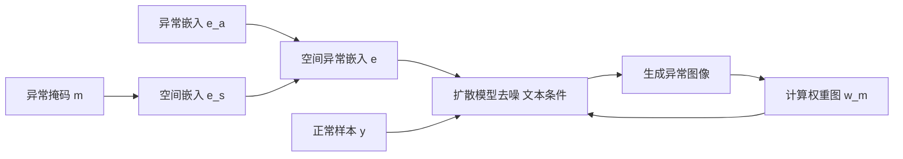

---
Title | paper AnomalyDiffusion
-- | --
Created @ | `2025-04-15T09:15:27Z`
Updated @| `2026-11-26T08:44:07Z`
Labels | ``
Edit @| [here](https://github.com/junxnone/aiwiki/issues/513)

---
# AnomalyDiffusion

用少量异常样本训练扩散模型，在指定的掩码位置生成逼真的异常，用于扩充异常检测与分割数据（见 [DualAnoDiff](https://github.com/junxnone/aiwiki/issues/522) 的对比）。

## Arch

- AnomalyDiffusion 的总体框架：
  - 空间异常嵌入 $e$，由异常嵌入 $e_{a}$ （一种通过学习得到的用于表示异常外观类型的文本嵌入）和空间嵌入 $e_{s}$ （由输入的异常掩码 $m$ 编码得到，用于指示异常位置）组成，它作为文本条件来引导异常生成过程；
  - 自适应注意力重加权机制根据去噪图像 $\hat{x}_{0}$ 与输入的正常样本 y  之间的差异来计算权重图 $w_m$ , 并通过权重图 $w_m$ 对交叉注意力图 $m_c$ 进行自适应重加权，以便在去噪过程中帮助模型更多地关注不太明显的异常区域。 

图中：该图为原文档附带的 AnomalyDiffusion 框架图，对应上面的空间异常嵌入和自适应注意力重加权。

图中：

- 异常嵌入 $e_a$ 描述异常**长什么样**，空间嵌入 $e_s$（来自掩码）描述异常**在哪里**；二者合成空间异常嵌入 $e$ 作为文本条件
- 以正常样本为基底去噪，在掩码处生成异常
- 自适应注意力重加权：根据去噪结果与正常样本的差异得到权重图 $w_m$，对交叉注意力图 $m_c$ 重新加权，使模型更关注不明显的异常区域
- 关键结论：位置由掩码精确控制，外观由学到的嵌入决定

可以写成：

$$
e=\left[e_a;\ e_s\right],\qquad \tilde{m}_c=w_m\odot m_c
$$

其中：

- $e_a$：学到的异常外观嵌入；$e_s$：由掩码 $m$ 编码的空间嵌入；$[\cdot;\cdot]$：拼接（表示组合）
- $m_c$：交叉注意力图；$w_m$：权重图；$\odot$：逐元素相乘；$\tilde{m}_c$：重加权后的注意力图

## 评估标准

- 采用与给定的异常数据无关的初始得分（Inception Score - IS），来直接评估生成质量；
- 还引入了簇内成对的感知损失距离 [ntra-cluster pairwise LPIPS distance]（IC-LPIPS）（奥哈等人，2021年），以衡量生成的多样性。

$$
\mathrm{IS}=\exp\Big(\mathbb{E}_{x}\,D_{KL}\big(p(y\mid x)\,\Vert\,p(y)\big)\Big)
$$

其中：

- $x$：生成图像；$p(y\mid x)$：分类器对它的类别预测分布；$p(y)$：所有生成图像的平均类别分布
- $D_{KL}$：KL 散度；$\mathbb{E}_x$：对生成图像取平均
- IS 越高，表示单张图像清晰（预测很确定）且整体类别多样

IC-LPIPS 是对同一簇（同一异常掩码生成的多张图）内的图像两两计算 LPIPS 距离再取平均，值越大说明同一类异常生成得越多样。

## Reference

- [[project page](https://sjtuplayer.github.io/anomalydiffusion-page/)]  - [[code](https://github.com/sjtuplayer/anomalydiffusion)]
- [paper - AnomalyDiffusion: Few-Shot Anomaly Image Generation with Diffusion Model](https://arxiv.org/abs/2312.05767)

