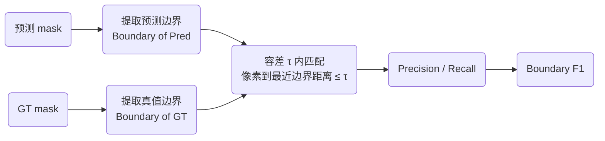

---
Title | ML Metrics Segmentation BF1S
-- | --
Created @ | `2025-11-13T08:09:31Z`
Updated @| `2026-11-24T01:05:02Z`
Labels | ``
Edit @| [here](https://github.com/junxnone/aiwiki/issues/526)

---
# Boundary F1-Score
- 分割边界 F1 分数（Segmentation Boundary F1-score）是评估图像分割边界精度的核心指标，综合了边界检测的精确率（Precision）和召回率（Recall）。
- 区域类指标（[IoU / Dice](/0231_ML_Metrics_Segmentation)）对边界不敏感：大目标的边界偏几个像素时，IoU 几乎不变；Boundary F1 专门衡量边界的贴合程度
- 最初用于评估轮廓检测（BSDS500），后来用于语义分割的边界质量评估


## 核心计算逻辑

1. 先定义 “真实边界”（来自标注数据）和 “预测边界”（模型输出结果）。
2. 计算精确率（Precision）：预测边界中与真实边界匹配的比例。
3. 计算召回率（Recall）：真实边界中被模型成功预测的比例。
4. 按 F1 公式计算：F1 = 2 × (Precision × Recall) / (Precision + Recall)，取值范围 0-1，越接近 1 表示边界分割越精准。

下图说明从掩码到 Boundary F1 的流程：



图中：

- 预测掩码和 GT 掩码分别提取出边界像素（如形态学腐蚀后与原掩码求差）
- 两个边界按**容差 $\tau$ 像素**做匹配：一个边界像素到对面最近边界像素的距离不超过 $\tau$ 就算匹配上
- 匹配结果分别得出 Precision 和 Recall，最后合成 Boundary F1

$$
P_b = \frac{\left|\{ p \in B_P : d(p, B_G) \le \tau \}\right|}{|B_P|}, \quad R_b = \frac{\left|\{ g \in B_G : d(g, B_P) \le \tau \}\right|}{|B_G|}, \quad BF = \frac{2 P_b R_b}{P_b + R_b}
$$

其中：

- $B_P$：预测边界的像素集合；$B_G$：真值边界的像素集合；$|\cdot|$ 为像素个数
- $d(p, B_G)$：像素 $p$ 到真值边界最近像素的距离；$\tau$：容差（像素），常取图像对角线的 0.75%（如 BSDS）或固定几个像素
- $P_b$：预测边界落在真值边界容差范围内的比例；$R_b$：真值边界被预测边界覆盖的比例
- $BF \in [0, 1]$，$\tau$ 越大越宽松，报告时必须注明 $\tau$

## 相关边界指标

Name | 说明
-- | --
Boundary IoU | 只在距边界一定宽度的带状区域内计算 IoU，对大目标边界更敏感
[Hausdorff Distance](/0715_ML_Metrics_Segmentation_Hausdorff) (HD95) | 两个边界之间最大（取 95% 分位）的距离，反映最坏情况的边界偏差，医学分割常用
ASSD / ASD | 平均对称表面距离，边界点平均偏差

表中是与 Boundary F1 互补的边界类指标：Boundary F1 是「有多少边界匹配上」（比例），Hausdorff/ASSD 是「偏差有多大」（距离）。

## Q？
- 标注本身存在的误差？pixel-level (几个甚至十几个 pixel 的误差)
  - 容差 $\tau$ 应不小于标注噪声，否则指标反映的是标注噪声而不是模型
- Instance-Level vs Class-Level(Semantic Segmentation)
  - 语义分割：每个类别分别提取边界再平均；实例分割：每个实例分别匹配边界；相邻实例的共享边界如何处理需要约定
- 大量的漏检误检如何计算？
  - 整块漏检时 $R_b$ 为 0、整块误检时 $P_b$ 为 0，BF 会大幅下降，需要和区域指标（IoU/AP）一起看
- confidence 限制？
  - 先用固定阈值把概率图二值化再提边界，阈值会影响结果；也可以对多个阈值取平均，或者使用 AP 类的指标

## Code
```python
import numpy as np
from scipy import ndimage as ndi

def boundary(mask):
    # mask: bool (H, W)，边界 = mask 减去腐蚀后的 mask
    return mask & ~ndi.binary_erosion(mask)

def boundary_f1(pred, gt, tau=2):
    bp, bg = boundary(pred), boundary(gt)
    dist_to_g = ndi.distance_transform_edt(~bg)     # 每个像素到真值边界的距离
    dist_to_p = ndi.distance_transform_edt(~bp)
    p = (dist_to_g[bp] <= tau).mean() if bp.any() else 0.0
    r = (dist_to_p[bg] <= tau).mean() if bg.any() else 0.0
    return 2 * p * r / (p + r) if p + r > 0 else 0.0
```


## Reference

- [Contour Detection and Hierarchical Image Segmentation](https://www2.eecs.berkeley.edu/Research/Projects/CS/vision/grouping/papers/amfm_pami2010.pdf) - BSDS500 边界评估
- [Boundary IoU: Improving Object-Centric Image Segmentation Evaluation](https://arxiv.org/abs/2103.16562)

