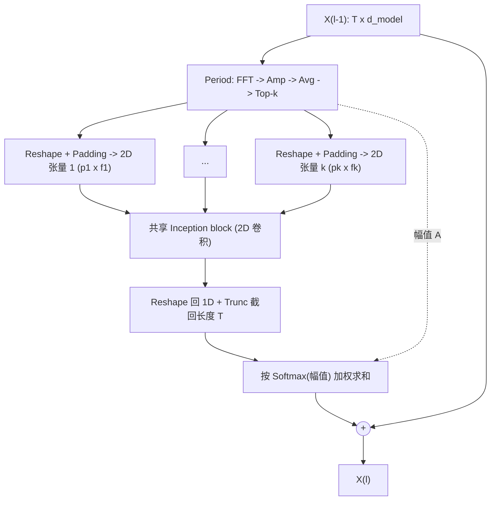

---
Title | paper TimesNet
-- | --
Created @ | `2026-11-11T07:11:23Z`
Updated @| `2026-11-12T06:21:14Z`
Labels | ``
Edit @| [here](https://github.com/junxnone/aiwiki/issues/622)

---
# TimesNet

> **TimesNet: Temporal 2D-Variation Modeling for General Time Series Analysis**
> Haixu Wu, Tengge Hu, Yong Liu, Hang Zhou, Jianmin Wang, Mingsheng Long（清华大学软件学院 / BNRist）
> arXiv:2210.02186（本文依据 v3，2023-04-12）｜代码：[thuml/TimesNet](https://github.com/thuml/TimesNet)

TimesNet 抓住时间序列的**多周期性**：先用 FFT 找出主要周期，再按周期把一维序列折叠成二维张量，使"周期内变化"和"周期间变化"分别落在二维张量的列和行上，然后直接用成熟的 2D 视觉骨干网络（文中默认 Inception block）建模。它的定位是一个**任务通用**的时序骨干，同时做短期/长期预测、填补、分类、异常检测五类任务。在时序模型整体脉络中的位置见 [深度学习时序模型](0606_ML_Tasks_TimeSeries_Deep)。

## 摘要

- 问题：时序分析的核心是**时间变化（temporal variation）建模**，但真实序列里上升、下降、波动等多种变化相互叠加，直接在一维序列上建模很困难。
- 观察：真实序列普遍具有**多周期性**（如天气的日/年周期，用电量的周/季度周期），多个周期相互叠加、相互作用。
- 想法：每个周期下，一个时间点的变化既受**相邻时间点**影响（周期内变化，intraperiod-variation），也与**相邻周期同相位点**相关（周期间变化，interperiod-variation）。一维结构很难同时表达这两种变化。
- 方法：按周期把 1D 序列 reshape 成 2D 张量，列表示周期内变化，行表示周期间变化，用 2D 卷积核建模；提出 TimesBlock，并堆叠成 TimesNet。
- 结果：在五类主流时序分析任务上取得一致的 state-of-the-art（论文表述）。

## 简介

### 现有方法的局限（论文观点）

方法 | 做法 | 局限
-- | -- | --
RNN | 沿时间逐点递推（马尔可夫假设） | 难以捕获长期依赖，串行计算效率低
TCN（一维卷积） | 沿时间维卷积 | 卷积核局部，只能建模相邻时间点，长期依赖不足
Transformer | 注意力建模时间点两两依赖 | 依赖被复杂时序模式掩盖，难以从分散的时间点直接找到可靠依赖
MLP（如 DLinear） | 沿时间维的全连接 | 把时间依赖编码为固定参数；论文认为分类这类需要层次化表征的任务上会退化

经典方法（ARIMA、Holt-Winters、Prophet）假设变化服从预定义模式，难以覆盖真实序列的复杂性。相关模型见 [经典统计时序模型](0604_ML_Tasks_TimeSeries_Classical)。

### 核心观察

- 一维序列只能直接表达相邻时间点之间的变化。
- 若把序列按周期长度 $p$ 折成矩阵：**每列**包含同一周期内的时间点（周期内变化），**每行**是不同周期中同一相位的点（周期间变化）。
- 这样二维张量同时具有两种局部性：列方向的相邻时间点、行方向的相邻周期，正适合 2D 卷积。
- 不同周期给出不同的二维变换，天然形成**模块化**设计：每个周期对应一个二维张量，分别处理再融合。
- 对没有明显周期性的序列，论文提到变化将由趋势等主导（原文此处被截断，细节以论文为准）。


- 一条混合多种周期的复杂 1D 波形，图中标注出 3 种显著周期 Period‑1、Period‑2、Period‑3；时序上每个时间点同时受周期内、跨周期两种变化共同影响，图中虚线连接 “不同周期相同相位” 的点，示意跨周期依赖关系。
- intraperiod‑variation: 存储一个完整周期内全部时间点, 周期内变化
- interperiod‑variation: 存储不同周期同一相位的时间点, 跨周期变化

## 方法

### 1D → 2D 变换

输入序列 $\mathbf{X}_{1D}\in\mathbb{R}^{T\times C}$（长度 $T$，$C$ 个变量）。先用 FFT 在频域找周期：

$$\mathbf{A}=\operatorname{Avg}\big(\operatorname{Amp}(\operatorname{FFT}(\mathbf{X}_{1D}))\big),\quad \{f_1,\dots,f_k\}=\mathop{\arg\mathrm{Topk}}_{f_*\in\{1,\dots,\lfloor T/2\rfloor\}}(\mathbf{A}),\quad p_i=\left\lceil \frac{T}{f_i}\right\rceil$$

- $\operatorname{Amp}(\cdot)$：各频率的幅值；$\operatorname{Avg}(\cdot)$：对 $C$ 个变量取平均，得 $\mathbf{A}\in\mathbb{R}^{T}$。
- $\mathbf{A}_j$ 表示频率 $j$ 的周期基函数强度，对应周期长度 $\lceil T/j\rceil$。
- 只取幅值最大的 top-$k$ 个频率（$k$ 是超参数），用来避开无意义的高频噪声；由于频域共轭对称，只考虑 $\{1,\dots,\lfloor T/2\rfloor\}$。
- 得到 $k$ 个周期长度 $\{p_1,\dots,p_k\}$，简记为 $\mathbf{A},\{f_i\},\{p_i\}=\operatorname{Period}(\mathbf{X}_{1D})$。

然后把序列折叠成 $k$ 个 2D 张量：

$$\mathbf{X}^{i}_{2D}=\operatorname{Reshape}_{p_i,f_i}\big(\operatorname{Padding}(\mathbf{X}_{1D})\big),\quad \mathbf{X}^{i}_{2D}\in\mathbb{R}^{p_i\times f_i\times C}$$

- $\operatorname{Padding}$：在时间维末尾补零，使长度能被整除地 reshape。
- 按论文记号，$p_i$ 是 2D 张量的行数，$f_i$ 是列数；列对应周期内变化，行对应周期间变化。


- 原始一维时序，经 FFT 频域分析，提取 Top-k 主频率（周期），并按每个周期分别做 Reshape（折叠），得到各自独立的 2D 张量
  - 先做 padding 补齐长度，保证可以整齐折叠；
  - 折叠成二维矩阵：维度 = 周期长度 $p_i$ × 周期个数 $s_i$
  - 列方向：intraperiod-variation（周期内变化）：一列就是一个完整周期内所有时刻
  - 行方向：interperiod-variation（跨周期变化）：同一行 = 不同周期里相同相位的时间点
- 送入 2D 卷积核（2D kernels）提取特征


### TimesBlock


模型先用嵌入层把输入映射成 $\mathbf{X}^0_{1D}=\operatorname{Embed}(\mathbf{X}_{1D})\in\mathbb{R}^{T\times d_{model}}$，第 $l$ 层用**残差**方式堆叠：

$$\mathbf{X}^{l}_{1D}=\operatorname{TimesBlock}(\mathbf{X}^{l-1}_{1D})+\mathbf{X}^{l-1}_{1D}$$

每个 TimesBlock 做两件事：

**1. 捕获二维变化**

$$\begin{aligned}
\mathbf{A}^{l-1},\{f_i\},\{p_i\}&=\operatorname{Period}(\mathbf{X}^{l-1}_{1D})\\
\mathbf{X}^{l,i}_{2D}&=\operatorname{Reshape}_{p_i,f_i}\big(\operatorname{Padding}(\mathbf{X}^{l-1}_{1D})\big)\\
\widehat{\mathbf{X}}^{l,i}_{2D}&=\operatorname{Inception}\big(\mathbf{X}^{l,i}_{2D}\big)\\
\widehat{\mathbf{X}}^{l,i}_{1D}&=\operatorname{Trunc}\big(\operatorname{Reshape}_{1,(p_i\times f_i)}(\widehat{\mathbf{X}}^{l,i}_{2D})\big)
\end{aligned}\qquad i\in\{1,\dots,k\}$$

- 周期是在**每一层的深层特征**上重新估计的，而不是只在原始输入上估计一次。论文的消融（Table 9）中只对原始输入做变换，异常检测平均 F1 从 85.49% 降到 84.85%。
- $\operatorname{Inception}$ 是多尺度 2D 卷积的 Inception block，参数高效；$\operatorname{Trunc}$ 把补零后长度 $p_i\times f_i$ 的序列截回原长 $T$。
- **$k$ 个 2D 张量共享同一个 Inception block**，因此模型参数量与超参数 $k$ 无关。

**2. 自适应聚合**

借鉴 Autoformer 的 Auto-Correlation，用频率幅值表示各周期的重要性，softmax 归一化后加权求和：

$$\widehat{\mathbf{A}}^{l-1}_{f_1},\dots,\widehat{\mathbf{A}}^{l-1}_{f_k}=\operatorname{Softmax}\big(\mathbf{A}^{l-1}_{f_1},\dots,\mathbf{A}^{l-1}_{f_k}\big),\qquad \mathbf{X}^{l}_{1D}=\sum_{i=1}^{k}\widehat{\mathbf{A}}^{l-1}_{f_i}\times\widehat{\mathbf{X}}^{l,i}_{1D}$$



### 骨干可替换

二维化之后，Inception block 可以换成其他视觉骨干，如 ResNet、ResNeXt、ConvNeXt、Swin Transformer。论文的消融（Table 8、Figure 4 右）显示，换成更强的 2D 骨干会进一步提升效果；考虑性能与效率的平衡，主实验使用 Inception block。论文认为这也把时序分析与快速发展的视觉骨干连接了起来。

### 实现与设置要点

项目 | 内容（来自论文附录）
-- | --
框架/硬件 | PyTorch，单张 NVIDIA TITAN RTX 24GB；所有实验重复 3 次
优化器 | ADAM，$(\beta_1,\beta_2)=(0.9,0.999)$
$d_{model}$ | $\min\{\max\{2^{\lceil\log C\rceil},d_{min}\},d_{max}\}$，随输入变量数 $C$ 自适应
基线对齐 | 所有模型共用同样的输入嵌入和最终投影层，只比较骨干；预测任务用时间维 MLP 初始化未来序列
分布偏移 | 使用 Non-stationary Transformer 的 Series Stationarization

各任务配置（论文 Table 7）：

任务 | $k$ | 层数 | $d_{min}$ | $d_{max}$ | 初始学习率 | 损失 | Batch | Epoch
-- | -- | -- | -- | -- | -- | -- | -- | --
长期预测 | 5 | 2 | 32 | 512 | $10^{-4}$ | MSE | 32 | 10
短期预测 | 5 | 2 | 16 | 64 | $10^{-3}$ | SMAPE | 16 | 10
填补 | 3 | 2 | 64 | 128 | $10^{-3}$ | MSE | 16 | 10
分类 | 3 | 2 | 32 | 64 | $10^{-3}$ | Cross Entropy | 16 | 30
异常检测 | 3 | 3 | 32 | 128 | $10^{-4}$ | MSE | 128 | 10

### 一个最小示意（非官方实现）

下面用 PyTorch 风格写出 TimesBlock 的逻辑，仅用于理解公式；官方实现见 [thuml/TimesNet](https://github.com/thuml/TimesNet) 与 Time-Series-Library。

```python
import torch, torch.nn as nn, torch.nn.functional as F

def find_periods(x, k):                       # x: [B, T, C]
    amp = torch.fft.rfft(x, dim=1).abs()      # [B, T//2+1, C]
    A = amp.mean(dim=(0, 2))                  # 对 batch 和变量取平均 -> 各频率强度
    A[0] = 0                                  # 去掉直流分量
    _, top_f = torch.topk(A, k)
    periods = x.shape[1] // top_f             # p_i = T / f_i
    return periods, amp.mean(-1)[:, top_f]    # 周期，及每个样本对应的幅值 [B, k]

class TimesBlock(nn.Module):
    def __init__(self, d_model, k, inception):
        super().__init__(); self.k, self.conv = k, inception   # 所有周期共享同一个 conv

    def forward(self, x):                     # x: [B, T, d_model]
        B, T, D = x.shape
        periods, amp = find_periods(x, self.k)
        outs = []
        for p in periods.tolist():
            L = ((T + p - 1) // p) * p        # 补零到 p 的整数倍
            xp = F.pad(x, (0, 0, 0, L - T))
            x2d = xp.reshape(B, L // p, p, D).permute(0, 3, 1, 2)   # [B, D, 行=周期数, 列=周期内]
            y = self.conv(x2d).permute(0, 2, 3, 1).reshape(B, L, D)[:, :T]
            outs.append(y)
        w = F.softmax(amp, dim=1)[:, None, None, :]                 # 按幅值加权
        return (torch.stack(outs, -1) * w).sum(-1) + x               # 残差
```

> 说明：示意代码里 `reshape` 的行/列取向按"每行是一个完整周期"的常见写法给出，和论文里 $p_i$/$f_i$ 的行列记号描述的是同一种折叠；实际实现细节（如周期去重、对 batch 平均幅值的方式）请以官方代码为准。

## 实验

### 基准与设置

任务 | 数据集 | 指标 | 序列长度
-- | -- | -- | --
长期预测 | ETT（4 个子集）、Electricity、Traffic、Weather、Exchange、ILI | MSE、MAE | 96 ~ 720（ILI：24 ~ 60）
短期预测 | M4（6 个子集） | SMAPE、MASE、OWA | 6 ~ 48
填补 | ETT（4 个子集）、Electricity、Weather | MSE、MAE | 96
分类 | UEA（10 个子集） | Accuracy | 29 ~ 1751
异常检测 | SMD、MSL、SMAP、SWaT、PSM | Precision、Recall、F1 | 100

- 基线共 15 个以上：RNN 类 LSTM、LSTNet、LSSL；CNN 类 TCN；MLP 类 LightTS、DLinear；Transformer 类 Reformer、Informer、Pyraformer、Autoformer、FEDformer、Non-stationary Transformer、ETSformer；以及任务专用的 N-HiTS、N-BEATS、Anomaly Transformer、Rocket、Flowformer。
- 填补：随机遮蔽 12.5%、25%、37.5%、50% 的时间点，结果为 4 种比例的平均。
- 异常检测：无监督；按 Anomaly Transformer 的预处理做滑窗；**所有模型统一使用重构误差作为异常判据**（把 Anomaly Transformer 原有的联合判据换成重构误差，以公平比较骨干）。评估相关讨论见 [异常检测](0609_ML_Tasks_TimeSeries_Anomaly) 与 [评估指标](0610_ML_Tasks_TimeSeries_Metrics)。

### 长期预测（Table 2，4 个预测长度的平均）

数据集 | TimesNet MSE / MAE | DLinear MSE / MAE | FEDformer MSE / MAE | Autoformer MSE / MAE
-- | -- | -- | -- | --
ETTm1 | 0.400 / 0.406 | 0.403 / 0.407 | 0.448 / 0.452 | 0.588 / 0.517
ETTm2 | 0.291 / 0.333 | 0.350 / 0.401 | 0.305 / 0.349 | 0.327 / 0.371
ETTh1 | 0.458 / 0.450 | 0.456 / 0.452 | 0.440 / 0.460 | 0.496 / 0.487
ETTh2 | 0.414 / 0.427 | 0.559 / 0.515 | 0.437 / 0.449 | 0.450 / 0.459
Electricity | 0.192 / 0.295 | 0.212 / 0.300 | 0.214 / 0.327 | 0.227 / 0.338
Traffic | 0.620 / 0.336 | 0.625 / 0.383 | 0.610 / 0.376 | 0.628 / 0.379
Weather | 0.259 / 0.287 | 0.265 / 0.317 | 0.309 / 0.360 | 0.338 / 0.382
Exchange | 0.416 / 0.443 | 0.354 / 0.414 | 0.519 / 0.500 | 0.613 / 0.539
ILI | 2.139 / 0.931 | 2.616 / 1.090 | 2.847 / 1.144 | 3.006 / 1.161

- 论文称 TimesNet 在长期预测的超过 80% 的情形取得最优（完整结果见论文 Table 13）。
- 但上表的 4 步平均值里并非处处领先：例如 ETTh1 的 MSE 上 FEDformer（0.440）和 DLinear（0.456）优于 TimesNet（0.458），Traffic 的 MSE 上 FEDformer 更优，Exchange 上 DLinear 在 MSE、MAE 上都更优。此处只抄录论文表中的数字，不做额外推断。
- 评测协议与后续基准的争论见 [评估指标](0610_ML_Tasks_TimeSeries_Metrics) 与 [时序模型总览](0603_ML_Tasks_TimeSeries)。

### 短期预测（Table 3，M4 加权平均）

模型 | SMAPE | MASE | OWA
-- | -- | -- | --
TimesNet | 11.829 | 1.585 | 0.851
N-HiTS | 11.927 | 1.613 | 0.861
N-BEATS | 11.851 | 1.599 | 0.855
FEDformer | 12.840 | 1.701 | 0.918
DLinear | 13.639 | 2.095 | 1.051

M4 含 100,000 条不同频率的序列，而长期预测的每个数据集只有一条连续序列，靠滑窗取样。

### 填补、分类、异常检测

- **填补（Table 4）**：论文称 TimesNet 在该任务上同样取得一致的最优，说明它能从不规则、部分观测的序列中发现潜在时间模式。各数值见论文 Table 4 与 Table 16。
- **分类（Figure 5）**：UEA 10 个子集的平均准确率 TimesNet 为 **73.6%**，高于经典方法 Rocket（72.5%）和深度模型 Flowformer（73.0%）；MLP 类的 DLinear 仅 67.5%。论文解释为 DLinear 只在时间维做一层 MLP，适合固定依赖的自回归类任务，却难以学习高层表征。
- **异常检测（Table 5，F1 %）**：

数据集 | TimesNet (Inception) | Anomaly Transformer* | FEDformer | Autoformer | Transformer
-- | -- | -- | -- | -- | --
SMD | 85.12 | 85.49 | 85.08 | 85.11 | 79.56
MSL | 84.18 | 83.31 | 78.57 | 79.05 | 78.68
SMAP | 70.85 | 71.18 | 70.76 | 71.12 | 69.70
SWaT | 92.10 | 83.10 | 93.19 | 92.74 | 80.37
PSM | 95.21 | 79.40 | 97.23 | 93.29 | 76.07
平均 | **85.49** | 80.50 | 84.97 | 84.26 | 76.88

\* 把联合判据换成重构误差。论文还给出了换成 ResNeXt 后的 TimesNet 平均 F1 为 86.34%。从逐数据集的数字看，SWaT、PSM 上 FEDformer 的 F1 高于 TimesNet，TimesNet 的优势体现在 5 个数据集的平均。

论文对经典 Transformer 在异常检测上表现差的解释是：注意力计算每对时间点的相似性，容易被占主导的正常点干扰；而 TimesNet、FEDformer、Autoformer 都考虑了周期性，能更好地凸显违反周期的变化。

### 模型分析

- **表征分析（CKA 相似度）**：预测和异常检测（重构）任务中，性能越好的模型首末层表征 CKA 相似度越高（低层表征）；填补和分类任务则相反，需要层次化表征（CKA 相似度低）。TimesNet 能针对不同任务学到合适的表征；FEDformer 在预测和异常检测上好，但学不到层次化表征，所以填补和分类较差。
- **二维变化案例**：TimesNet 能较准确地识别多周期，转换后的 2D 张量结构清晰，行和列分别体现周期间和周期内的局部性，支持用 2D 卷积核的动机。

## 消融与分析

项目 | 结论（论文附录）
-- | --
超参数 $k$ | 各任务上性能整体稳定；预测、异常检测这类低层建模任务对 $k$ 更敏感，分类、填补更鲁棒。最终取 $k=3$（填补、分类、异常检测）和 $k=5$（短期预测）
2D 骨干 | 换成 ResNeXt、Swin Transformer、ConvNeXt 等更强的骨干会进一步提升；每个周期用独立参数也有提升，但模型大小会随 $k$ 变化
模型结构 | 叠加 Autoformer 的深度分解结构没有进一步提升；只对原始输入做 1D→2D 变换（而不是每层都做）会变差（异常检测平均 F1：85.49% → 84.85%）
自适应聚合 | 直接求和、或去掉 Softmax 都不如论文的 Softmax 幅值加权
效率（Table 11） | 在 ETTh1 填补任务上测得；论文称在表现前三的模型中 TimesNet 效率最高，参数量不随输入序列变化，GPU 显存相对 Transformer 类更省
混合数据集训练（Table 12） | 把 ETTh1/ETTh2/ETTm1/ETTm2 混合训练，TimesNet 在四个子集上总体有提升，其他基线混合训练在部分子集上反而变差，论文据此认为它有作为大规模预训练骨干的潜力

## 评价与注意

- **贡献**：把"周期性"这个先验落到可计算的结构上，并借二维化直接复用成熟的 2D 视觉骨干；以 FFT + top-$k$ 做周期发现，开销小，且 $k$ 个张量共享参数。
- **局限（基于论文设置的推断，非论文原话）**：周期通过 FFT 幅值估计，序列周期性弱或周期非整数时，折叠后的二维结构不一定"干净"；每层按 batch 平均幅值挑周期，意味着同一 batch 共用一组周期。这类问题在论文里只有"对无明显周期的序列变化将由趋势主导"一句涉及，实际效果请以实测为准。
- **阅读提示**：预测基准上的排名通常受数据划分、窗口长度、超参搜索等设置影响，论文表格里的小差距（如 ETTh1、Traffic）宜谨慎看待；可结合 [时序模型总览](0603_ML_Tasks_TimeSeries) 与 [评估指标](0610_ML_Tasks_TimeSeries_Metrics) 中的评估讨论一起读。

## Reference
- [TimesNet (arXiv:2210.02186)](https://arxiv.org/abs/2210.02186)
- [TimesNet (arXiv HTML, v3)](https://arxiv.org/html/2210.02186v3)
- [thuml/TimesNet](https://github.com/thuml/TimesNet)
- [thuml/Time-Series-Library](https://github.com/thuml/Time-Series-Library)
- [Autoformer (arXiv:2106.13008)](https://arxiv.org/abs/2106.13008)
- [Non-stationary Transformers (arXiv:2205.14415)](https://arxiv.org/abs/2205.14415)

