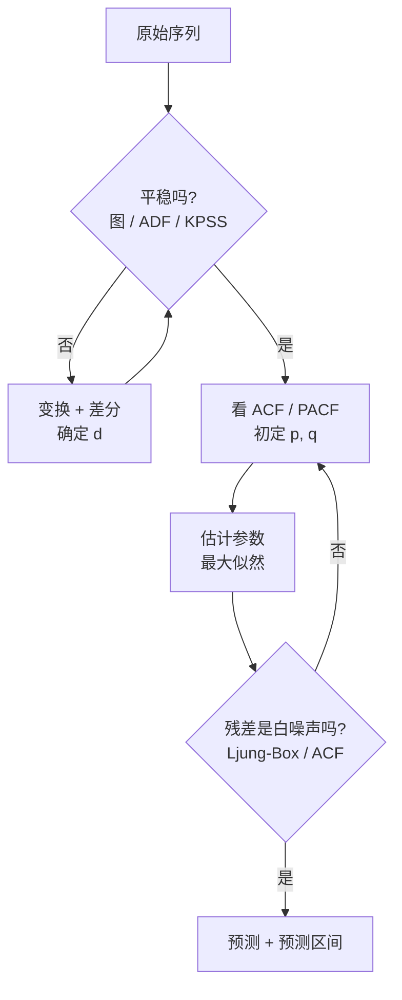
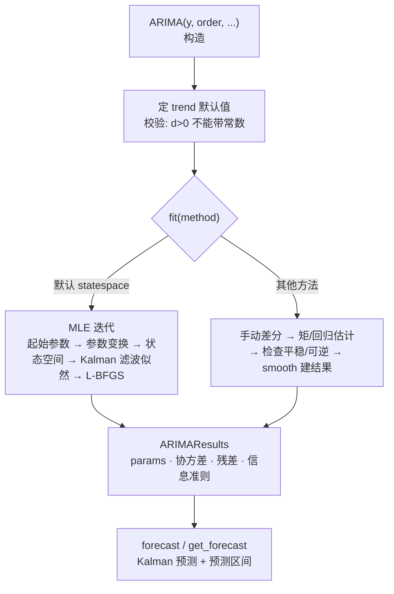
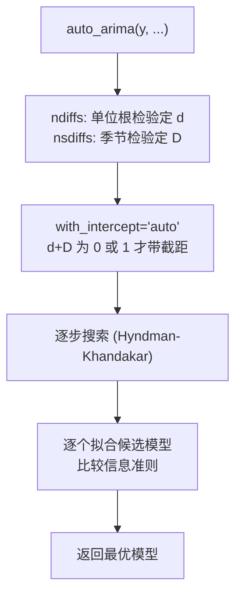

---
Title | ML Tasks TimeSeries Classical ARIMA
-- | --
Created @ | `2026-11-13T04:11:25Z`
Updated @| `2026-11-13T05:06:28Z`
Labels | ``
Edit @| [here](https://github.com/junxnone/aiwiki/issues/624)

---
# ARIMA

ARIMA（AutoRegressive Integrated Moving Average，自回归积分滑动平均）是最经典的时间序列预测模型之一。它的想法很朴素：**一个序列的未来，可以由它自己的过去值和过去的预测误差线性地表示出来**；如果序列有趋势，先做差分把它变平稳，再建模。本文从直觉到公式、从建模流程到代码，把 ARIMA 讲清楚。更多经典方法（ETS、Theta、状态空间等）见 [经典统计模型](0604_ML_Tasks_TimeSeries_Classical)，全貌见 [时序模型总览](0603_ML_Tasks_TimeSeries)。

## 一句话理解

$$\text{ARIMA}(p,d,q)=\underbrace{\text{AR}(p)}_{\text{过去的值}}+\underbrace{\text{I}(d)}_{\text{差分 }d\text{ 次}}+\underbrace{\text{MA}(q)}_{\text{过去的误差}}$$

三个参数：

| 参数 | 含义 | 直觉 |
| --- | --- | --- |
| $p$ | AR（自回归）阶数 | 用过去 $p$ 个**观测值**预测当前值 |
| $d$ | 差分次数（I，Integrated） | 做 $d$ 次差分，把趋势去掉，变成平稳序列 |
| $q$ | MA（滑动平均）阶数 | 用过去 $q$ 个**预测误差（冲击）**修正当前值 |

## 从 AR、MA 到 ARIMA

先看三个基础模块（设 $\varepsilon_t$ 是白噪声：均值 0、方差 $\sigma^2$、彼此不相关）。

**AR($p$)：当前值是过去值的线性组合加噪声**

$$y_t=c+\phi_1y_{t-1}+\cdots+\phi_py_{t-p}+\varepsilon_t$$

例如 AR(1)：$y_t=\phi y_{t-1}+\varepsilon_t$，$\phi$ 越接近 1，序列“记忆”越长。

**MA($q$)：当前值是过去噪声的线性组合**

$$y_t=\mu+\varepsilon_t+\theta_1\varepsilon_{t-1}+\cdots+\theta_q\varepsilon_{t-q}$$

注意这里的 MA 和“滑动平均平滑”不是一回事：它是**对噪声的加权**，描述“一次冲击会影响之后几期”。

**ARMA($p,q$)：两者合一**，适用于**平稳**序列：

$$y_t=c+\sum_{i=1}^{p}\phi_iy_{t-i}+\varepsilon_t+\sum_{j=1}^{q}\theta_j\varepsilon_{t-j}$$

**ARIMA($p,d,q$)：先差分，再用 ARMA**。一阶差分 $\nabla y_t=y_t-y_{t-1}$，对差分后的序列 $w_t=\nabla^d y_t$ 套 ARMA($p,q$) 模型。

### 用滞后算子写

引入滞后算子 $B$：$By_t=y_{t-1}$，差分算子 $\nabla=1-B$。令

$$\phi(B)=1-\phi_1B-\cdots-\phi_pB^p,\qquad \theta(B)=1+\theta_1B+\cdots+\theta_qB^q$$

则 ARIMA($p,d,q$) 可以紧凑地写成：

$$\phi(B)\,(1-B)^d\,y_t=c+\theta(B)\,\varepsilon_t,\qquad \varepsilon_t\sim\mathrm{WN}(0,\sigma^2)$$

- 平稳性条件：$\phi(z)=0$ 的根都在单位圆外。
- 可逆性条件：$\theta(z)=0$ 的根都在单位圆外（保证 MA 部分有唯一解，不然 $\theta$ 与 $1/\theta$ 会给出同样的自相关）。

## 为什么要平稳，以及怎么差分

**平稳**的直觉：序列的统计性质（均值、方差、自相关）不随时间变化。AR 和 MA 描述的是“围绕一个稳定水平的波动”，所以只适用于平稳序列。真实序列常有趋势或季节，需要先处理：

| 现象 | 处理 |
| --- | --- |
| 趋势（均值随时间漂移） | 一阶差分 $y_t-y_{t-1}$（$d=1$）；变化加速时再差一次（$d=2$） |
| 季节性（周期 $m$） | 季节差分 $y_t-y_{t-m}$（见下面的 SARIMA） |
| 波动幅度随水平增大 | 先取对数或 Box–Cox 变换，再差分 |

**怎么判断是否平稳、要差几次：**

- **ADF 检验**：原假设是“存在单位根（不平稳）”，p 值小则拒绝，认为平稳。
- **KPSS 检验**：原假设是“平稳”，p 值小则认为不平稳。两个检验互补，建议一起看。
- 肉眼看图，以及看 ACF：不平稳序列的 ACF 衰减得很慢。
- **不要过度差分**：差得太多会引入多余的负自相关，方差反而变大。差分后序列的一阶自相关接近 $-0.5$，是过度差分的典型信号（MA(1) 的 $\rho_1=\theta/(1+\theta^2)$，$\theta=-1$ 时为 $-0.5$）。

## 用 ACF / PACF 定阶

对差分后平稳的序列，看自相关函数（ACF）和偏自相关函数（PACF）：

| 模型 | ACF | PACF |
| --- | --- | --- |
| AR($p$) | 拖尾（逐渐衰减） | 在滞后 $p$ 之后**截尾** |
| MA($q$) | 在滞后 $q$ 之后**截尾** | 拖尾 |
| ARMA($p,q$) | 拖尾 | 拖尾 |

- PACF 在 $p$ 之后截尾 → 取 AR($p$)；ACF 在 $q$ 之后截尾 → 取 MA($q$)。
- 混合模型两者都拖尾，靠看图很难定阶，实践中更多用信息准则（AIC、AICc、BIC）在一组候选阶数里比较，选最小的。
- 注意：**只有在差分阶数 $d$ 相同的前提下，才能比较不同模型的 AIC**，不同 $d$ 之间的似然不可比。

## 建模流程（Box–Jenkins）



1. **识别**：差分到平稳，看 ACF/PACF 或用准则搜索，得到候选 $(p,d,q)$。
2. **估计**：通常用最大似然（也可用条件最小二乘）。含 MA 项时似然是非线性的，可能有局部最优，所以软件里会有“拟合失败”或“不可逆”的警告。
3. **诊断**：看残差——应该像白噪声（均值为 0、无自相关）。用 Ljung–Box 检验残差自相关，p 值不小（比如 $>0.05$）说明没有证据表明还有残余自相关；不通过就调整阶数重来。
4. **预测**：递推地向前预测，并给出预测区间。

## 预测是怎么算的

预测的做法是递推：每一步用已有的观测和已预测的值，代入模型的递推式，未来的噪声取期望 0。

**例子：AR(1) 的预测会回归均值。** 设 $y_t=\phi y_{t-1}+\varepsilon_t$（常数项为 0），则 $h$ 步预测是

$$\hat y_{T+h}=\phi^h\,y_T$$

若 $\phi=0.8$，$y_T=10$，预测依次为 $8,\ 6.4,\ 5.12,\ \dots\to0$：**越远越趋近均值**。

**例子：随机游走 ARIMA(0,1,0)。** $y_t=y_{t-1}+\varepsilon_t$，预测恒为 $\hat y_{T+h}=y_T$，**永不回归**。

差分阶数 $d$ 决定了模型对“冲击是暂时的还是永久的”的断言，也决定长期预测区间的形状：

| 模型 | 冲击的长期影响 | $h$ 步预测误差方差 | 区间 |
| --- | --- | --- | --- |
| 平稳 AR(1) | $\phi^{j}$，逐渐消失 | $\sigma^2\dfrac{1-\phi^{2h}}{1-\phi^2}\to\dfrac{\sigma^2}{1-\phi^2}$ | 变宽后趋平 |
| 随机游走 | 1，永久 | $h\,\sigma^2$ | 一直变宽 |

另外要注意：模型给出的预测区间默认把估计出来的参数当作真值，所以**实际不确定性比区间显示的更大，区间通常偏窄**；并且区间还依赖残差正态的假设。

## 常见的 ARIMA 特例

很多熟悉的模型就是 ARIMA 的特殊情形：

| 模型 | ARIMA 写法 | 说明 |
| --- | --- | --- |
| 白噪声 | (0,0,0) | 没有任何结构 |
| 随机游走 | (0,1,0) | 预测等于最近一个值（朴素预测） |
| 带漂移的随机游走 | (0,1,0) 加常数 | 预测按固定斜率延伸 |
| AR(1) | (1,0,0) | 预测向均值回归 |
| MA(1) | (0,0,1) | 冲击只影响一期 |
| 简单指数平滑（SES） | (0,1,1) | $\theta=\alpha-1$，即 $\alpha=1+\theta$ |
| Holt 线性趋势 | (0,2,2) | 近似对应，是教材里的标准结论 |

这说明 ARIMA 与指数平滑（ETS）是**互补的两个族**，并不是一个替代另一个：ETS 直接建模“水平、趋势、季节怎么演化”，ARIMA 建模“自相关结构”。实践中常把两者都拟合，再平均。

## 季节性：SARIMA

数据有周期 $m$（月度数据 $m=12$，周内 $m=7$）时，用季节 ARIMA，记作 ARIMA($p,d,q$)($P,D,Q$)$_m$：

$$\Phi(B^m)\,\phi(B)\,(1-B)^d(1-B^m)^D\,y_t=c+\Theta(B^m)\,\theta(B)\,\varepsilon_t$$

- 大写 $P,D,Q$ 是**季节部分**的阶数：季节自回归、季节差分次数、季节滑动平均，作用在滞后 $m,2m,\dots$ 上。
- 典型的月度模型：ARIMA(1,1,1)(1,1,1)$_{12}$。
- 周期很长（如日数据的年周期 $m=365$）时，参数数量爆炸、估计变慢，通常改用“傅里叶项加 ARIMA 误差”（动态谐波回归），或者换别的方法。

## 带外生变量：ARIMAX（动态回归）

要加入外部因素（价格、促销、温度）时，可以在 ARIMA 里加回归项：先回归外生变量，再对回归残差建 ARIMA；也可以把外生变量作为 `exog` 直接传给软件。预测时必须**提供未来的外生变量值**。

## 代码示例

用 Python 的 `statsmodels`（以月度序列为例）：

```python
import pandas as pd
from statsmodels.tsa.stattools import adfuller, kpss
from statsmodels.tsa.arima.model import ARIMA
from statsmodels.stats.diagnostic import acorr_ljungbox
from statsmodels.graphics.tsaplots import plot_acf, plot_pacf

y = pd.read_csv("series.csv", index_col=0, parse_dates=True)["value"].asfreq("MS")

# 1. 平稳性：ADF 原假设=有单位根，p 小 -> 平稳；KPSS 原假设=平稳，p 小 -> 不平稳
print("ADF p =", adfuller(y.dropna())[1])
print("KPSS p =", kpss(y.dropna(), nlags="auto")[1])

# 2. 差分后看 ACF / PACF 初定阶数
dy = y.diff().dropna()
plot_acf(dy, lags=36)
plot_pacf(dy, lags=36)

# 3. 拟合 ARIMA(1,1,1)
res = ARIMA(y, order=(1, 1, 1)).fit()
print(res.summary())

# 4. 残差诊断：p 值不小说明没有证据表明残差仍有自相关
print(acorr_ljungbox(res.resid, lags=[12, 24]))

# 5. 预测未来 12 期，带 95% 区间
fc = res.get_forecast(steps=12)
mean = fc.predicted_mean
ci = fc.conf_int(alpha=0.05)
```

季节模型用 `SARIMAX`，外生变量用 `exog` 参数：

```python
from statsmodels.tsa.statespace.sarimax import SARIMAX

res = SARIMAX(y, exog=X, order=(1, 1, 1), seasonal_order=(1, 1, 1, 12)).fit()
fc = res.get_forecast(steps=12, exog=X_future)   # 要提供未来的外生变量
```

**自动选阶**：手工看 ACF/PACF 费时，可以用自动搜索（单位根检验定 $d$，信息准则在 $p,q,P,Q$ 上逐步搜索）：

```python
# pmdarima（对应 R 的 auto.arima）
import pmdarima as pm
model = pm.auto_arima(y, seasonal=True, m=12, stepwise=True)

# statsforecast（编译加速，适合大量序列）
from statsforecast import StatsForecast
from statsforecast.models import AutoARIMA
sf = StatsForecast(models=[AutoARIMA(season_length=12)], freq="MS")
# 输入 DataFrame 需要列：unique_id, ds, y
```

## ARIMA 函数：参数与源码

上面的代码用到了三个常见接口。它们名字相近，默认行为却不一样，这一节逐个说明，并附上对应源码的 GitHub permalink（点链接后面的 `▸ 代码` 按钮就能在页面里展开对应的几行源码，不用跳转）。

| 库 | 函数 | 定位 |
| --- | --- | --- |
| statsmodels | `ARIMA` / `SARIMAX` | 手动指定阶数，细致的拟合、诊断、预测，适合分析单条序列 |
| pmdarima | `auto_arima` | 自动选阶（对应 R 的 `auto.arima`），底层调用 statsmodels，适合单条序列 |
| statsforecast | `AutoARIMA` | 自动选阶，编译加速，适合成千上万条序列 |

### statsmodels：`ARIMA`

签名见 [ARIMA.__init__](https://github.com/statsmodels/statsmodels/blob/27e747596049cc1a9b06e113af739fdeec59cecc/statsmodels/tsa/arima/model.py#L145-L150)：

```python
ARIMA(endog, exog=None, order=(0, 0, 0), seasonal_order=(0, 0, 0, 0), trend=None,
      enforce_stationarity=True, enforce_invertibility=True, concentrate_scale=False,
      trend_offset=1, dates=None, freq=None, missing='none', ...)
```

| 参数 | 默认值 | 说明 |
| --- | --- | --- |
| `endog` | 必填 | 被预测的序列，最好是带 `DatetimeIndex` 且频率明确的 `pd.Series` |
| `exog` | `None` | 外生变量（ARIMAX）；预测时必须在 `forecast(exog=...)` 里提供未来值 |
| `order` | `(0,0,0)` | $(p,d,q)$。`p`、`q` 可以是**整数，也可以是滞后列表**，如 `([1,3],1,0)` 表示 AR 只用滞后 1 和 3 |
| `seasonal_order` | `(0,0,0,0)` | $(P,D,Q,s)$，`s` 是季节周期，必须大于 1 |
| `trend` | `None` | 确定性趋势：`'n'` 无、`'c'` 常数、`'t'` 线性时间趋势、`'ct'` 两者、`'ctt'` 再加二次项 |
| `enforce_stationarity` | `True` | 要求 AR 参数对应平稳过程 |
| `enforce_invertibility` | `True` | 要求 MA 参数对应可逆过程 |
| `concentrate_scale` | `False` | 把噪声方差从似然里“集中”掉，少估计一个参数 |
| `missing` | `'none'` | 缺失值处理：`'none'` 不检查、`'drop'` 丢弃、`'raise'` 报错 |

**`trend` 的默认规则最容易踩坑**：不指定时，没有差分的模型默认 `'c'`（带常数），**有差分的模型默认 `'n'`（不带趋势项）**，见 [trend 默认值的源码](https://github.com/statsmodels/statsmodels/blob/27e747596049cc1a9b06e113af739fdeec59cecc/statsmodels/tsa/arima/model.py#L151-L160)。原因是差分会把常数消掉，所以在 $d>0$ 时显式写 `trend='c'` 会直接报错，见 [这段检查](https://github.com/statsmodels/statsmodels/blob/27e747596049cc1a9b06e113af739fdeec59cecc/statsmodels/tsa/arima/model.py#L176-L190)。想要“带漂移的随机游走”，应该用线性趋势：

```python
ARIMA(y, order=(0, 1, 0), trend="t")   # 等价于对差分序列拟合一个常数（漂移）
```

**`ARIMA` 和 `SARIMAX` 的区别**：`ARIMA` 把趋势和 `exog` 都当作回归项（“回归加 ARIMA 误差”），`SARIMAX` 则把趋势放进状态方程里单独处理。所以同样的阶数，两者的参数含义和默认趋势不完全一样，混用时要小心。

#### `.fit()`：估计方法

`fit(method=None, ...)` 不指定时会自动选择，最后兜底是 [状态空间法](https://github.com/statsmodels/statsmodels/blob/27e747596049cc1a9b06e113af739fdeec59cecc/statsmodels/tsa/arima/model.py#L330-L335)（用 Kalman 滤波计算似然后做最大似然）。可选的方法：

| `method` | 做法 | 备注 |
| --- | --- | --- |
| `'statespace'` | Kalman 滤波加最大似然 | 最通用，支持缺失值、外生变量和固定参数 |
| `'innovations_mle'` | 新息算法加最大似然 | 某些情况下比状态空间法快，但源码注释里说它“测试较少”；不支持传 `start_params` | 
| `'hannan_rissanen'` | 两步回归估计，不做最大似然 | 速度快，也支持固定参数 | 
| `'burg'`、`'yule_walker'` | AR 的矩估计 | 只能用于纯 AR 模型 |

#### 结果对象常用成员

| 成员 | 用途 |
| --- | --- |
| `summary()` | 参数估计、标准误、显著性检验、Ljung–Box 和 Jarque–Bera 等诊断一览 |
| `params`、`pvalues`、`bse` | 参数估计、p 值、标准误 |
| `aic`、`aicc`、`bic`、`hqic`、`llf` | 信息准则和对数似然 |
| `resid`、`fittedvalues` | 残差和拟合值 |
| `arroots`、`maroots` | AR/MA 多项式的根，用于检查平稳性和可逆性 |
| `forecast(steps)` | 只返回点预测 |
| `get_forecast(steps)` | 返回预测对象：`.predicted_mean`、`.conf_int(alpha)`、`.summary_frame()` |
| `get_prediction`、`predict` | 样本内和样本外预测，可用 `dynamic` 控制是否递推 |
| `plot_diagnostics()` | 一张图画出标准化残差、直方图、Q-Q 图和 ACF |
| `test_serial_correlation`、`test_normality`、`test_heteroskedasticity` | 残差的自相关、正态性、异方差检验 |
| `simulate(nsimulations)` | 按拟合的模型模拟样本路径 |
| `append`、`extend`、`apply` | 加入新数据：`append` 可以重新拟合，`extend` 保持参数不变，`apply` 在新数据上应用已有参数 |

### pmdarima：`auto_arima`

签名见 [auto_arima](https://github.com/alkaline-ml/pmdarima/blob/4c2dfccb28f64d2c00a5e10b59c1d1a3e16576a9/pmdarima/arima/auto.py#L330-L374)。关键参数：

| 参数 | 默认值 | 说明 |
| --- | --- | --- |
| `start_p`、`start_q`、`max_p`、`max_q` | 2、2、5、5 | 搜索的起点和上限 |
| `d` | `None` | `None` 时由单位根检验自动确定；也可以指定整数 |
| `test` | `'kpss'` | 确定 $d$ 用的检验，可选 `'adf'`、`'pp'` |
| `seasonal`、`m` | `True`、1 | 是否用季节模型、季节周期；`m=1` 时自动关闭季节 |
| `D`、`seasonal_test` | `None`、`'ocsb'` | 季节差分次数及其检验，`None` 时自动确定 |
| `information_criterion` | `'aic'` | 选模型的准则：`'aic'`、`'aicc'`、`'bic'`、`'hqic'`、`'oob'` |
| `stepwise` | `True` | 逐步搜索（快），`False` 变成网格搜索（慢） |
| `max_order` | 5 | $p+q+P+Q$ 的上限 |
| `with_intercept` | `'auto'` | 是否带截距：`'auto'` 时，差分总次数 $d+D$ 为 0 或 1 就带，否则不带，见 [源码](https://github.com/alkaline-ml/pmdarima/blob/4c2dfccb28f64d2c00a5e10b59c1d1a3e16576a9/pmdarima/arima/auto.py#L623-L624) |
| `n_jobs` | 1 | 并行数；注意逐步搜索不能并行 |
| `trace` | `False` | 打印每个候选模型的结果，调试时很有用 |

自动确定 $d$ 的代码在 [这几行](https://github.com/alkaline-ml/pmdarima/blob/4c2dfccb28f64d2c00a5e10b59c1d1a3e16576a9/pmdarima/arima/auto.py#L544-L560)：先用 `ndiffs` 估计差分次数，有外生变量时还会检查差分后的外生变量是不是常数。逐步搜索则交给 [`_StepwiseFitWrapper`](https://github.com/alkaline-ml/pmdarima/blob/4c2dfccb28f64d2c00a5e10b59c1d1a3e16576a9/pmdarima/arima/auto.py#L670-L702)。

### statsforecast：`AutoARIMA`

构造参数见 [AutoARIMA.__init__](https://github.com/Nixtla/statsforecast/blob/40323391bb3548447aea740b0a654ceeebc1f8ba/python/statsforecast/models.py#L345-L382)，设计上沿用 R 的 `auto.arima`。关键参数：

| 参数 | 默认值 | 说明 |
| --- | --- | --- |
| `season_length` | 1 | 季节周期，月度数据设 12 |
| `d`、`D` | `None` | 差分次数，`None` 时自动确定 |
| `max_p`、`max_q`、`max_P`、`max_Q`、`max_order` | 5、5、2、2、5 | 搜索上限 |
| `ic` | `'aicc'` | 信息准则 |
| `stepwise`、`nmodels` | `True`、94 | 逐步搜索，及最多尝试的模型数 |
| `test`、`seasonal_test` | `'kpss'`、`'seas'` | 确定 $d$ 和 $D$ 用的检验 |
| `allowdrift`、`allowmean` | `True`、`True` | 是否允许漂移项、均值项 |
| `blambda`、`biasadj` | `None`、`False` | Box–Cox 变换的 $\lambda$（可设 `'auto'`），以及反变换时是否修正偏差 |
| `prediction_intervals` | `None` | 用共形预测（`ConformalIntervals`）给预测区间 |

### 同一个阶数，不同库的结果为什么不一样

| 差异点 | 说明 |
| --- | --- |
| 默认趋势 | statsmodels `ARIMA` 在 $d>0$ 时默认不带趋势；`auto_arima` 默认 `with_intercept='auto'`（$d+D$ 为 0 或 1 时带截距）；statsforecast 会按 `allowdrift` 和 `allowmean` 自动决定是否加漂移或均值 |
| 信息准则 | `auto_arima` 默认 AIC，statsforecast 默认 AICc；小样本时两者选出的阶数可能不同 |
| 差分检验 | 三者默认都用 KPSS，但检验的实现和显著性水平有细微差别，可能得到不同的 $d$ |
| 估计算法 | 初值、优化器和收敛判据不同，同样的 $(p,d,q)$ 参数估计会有小差别 |

所以**比较不同库的结果时，要先把阶数、趋势项和信息准则对齐**，否则差异可能只是默认值造成的。

## ARIMA 函数的实现 Pipeline

前面讲了函数的参数，这一节讲 `ARIMA(...).fit().forecast()` 在内部到底做了什么。理解这条流水线，才能明白为什么它会报某些错、默认值为什么那样、拟合慢在哪里。下面以 statsmodels 为主线，再看自动选阶函数在它之上多做了什么。每一步都附源码 permalink（点链接后的 `▸ 代码` 展开）。

### statsmodels：从 `ARIMA(y, ...)` 到预测



| 步骤 | 做了什么 | 源码 |
| --- | --- | --- |
| 1. 构造 | 按 $d$ 决定默认趋势，并检查“差分模型不能带低阶趋势项”（如 $d=1$ 不能带常数） | [model.py L151-L190](https://github.com/statsmodels/statsmodels/blob/27e747596049cc1a9b06e113af739fdeec59cecc/statsmodels/tsa/arima/model.py#L151-L190) |
| 2. 选估计方法 | 没指定 `method` 就用状态空间法；有外生变量且方法不是状态空间时，先用 GLS 估计回归系数 | [model.py L384-L416](https://github.com/statsmodels/statsmodels/blob/27e747596049cc1a9b06e113af739fdeec59cecc/statsmodels/tsa/arima/model.py#L384-L416) |
| 3. 状态空间表示 | 状态向量由三段组成：**差分状态 + 平稳的 ARMA 状态 + 回归项**。差分状态用（近似）扩散初始化，ARMA 状态按平稳分布初始化 | [sarimax.py L669-L705](https://github.com/statsmodels/statsmodels/blob/27e747596049cc1a9b06e113af739fdeec59cecc/statsmodels/tsa/statespace/sarimax.py#L669-L705) |
| 4. 起始参数 | 先对序列做差分，外生变量用 OLS 回归，再用**条件平方和**估计 ARMA 参数作为优化起点 | [sarimax.py L948-L995](https://github.com/statsmodels/statsmodels/blob/27e747596049cc1a9b06e113af739fdeec59cecc/statsmodels/tsa/statespace/sarimax.py#L948-L995) |
| 5. 参数变换 | 优化器在**无约束**空间里搜索，每次评估前用 `constrain_stationary_univariate` 把 AR（和 MA）参数映射回平稳（可逆）区域，这样不会搜出不平稳的模型 | [sarimax.py L1366-L1372](https://github.com/statsmodels/statsmodels/blob/27e747596049cc1a9b06e113af739fdeec59cecc/statsmodels/tsa/statespace/sarimax.py#L1366-L1372) |
| 6. 算似然 | 把参数写进状态空间矩阵，再用 Kalman 滤波得到每一步的预测误差，累加成对数似然 | [mlemodel.py L1066-L1077](https://github.com/statsmodels/statsmodels/blob/27e747596049cc1a9b06e113af739fdeec59cecc/statsmodels/tsa/statespace/mlemodel.py#L1066-L1077) |
| 7. 优化 | 默认 L-BFGS、最多 50 次迭代，对数似然是非凸的，所以可能收敛到局部最优或不收敛 | [mlemodel.py L532-L551](https://github.com/statsmodels/statsmodels/blob/27e747596049cc1a9b06e113af739fdeec59cecc/statsmodels/tsa/statespace/mlemodel.py#L532-L551) |
| 8. 非状态空间方法 | 先手动差分（并发出警告），再用 Yule–Walker、Burg、Hannan–Rissanen 等估计，检查平稳性与可逆性，最后用估计出的参数跑一遍 `smooth` 建结果对象 | [model.py L418-L441](https://github.com/statsmodels/statsmodels/blob/27e747596049cc1a9b06e113af739fdeec59cecc/statsmodels/tsa/arima/model.py#L418-L441)、[L473-L515](https://github.com/statsmodels/statsmodels/blob/27e747596049cc1a9b06e113af739fdeec59cecc/statsmodels/tsa/arima/model.py#L473-L515) |

**几个值得记住的点：**

- **差分不是“先把数据差一遍”。** 默认的状态空间法把差分放进状态向量里，用全部观测计算，只是把前面若干个（对应扩散状态数的）似然项当作“烧入期”丢掉；而其他估计方法才会手动差分，并因此少 $d$ 个观测。所以同一个 `order`，不同 `method` 得到的结果会略有不同。
- **似然来自 Kalman 滤波的“预测误差分解”：**

$$\ln L=-\frac12\sum_{t}\Bigl(\ln(2\pi F_t)+\frac{v_t^{2}}{F_t}\Bigr)$$

  其中 $v_t=y_t-\hat y_{t|t-1}$ 是一步预测误差，$F_t$ 是它的方差。这也是为什么 ARMA、ETS、结构时序模型能用同一套流程估计。
- **参数变换保证了“估计出来一定平稳、可逆”**，代价是优化在变换后的空间里进行，数值上更绕。`enforce_stationarity=False` 可以放开限制，但要自己承担不平稳模型的风险。
- **预测复用同一个状态空间模型：** `forecast` / `get_forecast` 是把滤波一直推到样本末尾，再向前做 Kalman 预测，预测方差随步数累积，对应前面“预测是怎么算的”里的区间变宽。

### pmdarima：`auto_arima` 在外面多做了什么

`auto_arima` 把“选 $d$、选 $D$、搜索 $(p,q,P,Q)$”做成一条流水线，每个候选模型最终仍然交给 statsmodels 拟合，最后按信息准则挑出最优的。



| 步骤 | 做了什么 | 源码 |
| --- | --- | --- |
| 1. 定差分阶数 | 用 `ndiffs` 做单位根检验定 $d$；有外生变量时，如果差分后的外生变量变成常数，会把 $d$ 减 1 | [auto.py L544-L560](https://github.com/alkaline-ml/pmdarima/blob/4c2dfccb28f64d2c00a5e10b59c1d1a3e16576a9/pmdarima/arima/auto.py#L544-L560) |
| 2. 定截距 | `with_intercept='auto'` 时，$d+D$ 为 0 或 1 才带截距 | [auto.py L623-L624](https://github.com/alkaline-ml/pmdarima/blob/4c2dfccb28f64d2c00a5e10b59c1d1a3e16576a9/pmdarima/arima/auto.py#L623-L624) |
| 3. 初始模型 | 先拟合几个固定的“种子”模型：起始阶数 $(p,d,q)$、全零模型、基本 AR(1)、基本 MA(1)，有截距时再试一次不带常数的全零模型，把当前最优的更新为起点 | [_auto_solvers.py L287-L315](https://github.com/alkaline-ml/pmdarima/blob/4c2dfccb28f64d2c00a5e10b59c1d1a3e16576a9/pmdarima/arima/_auto_solvers.py#L287-L315) |
| 4. 邻域搜索 | 循环地把 $p,q,P,Q$ 各加 1 或减 1（以及它们的组合）、切换常数，只要找到信息准则更小的模型就以它为新起点继续；一轮没有改进就停止 | [_auto_solvers.py L317-L337](https://github.com/alkaline-ml/pmdarima/blob/4c2dfccb28f64d2c00a5e10b59c1d1a3e16576a9/pmdarima/arima/_auto_solvers.py#L317-L337) |
| 5. 比较与缓存 | 每个 `(order, seasonal_order, constant)` 只拟合一次并缓存；新模型的信息准则更小就替换最优；最多拟合 100 次（`max_steps` 可改） | [_auto_solvers.py L220-L271](https://github.com/alkaline-ml/pmdarima/blob/4c2dfccb28f64d2c00a5e10b59c1d1a3e16576a9/pmdarima/arima/_auto_solvers.py#L220-L271)、[L206-L208](https://github.com/alkaline-ml/pmdarima/blob/4c2dfccb28f64d2c00a5e10b59c1d1a3e16576a9/pmdarima/arima/_auto_solvers.py#L206-L208) |

这套逐步搜索是**贪心**的：只沿着“信息准则变小”的方向走，不保证找到全局最优，但能把需要拟合的模型数控制在很小的范围（`stepwise=False` 才会遍历所有组合，慢很多）。

### statsforecast：`AutoARIMA` 的流水线

statsforecast 的 `AutoARIMA` 是对 R `auto.arima` 的移植，同样是“定差分 → 逐步搜索 → 选最优”，并且 ARIMA 的拟合和预测由它自己用 Python 实现（移植自 R 的 `arima`），不依赖 statsmodels。需要注意它**默认会用近似来提速**：

| 步骤 | 做了什么 | 源码 |
| --- | --- | --- |
| 1. 近似 | 序列长度超过 150 或季节周期大于 12 时，默认打开近似：搜索阶段用条件平方和（CSS）拟合，否则用 CSS-ML；搜索结束后会把最优模型去掉近似重新拟合一遍 | [arima.py L2179-L2180](https://github.com/Nixtla/statsforecast/blob/40323391bb3548447aea740b0a654ceeebc1f8ba/python/statsforecast/arima.py#L2179-L2180)、[L1175-L1179](https://github.com/Nixtla/statsforecast/blob/40323391bb3548447aea740b0a654ceeebc1f8ba/python/statsforecast/arima.py#L1175-L1179)、[L2708-L2711](https://github.com/Nixtla/statsforecast/blob/40323391bb3548447aea740b0a654ceeebc1f8ba/python/statsforecast/arima.py#L2708-L2711) |
| 2. Box–Cox | 设了 `blambda` 就先做变换，预测后再反变换 | [arima.py L2243-L2244](https://github.com/Nixtla/statsforecast/blob/40323391bb3548447aea740b0a654ceeebc1f8ba/python/statsforecast/arima.py#L2243-L2244) |
| 3. 定差分 | `d` 用 `ndiffs`、`D` 用 `nsdiffs` 确定 | [arima.py L2271-L2272](https://github.com/Nixtla/statsforecast/blob/40323391bb3548447aea740b0a654ceeebc1f8ba/python/statsforecast/arima.py#L2271-L2272)、[L2292](https://github.com/Nixtla/statsforecast/blob/40323391bb3548447aea740b0a654ceeebc1f8ba/python/statsforecast/arima.py#L2292) |
| 4. 漂移与均值 | 仅当 $d+D=1$ 才允许漂移、仅当 $d+D=0$ 才允许均值 | [arima.py L2413-L2415](https://github.com/Nixtla/statsforecast/blob/40323391bb3548447aea740b0a654ceeebc1f8ba/python/statsforecast/arima.py#L2413-L2415) |
| 5. 逐步搜索 | 循环拟合邻域模型，直到没有改进或试满 `nmodels` 个（默认 94） | [arima.py L2541-L2542](https://github.com/Nixtla/statsforecast/blob/40323391bb3548447aea740b0a654ceeebc1f8ba/python/statsforecast/arima.py#L2541-L2542) |

**三者的流水线对比：**

| | statsmodels `ARIMA` | pmdarima `auto_arima` | statsforecast `AutoARIMA` |
| --- | --- | --- | --- |
| 阶数从哪来 | 你指定 | 自动搜索 | 自动搜索 |
| 拟合引擎 | Kalman 滤波 + 最大似然 | 调用 statsmodels | 自己实现的似然，必要时用 CSS 近似 |
| 速度 | 单个模型较慢 | 多个候选 × 单个较慢 | 为海量序列优化 |
| 搜索方式 | 无 | Hyndman–Khandakar 逐步搜索，最多 100 次 | 同样的逐步搜索，最多 `nmodels` 个 |

## 常见问题

| 问题 | 原因与对策 |
| --- | --- |
| 方差随水平增大 | ARIMA 假设方差大致恒定；先取对数或 Box–Cox 变换，预测后再反变换 |
| 过度差分 | 差分后方差反而变大、$\rho_1\approx-0.5$；退回少差一次，用 MA 项补偿 |
| 结构突变（政策、疫情） | 线性模型不能适应，需要分段建模、加干预变量或换方法 |
| 长期预测趋于平线 | $d=0$ 的预测回归均值，$d=1$ 无漂移时恒为最后一个值；中长期只能给出趋势和季节形状，不要期待逐点精度 |
| 预测区间偏窄 | 参数不确定性和残差非正态没有计入；对重要决策用滚动回测检验区间覆盖率 |
| 阶数选不准 | 看图定阶靠经验；用 AICc 搜索，并检查残差，不要只看拟合优度 |
| 周期长、数据多 | 季节参数爆炸、估计慢；用傅里叶项或分解 + 非季节模型 |
| 缺失值和不规则间隔 | 先插补或重采样到规则频率（如 `asfreq`） |
| 数据太短 | 一般至少需要几十个点，样本很少时参数估计不稳定 |

## 优缺点与适用场景

| | |
| --- | --- |
| **优点** | 理论完备；能刻画各种自相关结构；可加外生变量；有解析预测区间；可解释（参数有明确含义）；常常是很难被击败的基线 |
| **缺点** | 线性模型；每条序列单独拟合；识别阶数靠经验或搜索；对结构突变敏感；强季节和长周期时代价高 |
| **适用** | 自相关明显的单条序列；业务指标、库存的中短期预测；作为任何新模型的**对比基线** |

## 评估

时序预测的评估要用**滚动起点（rolling origin）交叉验证**，不能随机划分：每次用截止到某时刻的历史拟合、预测后面一段，再把窗口往后滚动。指标选择与陷阱见 [评估指标](0610_ML_Tasks_TimeSeries_Metrics)，常用数据集见 [Datasets TS](0623_Datasets_TS)。深度模型和基础模型的对比见 [深度学习](0606_ML_Tasks_TimeSeries_Deep)。

## Reference
- [Forecasting: Principles and Practice (3rd ed.) - ARIMA models](https://otexts.com/fpp3/arima.html)
- [Forecasting: Principles and Practice (3rd ed.) - Stationarity and differencing](https://otexts.com/fpp3/stationarity.html)
- Box, G. E. P. & Jenkins, G. M., *Time Series Analysis: Forecasting and Control*, 1970
- [Hyndman & Khandakar (2008), Automatic Time Series Forecasting: The forecast Package for R](https://www.jstatsoft.org/article/view/v027i03)
- [statsmodels - ARIMA](https://www.statsmodels.org/stable/generated/statsmodels.tsa.arima.model.ARIMA.html)
- [statsmodels - SARIMAX](https://www.statsmodels.org/stable/generated/statsmodels.tsa.statespace.sarimax.SARIMAX.html)
- [statsmodels - adfuller](https://www.statsmodels.org/stable/generated/statsmodels.tsa.stattools.adfuller.html)
- [statsmodels - acorr_ljungbox](https://www.statsmodels.org/stable/generated/statsmodels.stats.diagnostic.acorr_ljungbox.html)
- [pmdarima](https://alkaline-ml.com/pmdarima/)
- [statsforecast](https://github.com/Nixtla/statsforecast)

