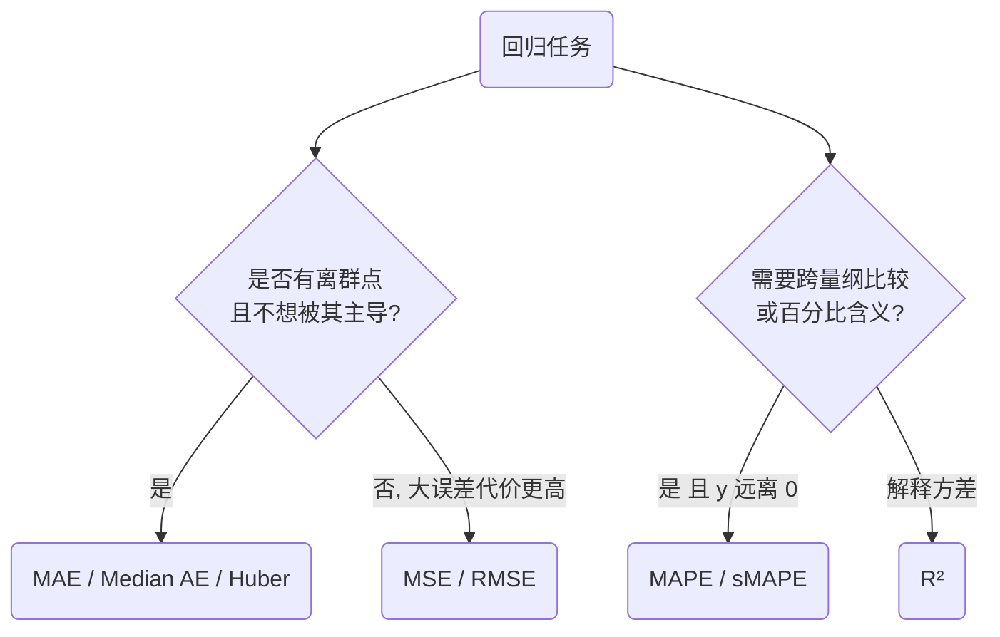

---
Title | ML Metrics Regression
-- | --
Created @ | `2026-11-24T01:03:46Z`
Updated @| `2026-11-24T05:37:19Z`
Labels | ``
Edit @| [here](https://github.com/junxnone/aiwiki/issues/710)

---
# Regression Metrics 回归指标

- Regression 任务输出**连续值**（价格、温度、深度、坐标偏移等），Metrics 衡量预测值 $\hat{y}$ 与真值 $y$ 之间的误差
- 与分类不同，没有「对/错」，只有「差多少」；不同指标对大误差的惩罚和对量纲的敏感程度不同
- 在视觉任务中：深度估计、BBox 回归、关键点坐标回归、年龄估计、计数等都属于回归
- 总览见 [Metrics](/0138_ML_Metrics)

## Metrics

Name | Formula | Description
-- | -- | --
MAE | $\frac{1}{N}\sum_{i=1}^{N}\lvert y_i - \hat{y}_i \rvert$ | 平均绝对误差，单位同 $y$，对异常值不敏感
MSE | $\frac{1}{N}\sum_{i=1}^{N}(y_i - \hat{y}_i)^2$ | 均方误差，大误差被平方放大，常用作损失
RMSE | $\sqrt{MSE}$ | 均方根误差，单位同 $y$，比 MSE 更直观
MAPE | $\frac{100\%}{N}\sum_{i=1}^{N}\left\lvert \frac{y_i - \hat{y}_i}{y_i} \right\rvert$ | 平均绝对百分比误差，无量纲；$y_i$ 接近 0 时不稳定
sMAPE | $\frac{100\%}{N}\sum_{i=1}^{N}\frac{\lvert y_i - \hat{y}_i \rvert}{(\lvert y_i \rvert + \lvert \hat{y}_i \rvert)/2}$ | 对称 MAPE，缓解 $y_i \approx 0$ 的问题
$R^2$ | $1 - \frac{\sum_i (y_i - \hat{y}_i)^2}{\sum_i (y_i - \bar{y})^2}$ | 决定系数，相对「总是预测均值」的改善比例
Median AE | $\text{median}(\lvert y_i - \hat{y}_i \rvert)$ | 误差中位数，对离群点更稳健
Max Error | $\max_i \lvert y_i - \hat{y}_i \rvert$ | 最坏情况误差，安全相关任务关注

其中：

- $N$：样本数；$y_i$：第 $i$ 个样本的真值；$\hat{y}_i$：第 $i$ 个样本的预测值；$\bar{y}$：所有真值的均值
- $R^2$：取值 $(-\infty, 1]$，1 表示完美预测，0 表示和「总是预测均值」一样好，**小于 0 表示比预测均值还差**
- $R^2$ 的分子 $\sum_i (y_i - \hat{y}_i)^2$ 是模型的残差平方和，分母 $\sum_i (y_i - \bar{y})^2$ 是总平方和

## 如何选择

下图给出选择思路：



图中：

- 上半部分按误差敏感度选择：存在离群点、希望指标稳健时用 MAE 系列；大误差代价高（如安全相关）时用 MSE/RMSE，因为平方项会放大大误差
- 下半部分按可比性选择：需要百分比含义时用 MAPE/sMAPE，但真值接近 0 会使其爆炸；想知道模型解释了多少方差用 $R^2$
- 实际上往往同时报告 MAE 和 RMSE：RMSE 明显大于 MAE 说明存在少量大误差

## MAE vs RMSE

- 对相同的误差分布，总有 $MAE \le RMSE \le \sqrt{N} \cdot MAE$
- 误差都相同时 $RMSE = MAE$；$RMSE / MAE$ 越大，误差越集中在少数样本上
- MAE 对应误差服从 Laplace 分布的最大似然（损失为 L1），MSE 对应 Gaussian（损失为 L2）

## Huber / Smooth L1

- 小误差用平方（可导、收敛稳定），大误差用线性（对离群点稳健），常用于 BBox 回归

$$
L_\delta(e) = \begin{cases} \frac{1}{2}e^2 & \lvert e \rvert \le \delta \\ \delta\left(\lvert e \rvert - \frac{1}{2}\delta\right) & \lvert e \rvert > \delta \end{cases}
$$

其中：

- $e = y - \hat{y}$：残差；$\delta$：切换阈值，误差小于 $\delta$ 时按平方惩罚，大于 $\delta$ 时按线性惩罚

## 注意

- 报告 MAE/RMSE 要注明单位和是否做过归一化；对 $y$ 做了标准化后训练，评估前要反归一化
- 预测值分布和真值分布差异大的数据（如密度估计）要考虑相对误差，避免大值主导
- 深度估计常用 AbsRel、$\delta < 1.25$ 等；3D 位姿用 MPJPE 等

## Code
```python
from sklearn.metrics import (mean_absolute_error, mean_squared_error, r2_score,
                             mean_absolute_percentage_error, median_absolute_error)
import numpy as np

mae = mean_absolute_error(y_true, y_pred)
rmse = np.sqrt(mean_squared_error(y_true, y_pred))
r2 = r2_score(y_true, y_pred)
mape = mean_absolute_percentage_error(y_true, y_pred)   # 返回小数, 不是百分数
```

## Reference
- [Regression metrics - scikit-learn](https://scikit-learn.org/stable/modules/model_evaluation.html#regression-metrics)


