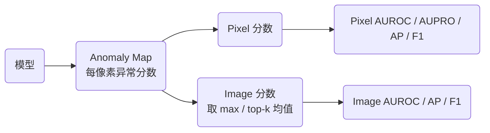

---
Title | ML Metrics Anomaly
-- | --
Created @ | `2026-11-24T01:03:48Z`
Updated @| `2026-11-24T01:03:48Z`
Labels | ``
Edit @| [here](https://github.com/junxnone/aiwiki/issues/711)

---
# Anomaly

- 异常检测（Anomaly Detection）的核心特点：**正常样本极多，异常样本极少**，且异常往往只占图像的一小块区域
- 评估分两个层次：
  - **Image Level**：整张图是否异常（分类问题）
  - **Pixel Level**：异常区域在哪里（分割问题）
- 任务背景见 [Anomaly](/0277_ML_Tasks_Image_Anomaly)，常用数据集见 [MVTec](/0323_ML_Tasks_Image_Anomaly_MVTec)，评估工具见 [anomalib](/0321_Tools_anomalib)

下图是异常检测的评估流程：



图中：

- 模型输出一张 Anomaly Map，每个像素一个异常分数，分数越大越异常
- 逐像素与 GT mask 比较得到 Pixel Level 指标；把整张图聚合成一个分数（常取最大值或 top-k 均值）后与图像标签比较，得到 Image Level 指标
- 主流指标都是阈值无关的（扫过所有阈值），避免需要选定阈值

## Metrics

Level | Metric | Description
-- | -- | --
Image | AUROC | 随机取一张异常图和一张正常图，异常图分数更高的概率，最常用
Image | AP / AUPR | 异常样本很少时比 AUROC 更敏感
Image | F1-max | 扫阈值取 F1 最大值
Pixel | AUROC | 所有像素的 AUROC，**被大量背景像素主导**，数值容易偏高
Pixel | AUPRO | 区域重叠度，对小缺陷与大缺陷一视同仁，见下文
Pixel | AP / F1-max | 不均衡下更严格
Both | FPR@95%TPR | TPR 达到 95% 时的误报率，反映工程可用性

表中先分 Image/Pixel 两个层级，同一指标在两个层级含义不同。一般报告 Image AUROC 和 Pixel AUROC，再加 AUPRO 弥补 Pixel AUROC 对小缺陷不敏感的问题。

## AUROC

- 详见 [Metrics for Classification](/0137_ML_Metrics_Classification) 中的 AUROC
- **Image AUROC**：每张图一个分数和一个 0/1 标签，直接用分类的 AUROC
- **Pixel AUROC**：把测试集所有像素展开，每个像素一个分数和一个 0/1 标签；异常像素占比常常不到 1%，少量背景误报对 FPR 影响很小，所以数值普遍很高（> 95%），区分度差
- 因此 Pixel AUROC 高不一定代表缺陷定位得好

## AUPRO

- **PRO** - `Per-Region Overlap`，对每个异常**连通区域**分别计算被预测覆盖的比例，再平均，使小缺陷和大缺陷权重相同
- **AUPRO** - 以 FPR 为横轴、PRO 为纵轴的曲线下面积，**只积分到 FPR 上限**（MVTec 为 0.3），再除以上限归一化到 $[0, 1]$

$$
PRO(\theta) = \frac{1}{K}\sum_{k=1}^{K}\frac{\lvert P_\theta \cap C_k \rvert}{\lvert C_k \rvert}, \qquad AUPRO = \frac{1}{\text{FPR}_{max}}\int_{0}^{\text{FPR}_{max}} PRO\, d\,\text{FPR}
$$

其中：

- $\theta$：二值化阈值，$P_\theta$：阈值 $\theta$ 下预测为异常的像素集合
- $C_k$：真值中第 $k$ 个异常连通区域的像素集合，$K$ 是该测试集所有异常连通区域的总数；$\lvert\cdot\rvert$ 为像素个数
- $\frac{\lvert P_\theta \cap C_k \rvert}{\lvert C_k \rvert}$：第 $k$ 个区域被覆盖的比例（即该区域的 Recall）
- $\text{FPR}$：阈值 $\theta$ 下对应的像素级假阳性率；$\text{FPR}_{max}$：积分上限，通常取 0.3，只关注误报率较低的区间，因为过高的误报率在工程上没有意义
- 与 Pixel Recall 的区别：Pixel Recall 按像素总数算，大缺陷主导；PRO 按区域平均，小缺陷同样重要

## F1-max

- 对所有阈值计算 F1，取最大值，免去选阈值的步骤
- 最大值是在**测试集上取到的**，等价于用测试标签挑了最优阈值，数值偏乐观；真实部署要在验证集（或正常样本分布）上确定阈值
- 阈值设定方法：正常验证集分数的某个分位数（如 99%）、$\mu + 3\sigma$ 等

## 报告建议

- 同时报告 Image AUROC、Pixel AUROC、AUPRO，必要时加 AP；只报 AUROC 会掩盖不均衡下的问题
- 注明类别平均方式：MVTec 等多类别数据集通常对每个类别单独计算再取平均
- 说明 Image 分数聚合方式（max / top-k mean）和是否对 Anomaly Map 做了高斯平滑，二者会明显影响指标
- 工程落地要补充：固定阈值下的 Precision/Recall、每千张图的误报数、漏检率等

## Code
```python
from sklearn.metrics import roc_auc_score, precision_recall_curve
import numpy as np

# amap: (N, H, W) 异常分数, masks: (N, H, W) 0/1, labels: (N,) 0/1
img_scores = amap.reshape(len(amap), -1).max(axis=1)         # 取 max 聚合
image_auroc = roc_auc_score(labels, img_scores)
pixel_auroc = roc_auc_score(masks.ravel(), amap.ravel())

p, r, _ = precision_recall_curve(masks.ravel(), amap.ravel())
f1_max = (2 * p * r / (p + r + 1e-12)).max()

# AUPRO 可使用 anomalib 的 AUPRO 指标或 MVTec 官方评估代码
```

## Reference
- [MVTec AD — A Comprehensive Real-World Dataset for Unsupervised Anomaly Detection](https://openaccess.thecvf.com/content_CVPR_2019/papers/Bergmann_MVTec_AD_--_A_Comprehensive_Real-World_Dataset_for_Unsupervised_Anomaly_CVPR_2019_paper.pdf)
- [Uninformed Students: Student-Teacher Anomaly Detection with Discriminative Latent Embeddings](https://arxiv.org/abs/1911.02357) - 提出 PRO
- [anomalib](https://github.com/openvinotoolkit/anomalib)

