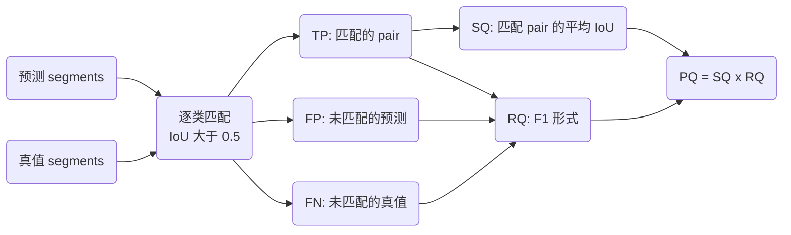

---
Title | ML Metrics Segmentation PQ
-- | --
Created @ | `2026-11-24T01:03:52Z`
Updated @| `2026-11-24T05:37:24Z`
Labels | ``
Edit @| [here](https://github.com/junxnone/aiwiki/issues/713)

---
# Panoptic Quality 全景分割质量

- **PQ** - `Panoptic Quality`，全景分割（Panoptic Segmentation）的统一评价指标
- 全景分割要求每个像素同时有**类别**和**实例 ID**：`Things`（可数目标，如人、车）要区分实例，`Stuff`（不可数背景，如天空、道路）只要类别
- 语义分割指标（mIoU）不区分实例，实例分割指标（AP）不评价 Stuff，PQ 把两者放在同一个指标下，总览见 [Segmentation Metrics](/0231_ML_Metrics_Segmentation)

## 定义

下图是计算 PQ 的流程：



图中：

- 先按类别把预测 segment 和真值 segment 做匹配，两者 IoU 大于 0.5 才算匹配；预测和真值都是互不重叠的，因此在这个阈值下每个 segment 最多只匹配一个，**匹配是唯一的**，不需要像检测那样按 score 排序
- 匹配上的是 TP，没匹配上的预测是 FP，没匹配上的真值是 FN
- TP 的平均 IoU 得到 SQ（分割得准不准），TP/FP/FN 的 F1 形式得到 RQ（有没有识别出来），两者相乘得到 PQ

$$
PQ = \underbrace{\frac{\sum_{(p, g) \in TP} IoU(p, g)}{\lvert TP \rvert}}_{SQ} \times \underbrace{\frac{\lvert TP \rvert}{\lvert TP \rvert + \frac{1}{2}\lvert FP \rvert + \frac{1}{2}\lvert FN \rvert}}_{RQ}
$$

其中：

- $p$：预测 segment；$g$：真值 segment；$(p, g) \in TP$：已匹配的配对
- $IoU(p, g)$：两个 segment 的像素 IoU；$\lvert TP \rvert, \lvert FP \rvert, \lvert FN \rvert$：对应的 segment 个数
- $SQ$ (Segmentation Quality)：只衡量匹配上的 segment 的分割质量，取值 $[0.5, 1]$（因为匹配要求 IoU 大于 0.5）
- $RQ$ (Recognition Quality)：等价于 $F_1 = \frac{2TP}{2TP + FP + FN}$，衡量识别（检测）质量
- $PQ \in [0, 1]$，对每个类别分别计算后再对类别取平均

## 示例

- 某类别有 3 对匹配的 segment，IoU 分别为 0.9、0.8、0.7；另有 1 个未匹配的预测（FP）和 2 个未匹配的真值（FN）
- $SQ = \frac{0.9 + 0.8 + 0.7}{3} = 0.8$
- $RQ = \frac{3}{3 + 0.5 \times 1 + 0.5 \times 2} = \frac{3}{4.5} \approx 0.667$
- $PQ = SQ \times RQ \approx 0.533$

示例说明：分割得再准（SQ=0.8），漏检和误检也会使 PQ 下降；PQ 同时惩罚两类错误。

## Things / Stuff

Name | 含义
-- | --
$PQ$ | 所有类别平均
$PQ^{Th}$ | 只对 Things 类别平均
$PQ^{St}$ | 只对 Stuff 类别平均

表中三个值通常一起报告，一般 $PQ^{St}$ 高于 $PQ^{Th}$，如果 $PQ^{Th}$ 明显偏低，说明实例的区分是短板。Stuff 类每张图只有一个 segment，所以匹配退化为语义分割的 IoU 判断。

## 细节

- **Void 标签**：标注中未标注/模糊的区域（void）不参与匹配，预测落在 void 上的部分不算 FP；多个预测 segment 在 void 内的重叠也会被忽略
- **Crowd 区域**：COCO 全景中 crowd 区域的预测不计 FP
- **与 AP 的区别**：PQ 没有置信度，用的是最终的无重叠分割结果，不扫阈值；因此也不用做 NMS 之外的排序，评估的是模型实际输出的结果
- 与 [AP](/0382_ML_Metrics_Detection_APmAPAR) 的关系：AP 评估带分数的检测结果排序，PQ 评估最终输出的分割质量

## Code
```python
import torch
from torchmetrics.detection import PanopticQuality

# things / stuffs: 类别 id 集合; 输入 (B, H, W, 2): 最后一维为 (category_id, instance_id)
pq = PanopticQuality(things={0, 1}, stuffs={6, 7}, allow_unknown_preds_category=True)
pq.update(preds, target)
print(pq.compute())          # 单个 PQ 值; return_sq_and_rq=True 时同时返回 SQ / RQ
```

## Reference
- [Panoptic Segmentation](https://arxiv.org/abs/1801.00868)
- [panopticapi](https://github.com/cocodataset/panopticapi)
- [TorchMetrics PanopticQuality](https://lightning.ai/docs/torchmetrics/stable/detection/panoptic_quality.html)


