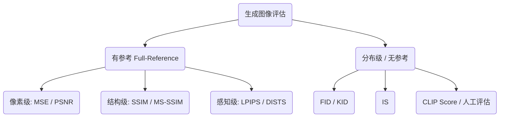

---
Title | ML Metrics Generation
-- | --
Created @ | `2026-11-24T01:04:02Z`
Updated @| `2026-11-24T05:37:28Z`
Labels | ``
Edit @| [here](https://github.com/junxnone/aiwiki/issues/718)

---
# Image Generation Metrics 图像生成与重建指标

- 生成/重建类任务（超分、去噪、压缩、图像生成、风格迁移、异常合成）输出的是**图像**，没有唯一的「对错」，评估分两类：
  - **有参考 (Full-Reference)**：有对应的真值图，逐像素或逐特征比较，如 PSNR / SSIM / LPIPS
  - **无参考 / 分布级**：没有逐一对应的真值，比较生成图像整体分布与真实图像分布，如 FID / IS / KID
- 总览见 [Metrics](/0138_ML_Metrics)；合成缺陷图像的任务见 [Anomaly Synthesis](/0517_ML_Tasks_Image_Anomaly_Synthesis)

下图是指标分类：



图中：

- 有参考指标从左到右越来越接近人的感知：像素级只比数值差，结构级考虑局部结构，感知级用深度特征比较
- 分布级指标不要求图像一一对应，只比较两堆图像的统计特性，适用于无条件生成
- 文生图等还要用 CLIP Score 评价图文一致性，以及人工评估（用户偏好）

## PSNR

$$
PSNR = 10\log_{10}\frac{MAX^2}{MSE}, \qquad MSE = \frac{1}{HW}\sum_{x,y}\big(I(x, y) - \hat{I}(x, y)\big)^2
$$

其中：

- $I$：真值图，$\hat{I}$：生成/重建图；$H, W$：图像高和宽；彩色图在所有通道上平均
- $MAX$：像素最大值，8 bit 图像为 255，归一化到 $[0, 1]$ 时为 1
- 单位 dB，越大越好；常见经验：超分/压缩 30 dB 以上较好，40 dB 以上肉眼难以察觉差异
- 缺点：与人眼感知不完全一致，轻微的整体偏移（平移）PSNR 会很低但看起来几乎相同

## SSIM

$$
SSIM(x, y) = \frac{(2\mu_x\mu_y + C_1)(2\sigma_{xy} + C_2)}{(\mu_x^2 + \mu_y^2 + C_1)(\sigma_x^2 + \sigma_y^2 + C_2)}
$$

其中：

- $x, y$：两张图在同一滑动窗口（常取 11x11 高斯窗口）内的像素块
- $\mu_x, \mu_y$：窗口内亮度均值；$\sigma_x^2, \sigma_y^2$：方差（对比度）；$\sigma_{xy}$：协方差（结构相关性）
- $C_1 = (K_1 L)^2$，$C_2 = (K_2 L)^2$：防止分母为 0 的小常数，$L$ 为像素动态范围，通常 $K_1 = 0.01$，$K_2 = 0.03$
- 把亮度、对比度、结构三方面合在一起，取值 $[-1, 1]$（常见在 $[0, 1]$），越大越好；对整张图取所有窗口的均值（MSSIM）
- `MS-SSIM` 在多个尺度上计算后组合，对尺度变化更稳健

## LPIPS

- **LPIPS** - `Learned Perceptual Image Patch Similarity`：用预训练网络（AlexNet/VGG）提取多层特征，在特征空间比较，并通过人类感知数据学习各层的权重
- 值越小越相似，与人的主观感知相关性高于 PSNR/SSIM，是超分、图像翻译常用的感知指标

$$
LPIPS(x, \hat{x}) = \sum_{l}\frac{1}{H_l W_l}\sum_{h, w}\big\lVert w_l \odot (\hat{y}^l_{hw} - \hat{y}^{l}_{0hw})\big\rVert_2^2
$$

其中：

- $l$：网络的第 $l$ 层；$\hat{y}^l_{hw}$、$\hat{y}^l_{0hw}$：两张图在该层、位置 $(h, w)$ 的（通道归一化后的）特征向量
- $w_l$：该层各通道的学习权重，$\odot$ 为逐通道相乘；$H_l, W_l$：该层特征图的高宽，用于空间平均

## FID

- **FID** - `Fréchet Inception Distance`：用 Inception-v3 的特征（pool3，2048 维）把真实图像集和生成图像集各拟合成高斯分布，计算两个分布的 Fréchet 距离

$$
FID = \lVert \mu_r - \mu_g \rVert^2 + \text{Tr}\Big(\Sigma_r + \Sigma_g - 2(\Sigma_r\Sigma_g)^{1/2}\Big)
$$

其中：

- $\mu_r, \Sigma_r$：真实图像特征的均值向量和协方差矩阵；$\mu_g, \Sigma_g$：生成图像特征的均值和协方差
- $\text{Tr}(\cdot)$：矩阵的迹；$(\Sigma_r\Sigma_g)^{1/2}$：矩阵平方根
- 越小越好，0 表示两个分布完全一致；同时反映**质量**和**多样性**（模式坍塌会使协方差变小而 FID 变大）
- 注意：样本数太少时估计有偏（建议至少 5k~10k 张）；使用的 Inception 权重、图像缩放方式、预处理不同，FID 数值不可比，比较时要用同一工具

## IS

- **IS** - `Inception Score`：用 Inception 分类器对生成图像分类，期望每张图的类别预测清晰（质量），同时整体类别分布分散（多样性）

$$
IS = \exp\Big(\mathbb{E}_{x \sim p_g}\, D_{KL}\big(p(y \mid x)\,\Vert\, p(y)\big)\Big)
$$

其中：$x$ 为生成图像，$p(y \mid x)$ 为分类器对该图的类别分布，$p(y)$ 为所有生成图的平均类别分布，$D_{KL}$ 为 KL 散度；越大越好。IS 不与真实图像对比，且依赖 ImageNet 类别，对非 ImageNet 域几乎无意义，现在常被 FID 取代。

## 指标对比

Name | 类型 | 方向 | 适用
-- | -- | -- | --
PSNR | 有参考，像素 | 越大越好 | 重建、压缩、超分，快速对比
SSIM | 有参考，结构 | 越大越好 | 同上，更贴近结构
LPIPS | 有参考，感知 | 越小越好 | 超分、图像翻译
FID | 分布 | 越小越好 | 无条件/条件生成的总体质量和多样性
KID | 分布 | 越小越好 | 类似 FID，无偏，适合小样本
IS | 分布 | 越大越好 | ImageNet 类生成（已较少使用）

表中给出常见指标的类型和方向：没有一个指标能完全代替人的主观评价，通常 PSNR/SSIM 与 LPIPS 配合使用，生成模型则报告 FID，并辅以人工评估。PSNR 高并不代表看起来好（过度平滑的结果 PSNR 往往较高）。

## Code
```python
import torch
from torchmetrics.image import PeakSignalNoiseRatio, StructuralSimilarityIndexMeasure
from torchmetrics.image.fid import FrechetInceptionDistance
from torchmetrics.image.lpip import LearnedPerceptualImagePatchSimilarity

psnr = PeakSignalNoiseRatio(data_range=1.0)
ssim = StructuralSimilarityIndexMeasure(data_range=1.0)
lpips = LearnedPerceptualImagePatchSimilarity(net_type='alex', normalize=True)   # 输入 [0, 1]
print(psnr(pred, target), ssim(pred, target), lpips(pred, target))

fid = FrechetInceptionDistance(feature=2048, normalize=True)   # 输入 float [0, 1]
fid.update(real_imgs, real=True)
fid.update(fake_imgs, real=False)
print(fid.compute())
```

## Reference
- [Image Quality Assessment: From Error Visibility to Structural Similarity](https://www.cns.nyu.edu/pub/eero/wang03-reprint.pdf) - SSIM
- [The Unreasonable Effectiveness of Deep Features as a Perceptual Metric](https://arxiv.org/abs/1801.03924) - LPIPS
- [GANs Trained by a Two Time-Scale Update Rule Converge to a Local Nash Equilibrium](https://arxiv.org/abs/1706.08500) - FID
- [Improved Techniques for Training GANs](https://arxiv.org/abs/1606.03498) - IS
- [TorchMetrics Image](https://lightning.ai/docs/torchmetrics/stable/image/frechet_inception_distance.html)


