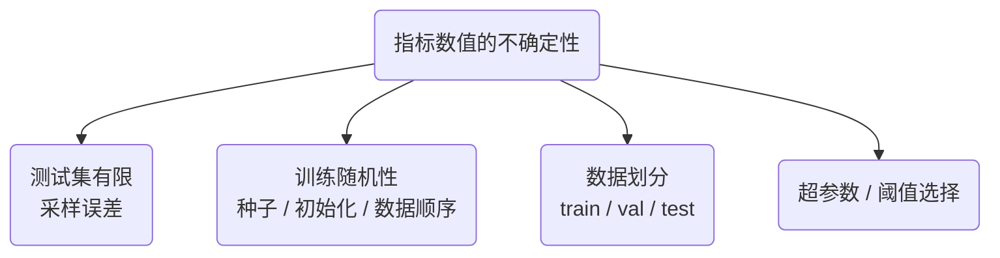

---
Title | ML Metrics Statistics
-- | --
Created @ | `2026-11-24T01:04:06Z`
Updated @| `2026-11-24T02:49:34Z`
Labels | ``
Edit @| [here](https://github.com/junxnone/aiwiki/issues/720)

---
# Statistical Significance 统计显著性

- 指标是在有限的测试集上算出来的**估计值**，带有随机性：换一批测试数据、换一个随机种子，结果都会变化
- 回答「模型 A 是不是真的比模型 B 好」，需要看**置信区间**和**显著性检验**，而不是比较两个数字的大小
- 与 [Cross Validation](/0249_ML_Metrics_CrossValidation) 配合使用；总览见 [Metrics](/0138_ML_Metrics)

## 随机性的来源

下图列出一个指标数值的不确定性来自哪里：



图中：

- **测试集有限**：测试样本是总体的一个抽样，样本越少越不稳定，可以用置信区间估计
- **训练随机性**：同一配置换种子训练，结果会不同，需多次实验取均值±标准差
- **数据划分**：不同的划分会影响结果，用交叉验证平均
- **超参数/阈值**：在测试集上调参会乐观，应在验证集上选定

## 报告均值 ± 标准差

- 对同一配置，用 $n$ 个不同随机种子训练，报告 $\bar{x} \pm s$，$n$ 至少为 3~5
- 标准差 $s$ 描述的是**结果的波动**；标准误 $SE = \frac{s}{\sqrt{n}}$ 描述的是**均值估计的精度**，二者不能混用，必须注明
- 两个方法的均值差距小于 1 个标准差时，通常不能说谁更好

## 置信区间

### 比例类指标（Accuracy、Recall 等）

- 在 $n$ 个测试样本上的正确率 $\hat{p}$，其近似 95% 置信区间：

$$
\hat{p} \pm 1.96\sqrt{\frac{\hat{p}(1-\hat{p})}{n}}
$$

其中：

- $\hat{p}$：测得的比例（如 Accuracy）；$n$：测试样本数（对 Recall 来说是正样本数）
- $1.96$：标准正态分布的 97.5% 分位数，对应 95% 置信度
- 例：$n=1000$，$\hat{p}=0.9$，区间半宽约 $1.96\times\sqrt{0.09/1000} \approx 0.019$，即 $90\% \pm 1.9\%$；所以 1000 个样本上 Accuracy 相差 1% 常常不显著
- 比例接近 0 或 1、或样本很少时，正态近似不准，应使用 Wilson 区间或 Clopper-Pearson 区间

### Bootstrap

- 对 mAP、AUC、F1、Dice 等没有简单解析公式的指标，用**自助法**：
  1. 从测试集中**有放回**地抽样 $n$ 个样本，构成一个 Bootstrap 样本
  2. 在该样本上计算指标
  3. 重复 $B$ 次（如 1000 次），取指标分布的 2.5% 和 97.5% 分位数作为 95% 置信区间
- 要对**样本单位**重采样：检测/分割应对图片重采样，同一个病人/场景的多张图应整体重采样

## 比较两个模型

Scenario | 方法 | 说明
-- | -- | --
同一测试集上比较两个分类器 | McNemar 检验 | 只看两个模型预测不一致的样本
多个随机种子/多折的结果 | 配对 t 检验 / Wilcoxon 符号秩检验 | 对同一划分上的差值检验
比较两个 AUC | DeLong 检验 | 考虑同一测试集的相关性
任意指标 | 配对 Bootstrap | 对差值 $\Delta = m_A - m_B$ 求置信区间，区间不含 0 则显著
多个模型多个数据集 | Friedman + Nemenyi 检验 | 做多重比较

表中是常用方法的选择：关键是使用**配对**的方法（两个模型在相同的样本/划分上），这样样本难度的差异被抵消，检验更灵敏。

### McNemar

$$
\chi^2 = \frac{(b - c)^2}{b + c}
$$

其中：

- $b$：模型 A 预测正确、模型 B 预测错误的样本数；$c$：模型 A 预测错误、模型 B 预测正确的样本数；两个模型都对或都错的样本不参与
- $\chi^2$ 近似服从自由度为 1 的卡方分布；$\chi^2 > 3.84$ 时在 5% 水平上认为两个模型有显著差异
- $b + c$ 太小（如小于 25）时应使用精确的二项检验

### 交叉验证的注意事项

- K 折交叉验证的各折训练集重叠，各折结果**不独立**，直接用普通 t 检验会低估方差，导致过多地判为显著
- 可使用 Nadeau & Bengio 的修正重采样 t 检验，或多次重复 K 折（5x2 cv）

## 其他注意

- **多重比较**：同时比较很多模型/指标时，总会碰巧出现「显著」结果，要用 Bonferroni 或 FDR 校正
- **效应大小**：统计显著不等于有实际意义，样本很大时 0.1% 的差异也可能显著；同时报告差值本身
- **不要在测试集上调参**：反复看测试结果调整模型会使测试指标乐观偏高（测试集泄漏）
- **报告内容**：数据集规模、划分方法、随机种子个数、指标均值±标准差（或 CI）、使用的检验方法和显著性水平

## Code
```python
import numpy as np
from scipy import stats

def bootstrap_ci(metric_fn, y_true, y_pred, B=1000, alpha=0.05, seed=0):
    rng = np.random.default_rng(seed)
    n = len(y_true)
    vals = []
    for _ in range(B):
        idx = rng.integers(0, n, n)                  # 有放回采样
        vals.append(metric_fn(y_true[idx], y_pred[idx]))
    return np.percentile(vals, [100 * alpha / 2, 100 * (1 - alpha / 2)])

# 配对 Bootstrap 比较两个模型: 对同一组 idx 计算 metric(A) - metric(B), 看区间是否包含 0

# McNemar
from statsmodels.stats.contingency_tables import mcnemar
table = [[both_correct, a_only], [b_only, both_wrong]]
print(mcnemar(table, exact=False, correction=True).pvalue)

# 多个种子的配对检验
print(stats.ttest_rel(scores_a, scores_b))
```

## Reference
- [Approximate Statistical Tests for Comparing Supervised Classification Learning Algorithms](https://sci2s.ugr.es/keel/pdf/algorithm/articulo/dietterich1998.pdf)
- [Statistical Comparisons of Classifiers over Multiple Data Sets](https://jmlr.org/papers/v7/demsar06a.html)
- [Inference for the Generalization Error](https://link.springer.com/article/10.1023/A:1024068626366) - Nadeau & Bengio


