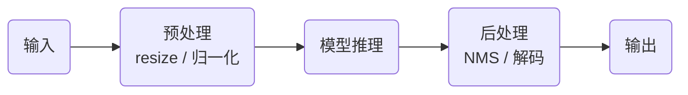

---
Title | ML Metrics Efficiency
-- | --
Created @ | `2026-11-24T01:04:08Z`
Updated @| `2026-11-24T02:49:37Z`
Labels | ``
Edit @| [here](https://github.com/junxnone/aiwiki/issues/721)

---
# Efficiency Metrics 模型效率指标

- 模型除了精度指标，还要评估**效率**：部署时能不能跑得动、跑得多快、占多少资源
- 精度指标见 [Metrics](/0138_ML_Metrics) 及各任务文章；NAS 中的效率约束见 [NAS Metrics](/0394_ML_AutoML_NAS_Metrics)
- 效率是**硬件相关**的：FLOPs 小不等于延迟低，最终必须在目标设备上实测

## Metrics

Name | Description | 单位
-- | -- | --
Params | 参数量，决定模型文件大小 | M (百万)
FLOPs / MACs | 一次前向的计算量（乘加次数），与硬件无关的估计 | G
Latency | 单次推理耗时，实时性的指标 | ms
Throughput | 单位时间处理的样本数，批量/离线场景关注 | FPS / img/s
Memory | 峰值内存/显存占用（权重 + 激活 + 工作区） | MB / GB
Energy / Power | 单次推理能耗，边缘设备关注 | J / W
Model Size | 序列化后的模型文件大小（与精度/量化相关） | MB

表中前两项是静态指标（只看模型结构），后面是动态指标（依赖硬件、软件栈和输入）。

## Params 与 FLOPs

$$
\text{FLOPs}_{conv} = 2 \times H_{out} W_{out} \times C_{out} \times K_h K_w C_{in}, \qquad \text{MACs} = \frac{\text{FLOPs}}{2}
$$

其中：

- $H_{out}, W_{out}$：输出特征图的高和宽；$C_{in}, C_{out}$：输入、输出通道数；$K_h, K_w$：卷积核大小
- 一个乘加（Multiply-Accumulate）包含一次乘法和一次加法，所以 $\text{FLOPs} = 2 \times \text{MACs}$；有些论文把 MACs 称作 FLOPs，**比较时要确认口径**
- 卷积的参数量为 $K_h K_w C_{in} C_{out}$（不含偏置），参数量与输入分辨率无关，而 FLOPs 与输入分辨率成正比

## Latency 与 Throughput

$$
Throughput = \frac{N_{batch}}{T_{batch}}
$$

其中：$N_{batch}$ 为一批的样本数，$T_{batch}$ 为处理一批的耗时（秒）；batch size = 1 时 $Throughput = 1/Latency$。

- **Latency** 优先：在线交互（相机、自动驾驶），用 batch=1，看单次耗时
- **Throughput** 优先：离线批处理、服务端，用较大的 batch 或多路并发，充分利用硬件
- 两者通常此消彼长：增大 batch 提升吞吐，但单次延迟变大

下图是推理延迟的构成：



图中：

- 端到端延迟 = 预处理 + 模型推理 + 后处理（+ 数据拷贝）；只测模型推理会低估真实延迟，检测模型的 NMS、分割模型的上采样与解码有时占比很大
- 报告时要说明测的是**纯模型推理**还是**端到端**

## 正确的测量方法

1. **预热 (Warmup)**：先跑若干次（如 10~50 次）再计时，排除首次加载、编译、缓存带来的影响
2. **重复多次**：跑数百次，报告中位数 (P50) 和尾部延迟 (P95/P99)，而不是单次或平均值；实时系统更关心 P99
3. **同步**：GPU 是异步执行的，计时前后要同步（如 `torch.cuda.synchronize()`），否则只测到了提交任务的时间
4. **固定条件**：固定输入尺寸、batch size、精度（FP32/FP16/INT8）、线程数、设备功耗模式（频率）
5. **注明硬件与软件栈**：CPU/GPU 型号、驱动、推理框架及版本（OpenVINO / ONNX Runtime / TensorRT）、是否开启了优化
6. **区分冷热**：首次推理（含模型编译）与稳定态推理分别统计

## 精度-效率权衡

- 单看精度或单看延迟都不够，用 **Pareto 前沿**图比较：横轴延迟（或 FLOPs），纵轴精度，位于左上方的模型占优
- 常见做法：给定延迟预算（如 30 ms）下比较精度，或给定精度要求下比较延迟
- 量化（INT8）、剪枝、蒸馏、更换算子都在这条曲线上移动，需要同时报告精度损失和加速比

## Code
```python
import time
import numpy as np
import torch

@torch.no_grad()
def benchmark(model, x, warmup=20, iters=200):
    for _ in range(warmup):
        model(x)
    if x.is_cuda:
        torch.cuda.synchronize()
    times = []
    for _ in range(iters):
        t0 = time.perf_counter()
        model(x)
        if x.is_cuda:
            torch.cuda.synchronize()
        times.append((time.perf_counter() - t0) * 1000)       # ms
    t = np.array(times)
    return dict(p50=np.percentile(t, 50), p95=np.percentile(t, 95), p99=np.percentile(t, 99),
                fps=1000 * x.shape[0] / t.mean())
```

使用 OpenVINO 时可直接使用官方的 `benchmark_app` 工具：

```bash
# 延迟优先 (batch=1, 单流)
benchmark_app -m model.xml -d CPU -hint latency
# 吞吐优先 (多流并发)
benchmark_app -m model.xml -d GPU -hint throughput
```

## Reference
- [OpenVINO Benchmark Tool](https://docs.openvino.ai/2024/learn-openvino/openvino-samples/benchmark-tool.html)
- [Efficient Processing of Deep Neural Networks: A Tutorial and Survey](https://arxiv.org/abs/1703.09039)
- [ptflops](https://github.com/sovrasov/flops-counter.pytorch)


