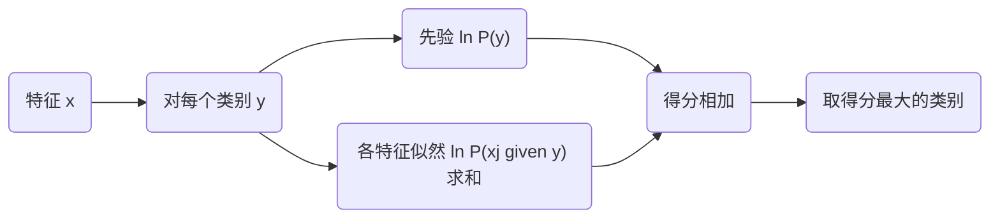

---
Title | ML OML NaiveBayes
-- | --
Created @ | `2026-11-24T03:39:18Z`
Updated @| `2026-11-24T05:37:40Z`
Labels | ``
Edit @| [here](https://github.com/junxnone/aiwiki/issues/725)

---
# Naive Bayes 朴素贝叶斯

- 基于**贝叶斯定理**和**特征条件独立假设**的概率分类器：先估计每个类别下各特征的分布，再用贝叶斯公式反推样本属于每个类别的后验概率
- 「朴素」指的是假设给定类别后，各特征之间相互独立；这个假设在现实中几乎不成立，但分类效果往往仍然不错
- 属于 [传统机器学习](/0367_ML_OML)，训练极快，常用于文本分类（垃圾邮件、情感分析）

## 原理

$$
P(y \mid x) = \frac{P(x \mid y)\,P(y)}{P(x)}, \qquad \hat{y} = \underset{y}{\arg\max}\ P(y)\prod_{j=1}^{d}P(x_j \mid y)
$$

其中：

- $y$：类别；$x = (x_1, \dots, x_d)$：$d$ 维特征向量
- $P(y)$：**先验概率**，类别 $y$ 在训练集中出现的频率；$P(x \mid y)$：**似然**，类别为 $y$ 时观察到特征 $x$ 的概率；$P(y \mid x)$：**后验概率**，观察到 $x$ 之后属于类别 $y$ 的概率
- $P(x)$：证据，对所有类别相同，比较大小时可以省略，所以只需最大化分子
- 朴素假设：$P(x \mid y) = \prod_{j=1}^{d}P(x_j \mid y)$，把高维联合分布拆成 $d$ 个一维分布的乘积，需要估计的参数从指数级降为线性级
- 实际计算中概率连乘会下溢，所以取对数：$\hat{y} = \arg\max_y\ \big[\ln P(y) + \sum_j \ln P(x_j \mid y)\big]$

下图是预测流程：



图中：

- 对每个候选类别，把对数先验和各特征的对数似然相加得到该类别的得分
- 得分最大的类别即预测结果；各类别得分经过 softmax 归一化后可以得到后验概率的估计

## 常见变体

Name | 特征类型 | $P(x_j \mid y)$ 的假设 | 典型场景
-- | -- | -- | --
Gaussian NB | 连续值 | 每个类别下特征服从高斯分布 | 通用连续特征
Multinomial NB | 计数（词频） | 多项式分布 | 文本分类
Bernoulli NB | 二值（词是否出现） | 伯努利分布 | 短文本、二值特征
Complement NB | 计数 | 对 Multinomial 改进，使用补集统计 | 不均衡文本数据

表中说明如何根据特征类型选择变体：核心区别只是对 $P(x_j \mid y)$ 的分布假设不同，参数都由训练集统计得到。

Gaussian NB 的似然：

$$
P(x_j \mid y = c) = \frac{1}{\sqrt{2\pi\sigma_{jc}^2}}\exp\Big(-\frac{(x_j - \mu_{jc})^2}{2\sigma_{jc}^2}\Big)
$$

其中：$\mu_{jc}$、$\sigma_{jc}^2$ 分别是类别 $c$ 的训练样本中第 $j$ 个特征的均值和方差，直接由样本估计，不需要迭代优化。

## 拉普拉斯平滑

- 若某个特征取值在某类别的训练样本中从未出现，则 $P(x_j \mid y) = 0$，会使整个乘积为 0（零概率问题）
- 拉普拉斯平滑给每个计数加一个小常数：

$$
P(x_j = v \mid y = c) = \frac{N_{jvc} + \alpha}{N_c + \alpha\, V_j}
$$

其中：

- $N_{jvc}$：类别 $c$ 中第 $j$ 个特征取值为 $v$ 的样本数；$N_c$：类别 $c$ 的样本总数；$V_j$：第 $j$ 个特征可能取值的个数
- $\alpha \ge 0$：平滑系数，$\alpha = 1$ 即拉普拉斯平滑，$0 < \alpha < 1$ 为 Lidstone 平滑；$\alpha$ 越大，估计越接近均匀分布

## 示例

- 垃圾邮件分类：邮件中出现「免费」「中奖」时 $P(\text{词} \mid \text{垃圾}) \gg P(\text{词} \mid \text{正常})$
- 判断时把邮件中所有词的对数似然相加，再加上先验，得分更高的类别为预测结果
- 即使「免费」和「中奖」常常一起出现（不独立），朴素贝叶斯仍能给出正确的类别，因为分类只需要**排序**正确，而不需要概率准确

## 优缺点

- **优点**
  - 训练和预测都很快（只需要计数/均值方差），对小样本也有效
  - 天然支持多分类，可以增量学习
  - 对无关特征不敏感，高维稀疏特征（文本）上表现好
- **缺点**
  - 条件独立假设过强，特征强相关时性能下降
  - 输出的概率**不可靠**（通常过于极端），只适合用来排序，需要概率时要校准
  - 连续特征不服从高斯分布时需要先变换或离散化

## Code
```python
from sklearn.feature_extraction.text import CountVectorizer
from sklearn.naive_bayes import MultinomialNB, GaussianNB
from sklearn.pipeline import make_pipeline

text_clf = make_pipeline(CountVectorizer(), MultinomialNB(alpha=1.0)).fit(train_texts, train_labels)
gnb = GaussianNB().fit(X_train, y_train)            # 连续特征
```

## Reference
- [scikit-learn - Naive Bayes](https://scikit-learn.org/stable/modules/naive_bayes.html)
- [朴素贝叶斯 – Naive Bayes](https://easyai.tech/ai-definition/naive-bayes/)


