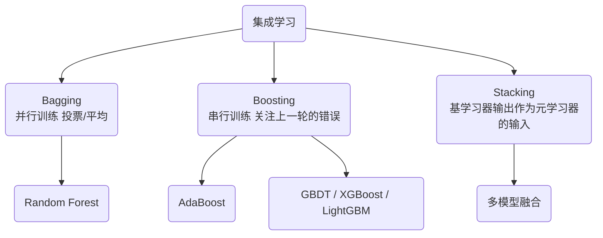

---
Title | ML OML Ensemble
-- | --
Created @ | `2026-11-24T03:39:20Z`
Updated @| `2026-11-24T03:39:20Z`
Labels | ``
Edit @| [here](https://github.com/junxnone/aiwiki/issues/726)

---
# Ensemble Learning 集成学习

- 集成学习（Ensemble Learning）把**多个弱学习器**组合成一个强学习器，「三个臭皮匠，顶个诸葛亮」
- 前提：各个学习器要**有一定准确率**，并且彼此**有差异**；如果所有模型犯同样的错误，组合起来没有收益
- 三大框架：**Bagging**（并行，降低方差）、**Boosting**（串行，降低偏差）、**Stacking**（用模型组合模型）
- 属于 [传统机器学习](/0367_ML_OML)，在表格数据上通常是精度最高的一类方法

下图对比了三种框架的结构：



图中：

- **Bagging** 各基学习器独立并行训练，对结果投票或平均；代表是 [Random Forest](/0114_ML_OML_RandomForest)
- **Boosting** 基学习器串行训练，后一个学习器专门纠正前一个的错误；代表是 AdaBoost、[GBDT](/0727_ML_OML_Ensemble_GBDT)、[XGBoost](/0728_ML_OML_Ensemble_XGBoost)
- **Stacking** 先训练多个不同的基学习器，再训练一个元学习器学习如何组合它们的输出

## 为什么集成有效

- 假设有 $T$ 个独立的二分类器，每个的准确率为 $p > 0.5$，多数投票的集成准确率为：

$$
P_{ens} = \sum_{k=\lceil T/2 \rceil}^{T}\binom{T}{k}p^k(1-p)^{T-k}
$$

其中：

- $T$：基分类器个数；$p$：每个分类器的准确率；$\binom{T}{k}$：从 $T$ 个分类器中选出 $k$ 个的组合数
- 求和项表示恰好有 $k$ 个分类器正确的概率，对所有「正确数过半」的情形求和
- 例：$p = 0.6$，$T=1$ 时准确率 0.6，$T = 21$ 时约 0.83，$T=101$ 时约 0.98；$T$ 越大集成越准，**前提是分类器相互独立**，实际中模型相关性越高收益越小

- 从偏差-方差的角度（见 [传统机器学习](/0367_ML_OML)）：Bagging 对高方差的模型（深树）取平均，降低**方差**；Boosting 不断拟合残差，降低**偏差**

## Bagging

- **Bootstrap Aggregating**：对训练集有放回抽样得到多个子集，各训练一个基学习器，再投票（分类）或平均（回归）
- 基学习器应是**高方差**的模型（完全生长的决策树、神经网络），低方差的模型（线性回归、KNN）从中获益很少
- 可并行；用 OOB 样本做免费的验证；随机森林在 Bagging 的基础上增加了特征随机

## Boosting

- 基学习器**串行**训练，每一轮根据当前集成的错误调整后续学习器的关注点
- 基学习器应是**高偏差**的弱模型（浅树、决策桩），逐步提升
- 容易过拟合噪声，需要控制学习率、树的数量和深度

### AdaBoost

- 通过调整**样本权重**：被上一轮分错的样本权重增大，下一个学习器更关注它们

$$
\alpha_t = \frac{1}{2}\ln\frac{1 - \varepsilon_t}{\varepsilon_t}, \qquad w_i^{(t+1)} = \frac{w_i^{(t)}\exp\big(-\alpha_t\,y_i\,h_t(x_i)\big)}{Z_t}, \qquad H(x) = \operatorname{sign}\Big(\sum_{t=1}^{T}\alpha_t h_t(x)\Big)
$$

其中：

- $h_t(x) \in \{-1, +1\}$：第 $t$ 个弱分类器；$y_i \in \{-1, +1\}$：真实标签；$T$：迭代轮数
- $\varepsilon_t$：第 $t$ 个分类器在当前样本权重下的加权错误率，需小于 0.5
- $\alpha_t$：该分类器的话语权，错误率越低 $\alpha_t$ 越大；错误率为 0.5 时 $\alpha_t = 0$，不起作用
- $w_i^{(t)}$：第 $t$ 轮样本 $i$ 的权重；分类正确（$y_i h_t(x_i) = 1$）权重乘以 $e^{-\alpha_t} < 1$ 变小，分类错误则乘以 $e^{\alpha_t} > 1$ 变大；$Z_t$ 是归一化系数，使权重之和为 1
- 最终分类器 $H(x)$ 是所有弱分类器按 $\alpha_t$ 加权投票

### Gradient Boosting

- 不再调整样本权重，而是让每个新学习器拟合当前集成的**损失函数负梯度**（残差），详见 [GBDT](/0727_ML_OML_Ensemble_GBDT)；工程实现见 [XGBoost](/0728_ML_OML_Ensemble_XGBoost)

## Stacking

- 第一层：用不同类型的基学习器（如 SVM、随机森林、KNN、逻辑回归）训练
- 第二层：用基学习器的**预测输出**作为特征，训练一个元学习器（通常是简单的线性模型）
- 为避免信息泄漏，第二层的训练特征必须是基学习器在**交叉验证中的折外预测 (out-of-fold)**，而不是在训练集上的预测，见 [Cross Validation](/0249_ML_Metrics_CrossValidation)
- 各基学习器差异越大，Stacking 的收益越大；竞赛中常用，但推理成本高、维护复杂

## Voting

- 最简单的融合：**硬投票**（多数类别）或**软投票**（对预测概率取平均，通常更好）
- 可以对表现更好的模型赋予更高权重

## 对比

Name | Bagging | Boosting | Stacking
-- | -- | -- | --
训练方式 | 并行，彼此独立 | 串行，依赖前一个 | 两层，先基后元
样本处理 | 有放回抽样 | 调整权重或拟合残差 | 全部样本（折外预测）
主要降低 | 方差 | 偏差 | 两者
基学习器 | 强（深树） | 弱（浅树） | 异构的不同模型
代表 | Random Forest | AdaBoost / GBDT / XGBoost | 多模型融合
风险 | 偏差不变，提升有限 | 噪声敏感，易过拟合 | 泄漏、推理成本高

表中从训练方式、关注的误差类型和风险三个方面对比。选择建议：数据噪声大、想要稳健用 Bagging；追求最高精度、愿意调参用 Boosting；比赛压榨最后的精度用 Stacking。

## 多样性的来源

- **数据多样**：Bootstrap 抽样、样本加权
- **特征多样**：随机子空间，每个节点随机选特征（随机森林）
- **模型多样**：使用不同类型的算法
- **参数多样**：不同的超参数、不同随机种子
- 深度学习中的集成：多个随机种子/不同结构的模型平均（Deep Ensembles）、快照集成、Dropout 可以看作隐式集成

## Code
```python
from sklearn.ensemble import (BaggingClassifier, RandomForestClassifier, AdaBoostClassifier,
                              GradientBoostingClassifier, VotingClassifier, StackingClassifier)
from sklearn.linear_model import LogisticRegression
from sklearn.svm import SVC
from sklearn.tree import DecisionTreeClassifier

bag = BaggingClassifier(DecisionTreeClassifier(), n_estimators=100, oob_score=True)
ada = AdaBoostClassifier(DecisionTreeClassifier(max_depth=1), n_estimators=200, learning_rate=0.5)

estimators = [('rf', RandomForestClassifier(n_estimators=200)), ('svm', SVC(probability=True))]
stack = StackingClassifier(estimators, final_estimator=LogisticRegression(), cv=5)   # 内部用折外预测
vote = VotingClassifier(estimators, voting='soft')
```

## Reference
- [scikit-learn - Ensemble methods](https://scikit-learn.org/stable/modules/ensemble.html)
- [Ensemble Methods: Foundations and Algorithms - 周志华](https://book.douban.com/subject/10564282/)
- [A Decision-Theoretic Generalization of On-Line Learning and an Application to Boosting](https://www.sciencedirect.com/science/article/pii/S002200009791504X) - AdaBoost

