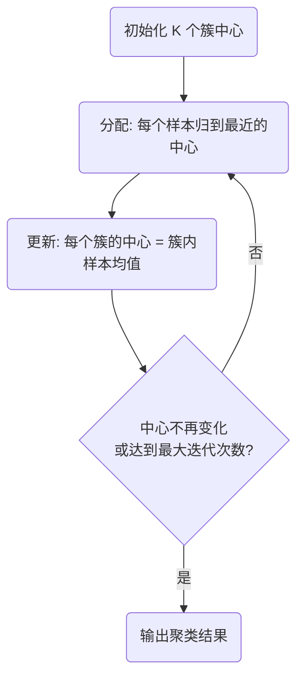

---
Title | ML OML KMeans
-- | --
Created @ | `2026-11-24T03:39:35Z`
Updated @| `2026-11-24T03:39:35Z`
Labels | ``
Edit @| [here](https://github.com/junxnone/aiwiki/issues/729)

---
# K-Means K 均值聚类

- **K-Means** 是最常用的**无监督聚类**算法：把样本划分成 $K$ 个簇，使每个样本属于离它最近的簇中心，同时让簇内样本尽可能紧凑
- 属于 [传统机器学习](/0367_ML_OML) 的无监督学习；评估见 [Clustering Metrics](/0719_ML_Metrics_Clustering)；不规则形状的簇见 [DBSCAN](/0730_ML_OML_DBSCAN)

## 目标函数

$$
J = \sum_{k=1}^{K}\sum_{x_i \in C_k}\lVert x_i - \mu_k \rVert^2, \qquad \mu_k = \frac{1}{\lvert C_k \rvert}\sum_{x_i \in C_k}x_i
$$

其中：

- $K$：簇的个数，需要**事先指定**；$C_k$：第 $k$ 个簇包含的样本集合；$\lvert C_k \rvert$：该簇的样本数
- $\mu_k$：第 $k$ 个簇的中心（质心），等于簇内样本的均值
- $\lVert x_i - \mu_k \rVert^2$：样本到所属簇中心的欧氏距离平方；$J$ 称为**簇内平方和** (Inertia / WCSS)，越小说明簇越紧凑
- 精确最小化 $J$ 是 NP 难问题，K-Means 用迭代的方式找到局部最优

## 算法

下图是 K-Means 的迭代流程（Lloyd 算法）：



图中：

- **分配步**：固定中心，把每个样本分配给距离最近的中心，这一步使 $J$ 不增
- **更新步**：固定分配，把每个簇的中心更新为簇内均值，均值是使簇内平方和最小的点，这一步也使 $J$ 不增
- 两步交替使 $J$ 单调不增，且状态有限，所以一定收敛，但收敛到的是**局部最优**，结果依赖初始中心

## 初始化：K-Means++

- 随机初始化可能很差（多个中心落在同一个簇里），结果不稳定
- **K-Means++**：第一个中心随机选；之后每个新中心按 $D(x)^2$ 的概率选取，$D(x)$ 为样本到最近的已选中心的距离，使初始中心尽量分散
- 理论上保证期望误差为最优解的 $O(\log K)$ 倍；scikit-learn 默认使用，同时用 `n_init` 多次随机初始化取 $J$ 最小的结果

## 如何选择 K

Method | 做法 | 说明
-- | -- | --
肘部法 (Elbow) | 画出不同 $K$ 下的 $J$，选曲线拐点 | 直观，但拐点常常不明显
轮廓系数 (Silhouette) | 选使平均轮廓系数最大的 $K$ | 见 [Clustering Metrics](/0719_ML_Metrics_Clustering)
Gap Statistic | 与随机均匀数据的 $J$ 比较 | 理论更完善，计算量大
业务需求 | 如客户分为 3 档、压缩成 256 个码字 | 往往最实用

表中是常见的选 $K$ 方法：$J$ 随 $K$ 增大一定单调减小（$K=N$ 时为 0），所以不能直接选 $J$ 最小的 $K$，要看下降是否「值得」。

## 局限与改进

- **需要指定 $K$**，且对初始化敏感
- **只适合凸的球形簇**：基于到中心的欧氏距离，对环形、月牙形、大小/密度差别大的簇效果差
- **对离群点敏感**：均值会被离群点拉偏，可使用 K-Medoids（用实际样本作中心）
- **特征需要标准化**，高维时距离失效，先用 [PCA](/0731_ML_OML_PCA) 降维

变体：

Name | 改进
-- | --
Mini-Batch K-Means | 每次只用一小批样本更新中心，适合大规模数据，速度快、精度略低
K-Medoids / PAM | 中心必须是真实样本，对离群点稳健，可以用任意距离
Kernel K-Means | 核方法映射后再聚类，可处理非线性簇
Fuzzy C-Means / GMM | 软聚类，每个样本属于各簇的概率；GMM 假设每个簇是高斯分布，用 EM 算法求解

## UseCase

- 客户分群、用户画像
- 图像颜色量化、向量量化（压缩，如乘积量化 PQ 的码本）
- 作为其他算法的预处理（如 RBF 网络的中心、检索中的倒排索引 IVF）
- 文档/图像聚类探索数据结构

## Code
```python
from sklearn.cluster import KMeans, MiniBatchKMeans
from sklearn.metrics import silhouette_score
from sklearn.preprocessing import StandardScaler

Xs = StandardScaler().fit_transform(X)
for k in range(2, 11):
    km = KMeans(n_clusters=k, init='k-means++', n_init=10, random_state=0).fit(Xs)
    print(k, km.inertia_, silhouette_score(Xs, km.labels_))      # J 与轮廓系数
```

## Reference
- [scikit-learn - Clustering](https://scikit-learn.org/stable/modules/clustering.html#k-means)
- [k-means++: The Advantages of Careful Seeding](https://theory.stanford.edu/~sergei/papers/kMeansPP-soda.pdf)

