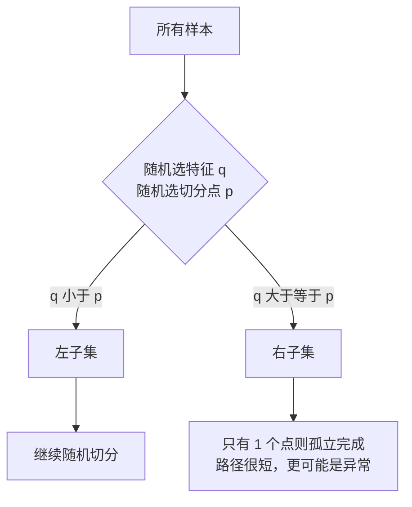

---
Title | ML OML IsolationForest
-- | --
Created @ | `2026-11-24T03:39:42Z`
Updated @| `2026-11-24T05:34:37Z`
Labels | ``
Edit @| [here](https://github.com/junxnone/aiwiki/issues/733)

---
# Isolation Forest 孤立森林

- **Isolation Forest (iForest)**：基于随机树的**无监督异常检测**算法。思想是：异常点「少且与众不同」，所以用随机划分把它**孤立**出来只需要很少的步骤
- 不需要计算距离或密度，速度快，线性复杂度，适合大规模、高维的表格数据
- 属于 [传统机器学习](/0367_ML_OML)，与 [Random Forest](/0114_ML_OML_RandomForest) 同属树集成，但不使用标签；评估见 [Anomaly Detection Metrics](/0711_ML_Metrics_Anomaly)

## 直观

下图说明「异常点更容易被孤立」：



图中：

- 每次随机选一个特征，再在该特征的取值范围内随机选一个切分点，把样本分成两部分，递归地进行，直到每个点单独成为一个叶节点
- 位于数据密集区域的正常点，周围有很多相似点，需要切很多刀才能被孤立，**路径长**
- 远离大多数点的异常点，只需几刀就被单独分出来，**路径短**；所以路径长度可以直接作为异常程度的度量

## 算法

- **训练**：从数据中**无放回**随机抽取 $\psi$ 个样本（默认 256），构建一棵孤立树 (iTree)，重复 $t$ 次（默认 100）得到森林；树的最大高度限制为 $\lceil\log_2\psi\rceil$，不需要完全生长
- **预测**：把样本 $x$ 放入每棵树，得到路径长度 $h(x)$（从根到叶经过的边数，叶节点未完全孤立时再加上该叶对应样本数的修正 $c(n)$），再对所有树取平均 $E[h(x)]$

异常得分：

$$
s(x, \psi) = 2^{-\frac{E[h(x)]}{c(\psi)}}, \qquad c(n) = 2H(n-1) - \frac{2(n-1)}{n}, \quad H(i) \approx \ln i + 0.5772
$$

其中：

- $E[h(x)]$：样本 $x$ 在所有孤立树上路径长度的平均值；$\psi$：每棵树使用的子样本大小
- $c(n)$：对 $n$ 个样本构建二叉搜索树时，一次不成功查找的平均路径长度，用于**归一化**，使得得分不依赖样本量；$H(i)$ 为调和数，约等于 $\ln i + 0.5772$（欧拉常数）
- $s \in (0, 1)$：$E[h(x)] \to 0$（路径很短）时 $s \to 1$，表示**很可能是异常**；$E[h(x)] = c(\psi)$ 时 $s = 0.5$；$E[h(x)] \to \psi - 1$（路径很长）时 $s \to 0$，表示**很可能正常**
- 若所有样本得分都接近 0.5，说明数据中没有明显的异常

## 参数

Parameter | 含义 | 建议
-- | -- | --
`n_estimators` ($t$) | 树的数量 | 100 即可，增加到一定程度后得分趋于稳定
`max_samples` ($\psi$) | 每棵树的子样本数 | 256 通常足够；较小的子样本反而能减弱「淹没」和「掩盖」效应
`contamination` | 异常比例 | 用于确定判定阈值：把得分最高的该比例样本判为异常；未知时可以取 `auto`，只用得分排序
`max_features` | 每棵树使用的特征比例 | 默认 1.0；高维时可以降低

表中最需要业务知识的是 `contamination`：若不知道异常比例，应主要使用**得分排序**而不是固定阈值，并借助验证集或人工抽检确定阈值。

## 优缺点

- **优点**
  - 线性时间复杂度 $O(t\psi\log\psi)$，内存占用小，可扩展到大数据
  - 不需要标签，不依赖距离度量，高维数据上也能运行
  - 子采样使算法对「异常点占比较高」的数据也比较稳健
- **缺点**
  - 切分是**轴平行**的，对由特征组合形成的异常（斜向分布）不敏感；Extended Isolation Forest 用随机倾斜的超平面改进
  - 高维数据中大量无关特征会稀释信号，需要先做特征选择
  - 对局部异常（在密集簇旁边的小范围异常）不如基于密度的方法（LOF）
  - 阈值（`contamination`）需要根据业务确定

## 与相关方法对比

Name | 原理 | 特点
-- | -- | --
Isolation Forest | 随机划分的孤立难度 | 快，大数据，全局异常
LOF | 局部密度与邻居密度之比 | 能发现局部异常，复杂度高
One-Class SVM | 学习包围正常数据的边界 | 小数据，核选择困难，见 [SVM](/0115_ML_OML_SVM)
[DBSCAN](/0730_ML_OML_DBSCAN) | 噪声点即异常 | 同时得到簇结构
重构误差 (PCA / AutoEncoder) | 重构误差大的为异常 | 适合图像等复杂数据，见 [Anomaly](/0277_ML_Tasks_Image_Anomaly)

表中从原理和特点对比了常见的异常检测方法：Isolation Forest 是表格数据的快速基线；图像异常检测通常使用深度特征方法，评估指标见 [Anomaly Detection Metrics](/0711_ML_Metrics_Anomaly)。

## Code
```python
from sklearn.ensemble import IsolationForest

iso = IsolationForest(n_estimators=200, max_samples=256, contamination='auto', random_state=0).fit(X_train)
score = -iso.score_samples(X_test)         # 越大越异常 (score_samples 越小越异常, 取负号对齐)
pred = iso.predict(X_test)                 # 1 正常, -1 异常
```

## Reference
- [Isolation Forest - Liu, Ting, Zhou 2008](https://cs.nju.edu.cn/zhouzh/zhouzh.files/publication/icdm08b.pdf)
- [Extended Isolation Forest](https://arxiv.org/abs/1811.02141)
- [scikit-learn - Outlier detection](https://scikit-learn.org/stable/modules/outlier_detection.html#isolation-forest)

