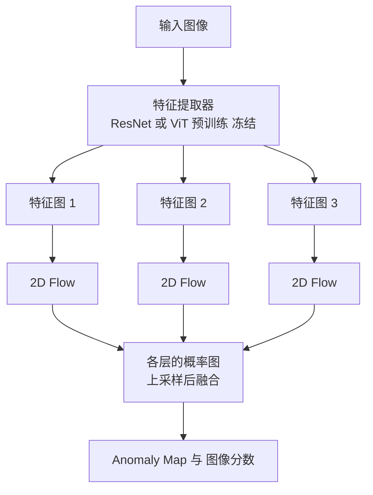

---
Title | paper FastFlow
-- | --
Created @ | `2026-11-24T08:14:09Z`
Updated @| `2026-11-24T09:22:00Z`
Labels | ``
Edit @| [here](https://github.com/junxnone/aiwiki/issues/736)

---
# FastFlow 二维归一化流异常检测

- **FastFlow**：Unsupervised Anomaly Detection and Localization via 2D Normalizing Flows，论文 [arXiv 2111.07677](https://arxiv.org/abs/2111.07677)（SenseTime Research）
- 类型：Segmentation
- 动机：此前的 SPADE、PatchCore 需要对正常特征库做 kNN，推理慢；[CFlow](/0735_paper_CFlow) 虽然用了流，但子网络是全连接的，要把特征图展平成一维向量，**破坏了特征图的空间位置关系**，且速度和参数量仍有提升空间
- 核心思想：把归一化流扩展成**二维**（Fast 2D flow），子网络使用**二维卷积**，直接在特征图上做密度估计；它可以作为**即插即用**的模块接在任意特征提取器（ResNet、Vision Transformer）之后
- 训练只用正常图像，把特征分布变换成标准正态分布；推理时用**特征图每个位置的概率值**作为异常分数
- 归一化流的基础见 [CFlow](/0735_paper_CFlow)；属于 [anomalib](/0321_Tools_anomalib) 的流模型

## 原理

下图是 FastFlow 的流程：

图中：

- **特征提取器**冻结。ViT（如 DeiT、CaiT）只取某一层的特征图，因为 ViT 本身就能建立局部与全局的联系，不需要人工设计多尺度特征；ResNet18 和 Wide-ResNet50-2 取前三个 block 最后一层的特征，三个特征图分别送入各自的 2D Flow，最后取平均作为结果
- 每个特征图后接一个独立的 **2D Flow**，把特征变换成标准正态分布，位置 $(h, w)$ 处隐变量的对数似然就代表该位置的正常程度

归一化流的目标（变量替换）：

$$
\log p_X(x) = \log p_Z\big(f_\theta(x)\big) + \log\left\lvert \det\frac{\partial f_\theta(x)}{\partial x}\right\rvert
$$

**可逆耦合层**把输入沿通道维切成两半，用两个子网络生成缩放和平移：

$$
y'_a = y_a, \qquad y'_b = s(y_a) \odot y_b + b(y_a), \qquad y' = \text{concat}(y'_a, y'_b)
$$

其中：

- $x$：特征图；$f_\theta$：由多个耦合层复合成的可逆变换（$X \to H_1 \to H_2 \to \cdots \to Z$）；$p_Z$：标准正态分布；$\log\lvert\det\rvert$：体积变化项
- $y = \text{split}(y)$ 得到 $y_a$、$y_b$：沿**通道维**一分为二；$y'_a$ 保持不变，$y'_b$ 由 $y_a$ 生成的缩放 $s(y_a)$ 和平移 $b(y_a)$ 变换得到，所以变换可逆，且雅可比矩阵是三角矩阵，行列式容易计算
- **与原始流的关键区别**：原始流里 $s(\cdot)$、$b(\cdot)$ 用全连接网络，必须把二维特征图压成一维，丢失空间位置关系；FastFlow 的子网络使用**二维卷积层**，直接作用于特征图，**保留空间结构**，参数量也更少
- 子网络的卷积核设计：论文消融实验比较了「**交替使用 3×3 和 1×1 卷积**」与「全用 3×3 卷积」。对容量大的骨干（如 CaiT、Wide-ResNet50-2），交替使用 3×3 和 1×1 能在减少参数量的同时取得更高的性能

## 实验结果

- **数据集**：MVTec AD（15 类，5354 张图）、BTAD（3 类，2540 张图）和 CIFAR-10（一类为正常、其余九类为异常）；指标是图像级或像素级的 AUROC
- 在 MVTec AD 上，论文摘要报告 FastFlow 的检测 AUC 达到 **99.4%**（使用 CaiT 骨干）

**复杂度对比**（论文 Table 1，硬件：Intel Xeon E5-2680 V4 CPU 与 NVIDIA GTX 1080Ti）。「A.d.」表示 additional，即不含骨干本身的额外耗时和参数量：

Backbone | 方法 | FPS | 额外耗时 (ms) | 额外参数 (M) | 图像级 AUC | 像素级 AUC
-- | -- | -- | -- | -- | -- | --
CaiT-M48-distilled | PatchCore | 2.39 | 107 | 0 | 97.9 | 96.5
CaiT-M48-distilled | CFlow | 2.76 | 42 | 10.5 | 97.7 | 96.2
CaiT-M48-distilled | **FastFlow** | 3.08 | **9** | 14.8 | **99.4** | **98.5**
DeiT-base-distilled | PatchCore | 15.45 | 39 | 0 | 96.5 | 97.9
DeiT-base-distilled | CFlow | 16.91 | 34 | 10.5 | 95.6 | 97.9
DeiT-base-distilled | **FastFlow** | **30.14** | **8** | 14.8 | **98.7** | 98.1
ResNet18 | CFlow | 20.3 | 44 | 5.5 | 96.8 | 98.1
ResNet18 | **FastFlow** | **30.8** | **27** | 4.9 | 97.9 | 97.2
Wide-ResNet50-2 | PatchCore | 5.88 | 159 | 0 | 99.1 | 98.1
Wide-ResNet50-2 | CFlow | 14.9 | 56 | 81.6 | 98.3 | **98.6**
Wide-ResNet50-2 | **FastFlow** | **21.8** | **34** | 41.3 | **99.3** | 98.1

表中同一个骨干下比较三种后处理方法：FastFlow 的**额外耗时最小**（如 CaiT 上只有 9 ms，PatchCore 为 107 ms），FPS 最高，图像级 AUC 也最高；额外参数量比 CFlow 少（Wide-ResNet50-2 上 41.3M 对 81.6M）。SPADE 和 PatchCore 因为要做 kNN，不引入额外参数，但推理耗时高。像素级 AUC 上 FastFlow 与 CFlow、PatchCore 互有高低，在个别配置（如 ResNet18）上略低。

**anomalib 复现的结果**（README，MVTec AD 15 类平均，seed 0，early stopping patience 3）：

Metric | ResNet-18 | Wide ResNet-50 | DeiT | CaiT
-- | -- | -- | -- | --
Image AUROC | 0.907 | 0.963 | 0.925 | 0.944
Pixel AUROC | 0.968 | 0.979 | 0.975 | 0.980
Image F1 | 0.916 | 0.947 | 0.906 | 0.911
Pixel F1 | 0.519 | 0.589 | 0.557 | 0.575

表中每一行是一种指标，每一列是一种骨干。anomalib 的数值低于论文报告的 99.4%（论文使用了更大输入和训练设置，anomalib 是统一的小配置并使用了早停），README 注明增大 early stopping 的 patience 可能得到更高的指标。指标含义见 [Anomaly Detection Metrics](/0711_ML_Metrics_Anomaly)。

## 特点与局限

- **优点**：二维卷积保留空间结构；即插即用，骨干可换；速度快，额外开销小；在 MVTec AD 上图像级精度高
- **局限**：不同类别的结果波动较大（如 anomalib 中 ResNet-18 下 Screw 类图像级 AUROC 约为 0.52）；流模型训练需关注数值稳定性；性能依赖骨干特征质量；每个特征图单独建模，各层之间没有信息交流（对比 [CS-Flow](/0737_paper_CSFlow)）

## Reference
- [FastFlow: Unsupervised Anomaly Detection and Localization via 2D Normalizing Flows](https://arxiv.org/abs/2111.07677)
- [anomalib - Fastflow](https://github.com/openvinotoolkit/anomalib/tree/main/src/anomalib/models/image/fastflow)

