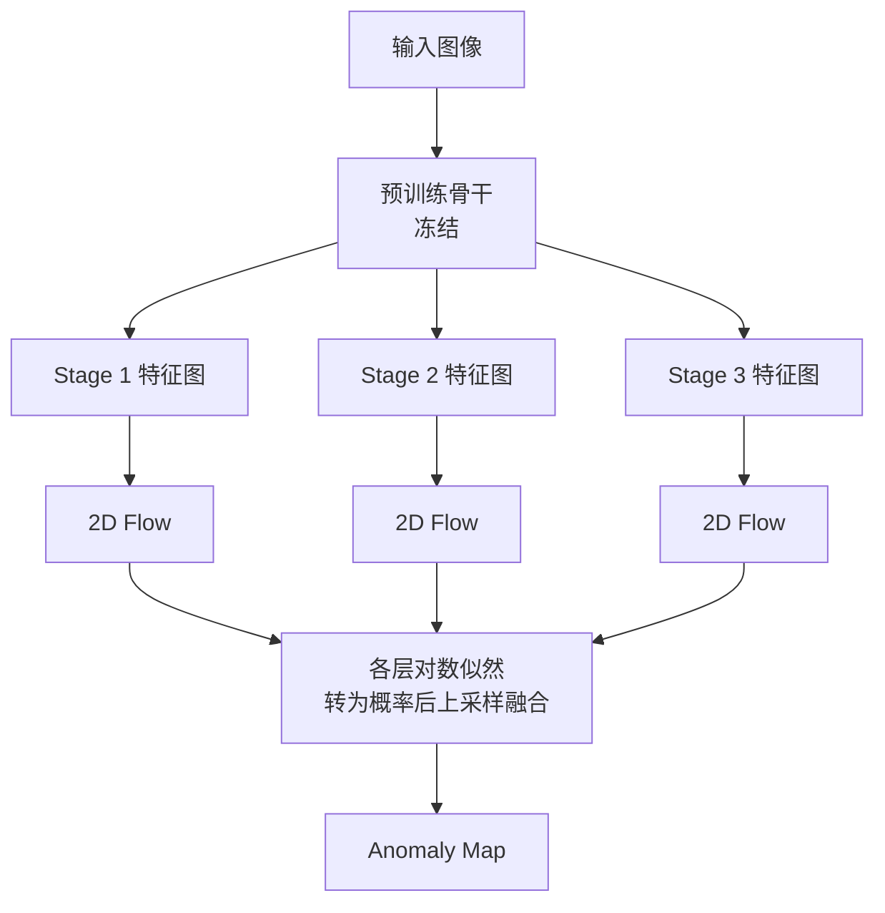

---
Title | paper FastFlow
-- | --
Created @ | `2026-11-24T08:14:09Z`
Updated @| `2026-11-24T08:14:09Z`
Labels | ``
Edit @| [here](https://github.com/junxnone/aiwiki/issues/736)

---
# FastFlow 二维归一化流异常检测

- **FastFlow**：Unsupervised Anomaly Detection and Localization via 2D Normalizing Flows，论文 [arXiv 2111.07677](https://arxiv.org/abs/2111.07677)
- 类型：Segmentation
- 思路：把归一化流从「向量」扩展到**二维特征图**，用卷积网络构成可逆流，直接保持空间结构；可以作为插件接在任意特征提取器（ResNet、Vision Transformer）之后
- 归一化流的基础见 [CFlow](/0735_paper_CFlow)；属于 [anomalib](/0321_Tools_anomalib) 的流模型

## 原理

下图是 FastFlow 的结构：



图中：

- 骨干网络提取若干个 stage 的二维特征图，骨干冻结；
- 每个 stage 后接一个独立的 2D Flow，把特征图变换成服从高斯分布的隐变量；
- 把各层的似然图（负对数似然越大越异常）上采样后融合，得到最终的异常图和图像分数

2D Flow 的每个耦合块把特征图沿通道拆成两半，用**卷积子网络**（3x3 与 1x1 卷积交替）生成缩放和平移参数：

$$
y_2 = x_2 \odot \exp\big(s(x_1)\big) + t(x_1), \qquad y_1 = x_1
$$

$$
\log p(x) = \log p_Z(z) + \sum_{k}\sum_{h,w}\sum_{c} s_k(h, w, c)
$$

其中：

- $x \in \mathbb{R}^{C \times H \times W}$：特征图，$x_1$、$x_2$ 为沿通道维切开的两半；$y_1, y_2$ 为耦合块输出
- $s(\cdot)$、$t(\cdot)$：由卷积子网络计算的缩放和平移；$\odot$ 为逐元素相乘；因为 $y_1$ 保持不变，变换是**可逆**的，雅可比矩阵是三角矩阵，行列式的对数就是缩放项 $s$ 之和
- $k$：第 $k$ 个耦合块；$(h, w, c)$：特征图的位置和通道；$z$：最终的隐变量，$p_Z$ 为标准高斯分布
- 与全连接子网络相比，卷积子网络参数少、保持空间局部性，所以速度快（FastFlow 名称由此而来）

## 特点

Name | 说明
-- | --
即插即用 | 可接 ResNet、Wide ResNet、DeiT、CaiT 等骨干，anomalib 里默认支持这几种
空间结构保留 | 二维流直接作用于特征图，不需要把特征展平成向量，也不需要位置编码
速度 | 训练和推理都比 [CFlow](/0735_paper_CFlow) 快，推理只前向
Stage 内独立 | 每个 stage 单独建模，再融合

表中是 FastFlow 的特点，它用卷积耦合层换取速度和空间结构。

## 使用与评估

```bash
anomalib train --model Fastflow --data MVTecAD --data.category <category>
```

anomalib README 中的结果（MVTec AD 15 类平均，seed 0，使用了 early stopping，patience 为 3）：

Metric | ResNet-18 | Wide ResNet-50 | DeiT | CaiT
-- | -- | -- | -- | --
Image AUROC | 0.907 | 0.963 | 0.925 | 0.944
Pixel AUROC | 0.968 | 0.979 | 0.975 | 0.980
Image F1 | 0.916 | 0.947 | 0.906 | 0.911
Pixel F1 | 0.519 | 0.589 | 0.557 | 0.575

表中每一行是一种指标，每一列是一种骨干。Wide ResNet-50 的整体最好，CaiT 的像素级指标最高；README 注明增大 early stopping 的 patience 有可能得到更高的指标。

## 优缺点

- **优点**：结构简单，速度快；保留二维结构；骨干可替换；性能较好
- **缺点**：对不同类别的结果波动较大（如 ResNet-18 下 Screw 类图像级 AUROC 约为 0.52）；流模型训练需要关注数值稳定性；性能依赖骨干特征质量

## Reference
- [FastFlow: Unsupervised Anomaly Detection and Localization via 2D Normalizing Flows](https://arxiv.org/abs/2111.07677)
- [anomalib - Fastflow](https://github.com/openvinotoolkit/anomalib/tree/main/src/anomalib/models/image/fastflow)

