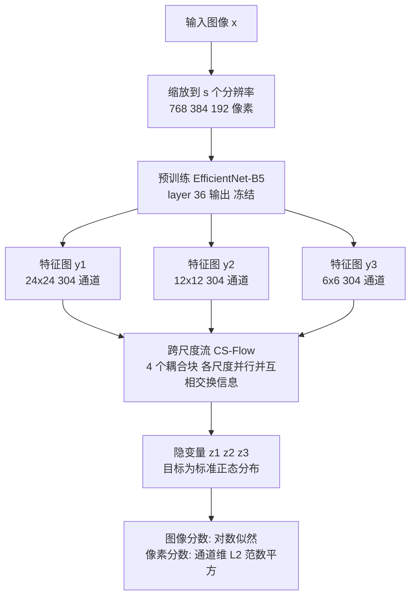

---
Title | paper CSFlow
-- | --
Created @ | `2026-11-24T08:14:11Z`
Updated @| `2026-11-24T09:21:58Z`
Labels | ``
Edit @| [here](https://github.com/junxnone/aiwiki/issues/737)

---
# CSFlow 跨尺度流异常检测

- **CS-Flow**：Fully Convolutional Cross-Scale-Flows for Image-based Defect Detection，论文 [arXiv 2110.02855](https://arxiv.org/abs/2110.02855)（WACV 2022）
- 类型：Segmentation（目标以图像级缺陷检测为主，同时可以定位）
- 动机：前作 DifferNet 把不同尺度的特征**拼接成一个向量**再做密度估计，会丢掉**细粒度的位置和上下文信息**，且在特征维度很高、训练样本很少时很难用。CS-Flow 让流模型**并行处理不同尺度的完整特征图**，各尺度之间交换信息
- 核心思想：**跨尺度流 (Cross-Scale Flow)** + 全卷积，既保留空间维度（可定位），又让全局与局部上下文互相补充
- 归一化流基础见 [CFlow](/0735_paper_CFlow)；同类还有 [FastFlow](/0736_paper_FastFlow)

## 原理

整体分为两步：**特征提取** $X \to Y$ 和**密度估计** $Y \to Z$。

图中：

- 把输入图像缩放到 $s = 3$ 个分辨率（MVTec AD 为 $768^2$、$384^2$、$192^2$），分别送入**同一个冻结的 EfficientNet-B5**，取 layer 36 的输出作为特征，这一层在语义层级与空间分辨率之间取得了较好的平衡。得到的特征图分别是 $24\times24$、$12\times12$、$6\times6$，每个都有 304 个通道
- 三个特征图 $y = [y^{(1)}, y^{(2)}, y^{(3)}]$ 被**同时**送入跨尺度流 $f_{csf}$，得到同样维度的隐变量 $z = [z^{(1)}, z^{(2)}, z^{(3)}]$，目标是标准多元正态分布 $\mathcal{N}(0, I)$
- 图像是否异常由似然 $p_Z(z)$ 与阈值 $\theta$ 比较决定：$p_Z(z) < \theta$ 判为异常

**跨尺度耦合块**以 RealNVP 为基础。每个尺度的输入张量先随机置换、沿通道维分成两部分，两部分相互生成缩放和平移参数：

$$
y_{out,2} = y_{in,2} \odot e^{\gamma_1 s_1(y_{in,1})} + \gamma_1 t_1(y_{in,1}), \qquad y_{out,1} = y_{in,1} \odot e^{\gamma_2 s_2(y_{out,2})} + \gamma_2 t_2(y_{out,2})
$$

其中：

- $y_{in,1}$、$y_{in,2}$：块输入沿通道维分开的两部分（对每个尺度 $i$ 都如此，上式省略了尺度的上标）；$y_{out,1}$、$y_{out,2}$：块输出；$\odot$：逐元素相乘
- $s_1, t_1$ 和 $s_2, t_2$：由块内的子网络 $r_1$、$r_2$ 输出，再各自拆成缩放项 $s$ 和平移项 $t$；子网络不需要可逆，可以是任意可微函数，这里实现为**全卷积网络**
- **跨尺度**体现在子网络内部：每个尺度先经过一个隐层把通道数增加，然后受 HRNet 启发，通过**双线性上采样或步长卷积**把各尺度的特征图调整到相同大小后**相加**，再回到各自尺度，所以不同尺度的信息在每个块里都会交换
- $\gamma_1, \gamma_2$：每个块里可学习的标量系数，初始化为 0，使初始时 $y_{out} = y_{in}$，保证稳定初始化；指数项使变换仍是仿射且可逆
- 为避免指数项带来的数值不稳定，对缩放项 $s$ 做**软截断**：$\sigma_\alpha(h) = \frac{2\alpha}{\pi}\arctan\frac{h}{\alpha}$，把 $s$ 限制在 $(-\alpha, \alpha)$ 之间，论文取 $\alpha = 3$

**学习目标**是最大化正常样本特征的似然，即最小化负对数似然：

$$
\mathcal{L}(y) = -\log p_Y(y) = \frac{\lVert z \rVert_2^2}{2} - \log\left\lvert\det\frac{\partial z}{\partial y}\right\rvert
$$

其中：

- $p_Y(y) = p_Z(z)\left\lvert\det\frac{\partial z}{\partial y}\right\rvert$：变量替换公式；$z = f_{csf}(y)$；$\frac{\lVert z\rVert^2}{2}$ 是标准正态分布的负对数密度（省略常数项）
- $\log\lvert\det\rvert$：对数雅可比行列式。由于式中是逐元素乘法，雅可比矩阵是对角矩阵，行列式的对数就化简为所有缩放项 $s$ 的和
- 训练固定轮数（没有验证集，无法早停），并把梯度的 $l_2$ 范数限制为 1 以稳定训练

**定位**：之前的 DifferNet 只用整个 $z$ 的所有分量得到图像级分数；CS-Flow 是全卷积，保留了位置信息，所以对特征图 $y^{(s)}$ 的每个位置 $(i, j)$ 沿**通道维**聚合：

$$
\text{score}^{(s)}(i, j) = \big\lVert z^{(s)}_{i,j} \big\rVert_2^2
$$

其中 $s$ 为尺度、$(i,j)$ 为位置、$z^{(s)}_{i,j}$ 为该位置的隐变量向量；范数越大，似然越低，越可能是缺陷。论文可视化的是最大尺度 $z^{(1)}$ 的输出，经双线性插值放大。论文强调该方法**不以像素级精确分割为目标**（特征图分辨率小），主要用于给操作员提供快速的视觉反馈，缺陷区域会因卷积感受野而有一定膨胀。

## 实现细节

Name | 设置
-- | --
特征提取器 | EfficientNet-B5 的 layer 36，ImageNet 预训练，训练中冻结
尺度 | MVTec AD：3 个尺度，输入 768 / 384 / 192；MTD：384 / 192 / 96
耦合块 | 4 个；前 3 个块内部网络用 $3 \times 3$ 卷积核，最后一个块用 $5 \times 5$
截断参数 | $\alpha = 3$；LeakyReLU 负斜率 0.1
优化器 | Adam，学习率 $2 \times 10^{-4}$，权重衰减 $10^{-5}$，$\beta_1 = 0.5$，$\beta_2 = 0.9$
训练 | batch size 16，固定 240 个 epoch（MVTec AD）/ 60 个 epoch（MTD）；一个 MVTec 类别在 RTX 2080 Ti 上约 45 分钟

表中是论文的训练设置，可以看到它的输入分辨率高（768），训练成本也较高。

## 实验结果

- **数据集**：MVTec AD（10 个物体类 + 5 个纹理类，3629 张无缺陷训练图、1725 张测试图）、Magnetic Tile Defects (MTD，灰度磁瓦图像，光照变化大)
- **检测（图像级 AUROC）**：MVTec AD 平均 **98.7%**，15 类中有 14 类 AUROC 超过 97%，在 12 个类别上优于或持平对手；MTD 上达到新的 SOTA **99.3%**；仅用每类 16 张样本训练时依然有竞争力，纹理类表现与全量训练几乎一样
- 为了公平，论文把对比的方法（[27]、[29]）也放到同样的多尺度特征上评估，这使它们的性能在每一类上都提高了

**消融实验**（MVTec AD，图像级 AUROC，论文 Table 3 和 Table 4）：

Name | AUROC (%)
-- | --
单尺度流（768×768） | 97.8
单尺度流（384×384） | 96.8
单尺度流（192×192） | 96.1
分开的多尺度（各尺度独立流，对数似然相加） | 98.2
拼接的多尺度（上采样后沿通道拼接，单个流） | 98.0
**CS-Flow** | **98.7**
耦合块数 1 / 2 / 3 / 4 / 5 / 6 | 94.6 / 97.8 / 98.5 / **98.7** / 98.7 / 98.6

表中结论：单个尺度的特征区分力较弱，其中分辨率最高的 768 最好；把各尺度独立训练再相加（98.2）已经有提升，说明不同尺度**互补**，但比联合训练的 CS-Flow 低 0.5%；把不同尺度拼接成一个张量的做法（类似 PaDiM）还会再下降 0.7%，证明了跨尺度卷积的价值；耦合块数到 4 之后饱和。论文还做了「15 个类别混在一起训练」的实验，平均检测 AUROC 为 98.2%，说明模型能够处理多峰分布。

**anomalib 复现的结果**（README，MVTec AD 15 类平均，seed 42，EfficientNet-B5，三个尺度的异常图融合）：

Input size | Image AUROC | Pixel AUROC | Pixel F1
-- | -- | -- | --
768 | 0.987 | 0.921 | 0.33
256 | 0.972 | 0.845 | 0.231

表中 768 的图像级结果（0.987）与论文的 98.7% 一致；输入缩到 256 时图像级略降、像素级明显下降，说明高分辨率对小缺陷定位很重要。README 说明使用了三个尺度融合的异常图，这与论文只可视化最大尺度不同，作者初步实验显示三个尺度融合更好。指标含义见 [Anomaly Detection Metrics](/0711_ML_Metrics_Anomaly)。

## 特点与局限

- **优点**：联合处理多尺度，保留细粒度位置和上下文；全卷积、输入大小灵活；少样本（16 张）也有效；能处理多类别混合的多峰分布
- **局限**：需要较大的输入（768）和 EfficientNet-B5，显存和训练时间成本高；论文定位的目标是给操作员提示，不是像素级精确分割（anomalib 里像素级 F1 偏低）；依赖冻结骨干的特征质量

## Reference
- [Fully Convolutional Cross-Scale-Flows for Image-based Defect Detection](https://arxiv.org/abs/2110.02855)
- [official code](https://github.com/marco-rudolph/cs-flow)
- [anomalib - Csflow](https://github.com/openvinotoolkit/anomalib/tree/main/src/anomalib/models/image/csflow)

