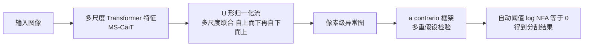

---
Title | paper UFlow
-- | --
Created @ | `2026-11-24T08:14:13Z`
Updated @| `2026-11-24T08:14:13Z`
Labels | ``
Edit @| [here](https://github.com/junxnone/aiwiki/issues/738)

---
# UFlow U 形流与无监督阈值

- **U-Flow**：A U-shaped Normalizing Flow for Anomaly Detection with Unsupervised Threshold，论文见 [ResearchSquare](https://www.researchsquare.com/article/rs-3367286/latest)，官方代码 [mtailanian/uflow](https://www.github.com/mtailanian/uflow)
- 类型：Segmentation
- 亮点：在归一化流的基础上，用统计检测理论（**a contrario**，反事实检验）自动确定**分割阈值**，不需要在测试集上调阈值
- 归一化流基础见 [CFlow](/0735_paper_CFlow)

## 原理

U-Flow 分三个阶段：



图中：

- **特征提取**：用多尺度图像 Transformer（MS-CaiT）提取特征，该特征提取器的输入大小为 448×448
- **U 形归一化流**：把多尺度特征送入一个 U 形结构的流，使不同尺度的信息既向下又向上传递，为最后的统计检测提供理论基础
- **a contrario 阈值**：把每个像素的异常分数当作假设检验，用多重假设检验得到**自动的检测阈值**，对应「期望的误报数 NFA（Number of False Alarms）」；以 $\log NFA = 0$ 为阈值，意思是在正常图像里平均每张最多出现一个这样的误报

阈值的意义：

$$
NFA(r) = N_{tests} \cdot P_{H_0}(\text{score} \ge s_r), \qquad \text{判定为异常} \iff \log NFA(r) < 0
$$

其中：

- $r$：一个候选的异常区域；$s_r$：该区域的异常得分；$N_{tests}$：在图像中进行的检验总数（所有可能区域的个数）
- $P_{H_0}(\cdot)$：在「该区域是正常」的假设 $H_0$ 下得分不小于 $s_r$ 的概率，由正常数据的流模型给出
- $NFA(r)$：期望误报数。当 $NFA < 1$（即 $\log NFA < 0$）时，这样高的得分在正常图像中是「几乎不可能」的偶然事件，因此判为异常；阈值有明确的统计含义，不依赖在测试集上调参

## 特点

Name | 说明
-- | --
自动阈值 | 工业应用需要确定运行点，U-Flow 给出有统计解释的阈值，不依赖异常样本
U 形结构 | 多尺度信息双向流动
评估指标 | 论文用 IoU 评估分割，用 AUROC 与 AUPRO 评估异常图，见 [Anomaly Detection Metrics](/0711_ML_Metrics_Anomaly)
anomalib 默认 | 为了与库内其他方法可比，anomalib 默认在训练时根据异常图计算阈值；NFA 阈值的代码在 `uflow/anomaly_map.py`

表中是 U-Flow 的特点：它的价值在于「检测阈值」这一常被忽略的工程问题；anomalib 默认没有启用 NFA 阈值，需要时可使用库中提供的代码。

## 使用与评估

```bash
anomalib train --model Uflow --data MVTecAD --data.category <category>
```

- 论文摘要报告：MVTec AD 上平均 pixel-level AUROC 为 98.74%，多数类别排名第一
- anomalib README 复现的各类别 pixel AUROC 在 96.7%~99.5% 之间（如 carpet 99.45、leather 99.41、transistor 96.70）
- 论文使用的特征提取器输入大小为 448×448，anomalib 基准测试使用 256×256 比较，所以结果可能与论文不同；如需精确复现论文结果，需使用官方代码和其配置

## 优缺点

- **优点**：像素级精度高；有统计意义的自动阈值；不需要异常样本
- **缺点**：依赖 Transformer 特征提取器，输入分辨率高、计算量大；NFA 阈值需要额外配置；论文为预印本/期刊，工程实现比 [FastFlow](/0736_paper_FastFlow) 复杂

## Reference
- [U-Flow: A U-shaped Normalizing Flow for Anomaly Detection with Unsupervised Threshold](https://www.researchsquare.com/article/rs-3367286/latest)
- [official code](https://www.github.com/mtailanian/uflow)
- [anomalib - Uflow](https://github.com/openvinotoolkit/anomalib/tree/main/src/anomalib/models/image/uflow)

