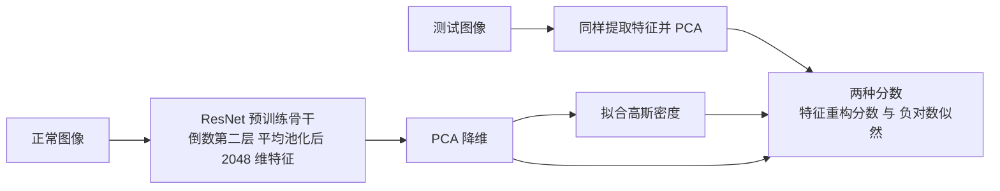

---
Title | paper DFM
-- | --
Created @ | `2026-11-24T08:14:17Z`
Updated @| `2026-11-24T09:21:51Z`
Labels | ``
Edit @| [here](https://github.com/junxnone/aiwiki/issues/740)

---
# DFM 深度特征建模

- **DFM**：Probabilistic Modeling of Deep Features for Out-of-Distribution and Adversarial Detection，论文 [arXiv 1909.11786](https://arxiv.org/abs/1909.11786)
- 类型：Classification（anomalib 中用于图像级异常分类，也可以由特征重构分数生成异常图）
- **论文的原始场景**：并不是工业缺陷检测，而是检测深度网络的**分布外 (OOD) 样本**和**对抗样本**；anomalib 把同样的思路（深度特征 + PCA + 高斯密度）用到了异常分类上
- 思路：网络训练完成后，用**参数化的概率分布**对各层的深度特征建模，推理时计算特征在这些分布下的似然，推导出不确定性度量，区分分布内和分布外样本
- 属于 [anomalib](/0321_Tools_anomalib) 的特征建模类模型；同类的简单方法还有 [DFKDE](/0741_paper_DFKDE)、[FRE](/0742_paper_FRE)

## 论文方法

**动机**：深度网络的 softmax 输出倾向于**过度自信**，遇到分布外或被攻击的输入时，也给出高置信度。已有工作中，Lee 等人（[13]）对预训练特征拟合**类条件的多元高斯分布**，用**共享（tied）协方差**，以到最近类中心的马氏距离作置信度。这个「共享协方差」假设来自 LDA 与 softmax 的联系：当类条件分布是协方差相同的高斯分布时，后验等价于 softmax 的线性分类。

DFM 指出这个假设**不一定成立**：论文用一个只分类 MNIST 数字 0 和 1 的小 CNN，画出 FC-2 层特征的二维密度直方图，发现两个簇的协方差明显不同。因此论文放宽假设，使用更一般的分布：

Name | 说明
-- | --
Gaussian (separate covariance) | 每个类别各有自己的协方差，对应 **QDA**（二次判别分析），能表示的分布比 tied 更多
GMM | 高斯混合模型。高维自然数据往往位于一个低维流形附近，GMM 能更好地建模，如论文用椭圆边界上的点作例，10 个分量的 GMM 拟合得很好，单个高斯则很差
Tied Gaussian | 作为基线（Lee 等人的做法）

表中是论文比较的三种密度模型：越往上越通用，对应需要估计的参数也越多。

**参数估计**：用最大似然。对类别 $k$：

$$
\mu_k = \frac{1}{M_k}\sum_{x \in C_k} f(x), \qquad \Sigma_k = \frac{1}{M_k}\sum_{x \in C_k}\big(f(x) - \mu_k\big)\big(f(x) - \mu_k\big)^\top
$$

其中：

- $f(x)$：网络某一层对输入 $x$ 输出的特征；$C_k$：第 $k$ 类的训练样本集合；$M_k$：该类的样本数
- $\mu_k$、$\Sigma_k$：该类特征的样本均值和样本协方差（最大似然估计）；若假设协方差在类间共享（tied），则用**所有**训练样本估计协方差，均值不变
- GMM 的参数用 **EM** 算法估计，分量个数用**贝叶斯信息准则 (BIC)** 选择，惩罚过于复杂的模型

**打分**：用对数似然衡量样本与分布的接近程度。对 $n$ 维多元高斯：

$$
2\mathcal{L} = -\Big[\, n\log 2\pi + \log\lvert\Sigma\rvert + \big(f(x) - \mu\big)^\top \Sigma^{-1} \big(f(x) - \mu\big) \Big]
$$

其中 $n$ 为特征维度，$\lvert\Sigma\rvert$ 为协方差行列式，最后一项就是**马氏距离**的平方。共享协方差时，前两项对所有类相同，可以忽略，只需要马氏距离；**协方差不共享时，不能只用马氏距离**，必须用完整的对数似然（忽略常数）；GMM 的似然是各分量指数项的加权和。

**计算问题与降维**：

- 特征维度 $n$ 很大而训练样本数 $M < n$ 时，最大似然协方差的秩为 $M < n$，是奇异的；高维特征还会让协方差矩阵严重病态；GMM 每个类的每个分量都要估计一个协方差，参数更多
- 论文的做法是：对非常高维的层先做**平均池化**（实验里池化因子 4，经验选择，主要为了计算效率），再用 **PCA** 投影到低维子空间，**保留 99.5% 的方差**，维度常常减少多达 90%，说明 99.5% 的信息其实位于低得多的子空间里

## 论文实验

- **数据集**：分布内数据为 MNIST 和 CIFAR10。OOD 数据：MNIST 对应 FashionMNIST、EMNIST Letters；CIFAR10 对应 SVHN 和缩放后的 LSUN。对抗攻击用 FGSM。网络：MNIST 用小 CNN（MNET），CIFAR10 用 ResNet50 和 DenseNet-BC；为了效率，只在网络最后 3 层上做实验
- **结论**：更精确的特征分布建模显著提升了 OOD 和对抗样本检测，**AUPR 和 AUROC 最多提升 12 个百分点**；**单高斯（独立协方差）与 GMM 的改进效果非常接近**，这与「GMM 参数多、估计时病态更严重」的分析一致；在 UCF101 + C3D 的视频数据上也有效，论文称是首个能可靠检测**白盒对抗边框 (adversarial framing)** 攻击的方法
- 这些实验指标（AUPR、AUROC）的含义见 [Anomaly Detection Metrics](/0711_ML_Metrics_Anomaly)

## anomalib 实现

anomalib 把该思路用于**图像级异常分类**：

图中：

- 特征取自 ImageNet 预训练 ResNet（README 以 ResNet-18 为例）平均池化层的输出，长度固定为 2048
- 在正常图像的特征上学习 PCA 变换和（类条件的）高斯密度模型；异常检测只有正常类，所以相当于单个类
- 测试时有两种分数：**特征重构分数**（降维再还原得到「原像」与原特征之差的范数）和**负对数似然**；其中**异常图只由特征重构分数生成**，图像级分数两种都可以用

$$
s_{recon}(x) = \big\lVert x - W W^\top (x - \mu) - \mu \big\rVert_2, \qquad s_{nll}(x) = -\log \mathcal{N}\big(W^\top (x - \mu);\, 0, \Lambda\big)
$$

其中：

- $x$：测试图像的特征向量；$\mu$：正常特征均值；$W$：PCA 保留的主成分方向，$WW^\top(x-\mu) + \mu$ 是把 $x$ 投影到主成分子空间再还原得到的原像
- $s_{recon}$：特征重构分数，正常特征主要在子空间内，重构误差小，异常特征偏离子空间，误差大
- $s_{nll}$：负对数似然，$W^\top(x-\mu)$ 为 PCA 低维表示，$\Lambda$ 为各主成分方差构成的对角协方差；表示在学到的高斯分布下该样本的不可能程度
- 两个分数越大越异常，分别衡量「偏离子空间的程度」和「在子空间内的位置是否合理」。README 里的 PCA 保留方差等超参数以 anomalib 实现为准

**anomalib 的结果**（README，MVTec AD 15 类平均，seed 42；注：ResNet-18 的池化核大小为 2，Wide ResNet-50 为 4）：

Backbone | Image AUROC | Image F1
-- | -- | --
ResNet-18 | 0.936 | 0.943
Wide ResNet-50 | 0.943 | 0.950

表中只有图像级指标。它与 [PaDiM](/0322_paper_PaDiM) 的图像级 AUROC（0.891~0.950）接近，但速度快得多（没有逐 Patch 的计算），所以适合作为简单快速的基线。

## 特点与局限

- **优点**：训练极快（提取特征、PCA、估计高斯参数，无反向传播）；推理快；有明确的统计含义；论文论证了「不共享协方差」比共享协方差更合理
- **局限**：单一高斯（或 GMM）对多模态的正常数据建模有限；主要用于图像级，定位能力弱于 [PatchCore](/0535_paper_PatchCore) 等 Patch 级方法；高维特征需要降维，而降维会损失信息

## Reference
- [Probabilistic Modeling of Deep Features for Out-of-Distribution and Adversarial Detection](https://arxiv.org/abs/1909.11786)
- [anomalib - Dfm](https://github.com/openvinotoolkit/anomalib/tree/main/src/anomalib/models/image/dfm)

