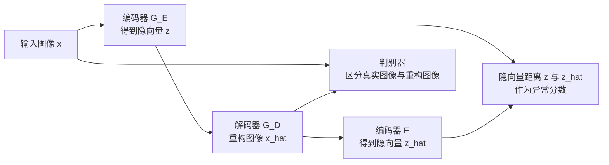

---
Title | paper GANomaly
-- | --
Created @ | `2026-11-24T08:14:24Z`
Updated @| `2026-11-24T08:14:24Z`
Labels | ``
Edit @| [here](https://github.com/junxnone/aiwiki/issues/743)

---
# GANomaly 对抗训练的异常检测

- **GANomaly**：Semi-Supervised Anomaly Detection via Adversarial Training，论文 [arXiv 1805.06725](https://arxiv.org/abs/1805.06725)
- 类型：Classification（图像级）
- 思路：用条件 GAN 训练一个只会生成「正常」图像的生成器；生成器采用**编码器-解码器-编码器**结构，通过比较两次编码得到的**隐向量**差异作为异常分数
- 属于 [anomalib](/0321_Tools_anomalib) 里基于生成/重构的方法，同类见 [DRAEM](/0744_paper_DRAEM)

## 原理

下图是 GANomaly 的结构：



图中：

- 生成器由三部分组成：编码器 $G_E$ 把图像压缩成隐向量 $z$，解码器 $G_D$ 把 $z$ 还原成图像 $\hat{x}$，第二个编码器 $E$ 再把 $\hat{x}$ 编码成 $\hat{z}$
- 判别器负责区分「真实图像」和「重构图像」，与生成器对抗，使重构图像更接近真实的正常图像
- 训练时只使用正常图像，使 $z$ 和 $\hat{z}$ 尽可能一致；测试时，异常图像无法被正确编码，重构出的图像偏向正常，导致 $\hat{z}$ 与 $z$ 差异很大

损失函数：

$$
\mathcal{L} = w_{adv}\,\mathcal{L}_{adv} + w_{con}\,\mathcal{L}_{con} + w_{enc}\,\mathcal{L}_{enc}, \qquad s(x) = \lVert G_E(x) - E(G(x)) \rVert_1
$$

其中：

- $\mathcal{L}_{adv}$：对抗损失，让重构图像难以与真实图像区分；$\mathcal{L}_{con}$：上下文（图像重构）损失，常用 $\lVert x - \hat{x} \rVert_1$，保证重构图像与输入相似；$\mathcal{L}_{enc}$：编码损失，即 $z$ 与 $\hat{z}$ 的距离，使生成器学会在正常数据上编码一致
- $w_{adv}$、$w_{con}$、$w_{enc}$：三项损失的权重
- $G(x)$：生成器的重构输出；$E(G(x)) = \hat{z}$；$s(x)$：测试时的异常分数，即两个隐向量的 L1 距离，越大越异常

## 特点

Name | 说明
-- | --
分数在隐空间 | 不直接比较图像像素，而是比较隐向量，对像素级噪声更稳健
图像级 | 输出只有图像级分数，没有像素级异常图
GAN 训练 | 需要同时训练生成器和判别器，训练不稳定
相对较早 | 2018 年的工作，在 MVTec AD 上效果弱于后来的特征类方法

表中是 GANomaly 的特点：它是生成式方法的代表，但 GAN 训练难，结果受训练过程影响较大。

## 使用与评估

```bash
anomalib train --model Ganomaly --data MVTecAD --data.category <category>
```

anomalib README 中的结果（MVTec AD 15 类平均，seed 42）：

Metric | 平均值
-- | --
Image AUROC | 0.421
Image F1 | 0.834

表中 Image AUROC 平均为 0.421，**低于 0.5 的随机水平**，说明在 anomalib 的默认设置下 GANomaly 在 MVTec AD 上基本没有区分能力；F1 较高（0.834）是因为 F1 对不均衡数据偏高，不能单独说明问题，两者需要一起看，见 [Anomaly Detection Metrics](/0711_ML_Metrics_Anomaly)。这个结果更多说明 GANomaly 在这个数据集和设置下效果很差，工程上优先选择 [PatchCore](/0535_paper_PatchCore) 等方法。

## 优缺点

- **优点**：思想经典，分数在隐空间；半监督（只需正常样本）
- **缺点**：GAN 训练不稳定；在 MVTec AD 这种工业纹理/物体数据上，anomalib 基准的 Image AUROC 低于随机；只有图像级输出

## Reference
- [GANomaly: Semi-Supervised Anomaly Detection via Adversarial Training](https://arxiv.org/abs/1805.06725)
- [anomalib - Ganomaly](https://github.com/openvinotoolkit/anomalib/tree/main/src/anomalib/models/image/ganomaly)

