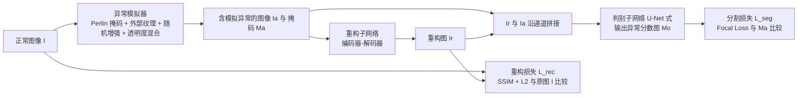

---
Title | paper DRAEM
-- | --
Created @ | `2026-11-24T08:14:26Z`
Updated @| `2026-11-24T09:21:42Z`
Labels | ``
Edit @| [here](https://github.com/junxnone/aiwiki/issues/744)

---
# DRAEM 判别式重构嵌入

- **DRÆM**：A discriminatively trained reconstruction embedding for surface anomaly detection，论文 [arXiv 2108.07610](https://arxiv.org/abs/2108.07610)（ICCV 2021）
- 类型：Segmentation
- 动机：此前基于生成模型的异常检测方法依靠「正常区域能被重构、异常区域重构失败」，再用**手工设计**的相似度（如 SSIM）和**后处理**把重构误差转成异常图，这使特征提取无法为检测能力做端到端优化
- 核心思想：把表面异常检测**主要建模为判别问题**，同时保留重构：用**重构子网络**把异常「修复」成合理的正常内容，用**判别子网络**根据「原图 + 重构图」自动学习一种距离度量并直接输出异常分割图；训练使用**模拟的异常**，不需要真实异常样本
- 与纯重构方法（如 [GANomaly](/0743_paper_GANomaly)）的区别：DRAEM 用合成的异常掩码监督判别子网络，不依赖手工的相似度函数和后处理
- 合成异常的更多讨论见 [Anomaly Synthesis](/0517_ML_Tasks_Image_Anomaly_Synthesis)

## 原理

DRAEM 由两个子网络组成：

图中：

- **重构子网络**：编码器-解码器结构，把局部模式转换成更接近正常样本分布的模式。输入是被模拟器破坏过的图像 $I_a$，训练目标是重构出原始图像 $I$，所以它被训练成隐式地检测异常并用语义合理的无异常内容重构它，同时保持非异常区域不变
- **判别子网络**：U-Net 式结构，输入 $I_c$ 是重构输出 $I_r$ 与输入图像沿**通道维拼接**的结果。由于重构子网络有「恢复正常」的性质，异常图像中 $I$ 与 $I_r$ 的联合外观会显著不同，为分割提供信息；与手工设计相似度函数不同，判别子网络**自动学习合适的距离度量**，输出与输入同尺寸的异常分数图 $M_o$

**总损失**由重构损失和分割损失两部分组成：

$$
L_{SSIM}(I, I_r) = \frac{1}{N_p}\sum_{i=1}^{H}\sum_{j=1}^{W}\Big(1 - \text{SSIM}(I, I_r)_{(i,j)}\Big), \qquad L_{rec} = \lambda L_{SSIM}(I, I_r) + l_2(I, I_r)
$$

$$
L(I, I_r, M_a, M) = L_{rec}(I, I_r) + L_{seg}(M_a, M)
$$

其中：

- $I$：原始无异常图像；$I_r$：重构图像；$H, W$：图像高宽；$N_p$：图像像素总数；$\text{SSIM}(I, I_r)_{(i,j)}$：以 $(i, j)$ 为中心的图像块之间的 SSIM 值（SSIM 的定义见 [Image Generation Metrics](/0718_ML_Metrics_Generation)）
- $l_2$ 损失在基于重构的方法中常用，但隐含了相邻像素相互独立的假设，所以论文额外加入基于图像块的 SSIM 损失，$\lambda$ 为两者的平衡系数
- $M_a$：模拟异常的真值掩码；$M$：判别子网络输出的分割掩码；$L_{seg}$：**Focal Loss**（见 [Focal Loss](/0284_ML_Arch_Func_LossFunction_FocalLoss)），用来提高对难样本分割的鲁棒性、应对异常像素极少的不均衡
- 此外判别子网络的梯度也会反传给重构子网络，给它提供额外的训练信号

## 模拟异常的生成

论文强调模拟**不需要逼真地反映目标领域的真实异常外观**，只需要产生「**刚刚超出分布 (just-out-of-distribution)**」的外观，让网络学会通过**偏离正常的程度**来识别异常。流程是：

1. 用 **Perlin 噪声**生成器产生噪声图 $P$，以随机采样的阈值二值化，得到形状各异的异常掩码 $M_a$
2. 从与输入分布**无关**的异常纹理数据集（论文使用 Describable Textures Dataset, DTD）采样纹理图 $A$
3. 对 $A$ 从候选集合 {posterize, sharpness, solarize, equalize, brightness change, color change, auto-contrast} 中随机取 3 个增强函数（受 RandAugment 启发）
4. 用 $M_a$ 把增强后的纹理 $A$ 取出，按不透明度 $\beta$ 与 $I$ 混合：

$$
I_a = \overline{M}_a \odot I + (1 - \beta)(M_a \odot I) + \beta (M_a \odot A)
$$

其中：$\overline{M}_a$ 是 $M_a$ 的取反；$\odot$ 为逐元素相乘；$\beta$ 是混合的不透明度，论文在 $[0.1, 1.0]$ 内均匀采样。$\beta$ 较小时异常很淡，接近正常分布，用来**收紧决策边界**；图像增强和透明度随机化使得仅用一张纹理就能产生多样的异常图。

这样每个训练样本是一个三元组：无异常图 $I$、含模拟异常的图 $I_a$、像素精确的异常掩码 $M_a$。

## 异常定位与检测

判别子网络输出像素级掩码 $M_o$。图像级分数的计算：先对 $M_o$ 做**均值滤波**（卷积层）汇聚局部响应，再取最大值：

$$
\eta = \max\big(M_o * f_{s_f \times s_f}\big)
$$

其中 $f_{s_f \times s_f}$ 是大小为 $s_f \times s_f$ 的均值滤波器，$*$ 是卷积，$\eta$ 为图像级异常分数。论文初步试验过再训练一个分类网络，没有比这种直接估计更好。

## 实验结果

- **数据集**：MVTec AD（评估无监督方法）、DAGM（与有监督方法对比）
- **训练设置**：在 MVTec AD 上训练 700 个 epoch，学习率 $10^{-4}$，在 400 和 600 个 epoch 后各乘以 0.1；对无异常训练图使用 $(-45°, 45°)$ 的随机旋转缓解过拟合；异常纹理源数据集用 DTD
- **指标**：图像级 AUROC 用于检测，像素级 AUROC 用于定位；论文还加了**像素级平均精度 (AP)**，因为只有极少像素是异常，假阳性率被大量非异常像素稀释，AUROC 不能很好反映定位精度（与 [Anomaly Detection Metrics](/0711_ML_Metrics_Anomaly) 里 Pixel AUROC 的分析一致）
- **检测（MVTec AD，图像级 AUROC）**：平均 **98.0%**，比之前最好的方法高 **2.5 个百分点**，在 15 类中的 9 类取得最高 AUROC；论文承认缺失零件这类异常最难检测，例如晶体管引脚被剪断，缺失区域通常含有其他常见特征，很难与正常区分
- **定位（MVTec AD，像素级 AUROC / AP，论文 Table 2）**：DRAEM 为 **97.3 / 68.4**，AUROC 与此前最好方法相当，**AP 超过 SOTA 13.4~13.5 个百分点**，15 类中 11 类 AP 更高（对比方法的平均值依次为 93.9/45.5、94.2/48.2、97.4/55.0）
- **DAGM（有监督对比）**：DRAEM 只用无异常样本训练，分类性能接近最好的全监督方法，并且在定位精度上超过它们

**消融实验**（论文 4.2 节）：

Name | 结论
-- | --
去掉重构子网络（只训练判别子网络，Disc.） | 性能下降，原因是判别子网络对**模拟异常过拟合**，而模拟并不是真实异常的忠实表示
只用重构子网络（Recon.-AE，用 SSIM 比较重构与输入） | 比此前的自编码器方法 AE-SSIM 好，说明模拟异常训练带来额外信息，但与完整 DRAEM 差距明显；换成更好的相似度函数 MSGMS 有提升，仍明显低于完整结构，说明**重构与判别两部分都需要**
用 Božič 等人的有监督判别网络替换骨干并用模拟异常重训 | 性能大幅下降，说明学习「偏离正常的程度」比学习异常或正常的外观更强
纹理来源：DTD vs ImageNet | 结果相当；使用增强和透明度随机化时，**不到 10 张**纹理图就能得到很好的性能
纹理换成**纯色区域**（DRAEM-color） | 仍达到 SOTA，说明不需要模拟与真实异常接近
Perlin 噪声形状换成矩形 | 只有轻微下降，说明模拟异常的形状**不必真实**
去掉图像增强和透明度随机化 | 定位性能明显下降，两者负责收紧决策边界；只加透明度随机化就能显著缩小差距

表中说明：DRAEM 的关键不在于模拟得像不像，而在于「刚好超出正常分布的扰动」加上「重构 + 判别」联合学习。

## anomalib 实现

anomalib 的 README 里 DRAEM 的 benchmark 一栏是 TODO，没有官方数值；评估指标见 [Anomaly Detection Metrics](/0711_ML_Metrics_Anomaly)。

## 特点与局限

- **优点**：合成异常监督，不需要真实缺陷标注；判别子网络直接输出异常图，不需要手工后处理和相似度函数；纹理类表面缺陷效果好；论文在 MVTec AD 的异常检测和定位上有大幅提升
- **局限**：合成的是局部纹理异常，对缺失零件、数量错误等**逻辑类异常**不擅长（论文自己也提到缺失部分最难检测）；需要外部纹理数据集；训练代价高于只提特征的方法；去掉重构分支后会对模拟异常过拟合

## Reference
- [DRÆM – A discriminatively trained reconstruction embedding for surface anomaly detection](https://arxiv.org/abs/2108.07610)
- [anomalib - Draem](https://github.com/openvinotoolkit/anomalib/tree/main/src/anomalib/models/image/draem)

