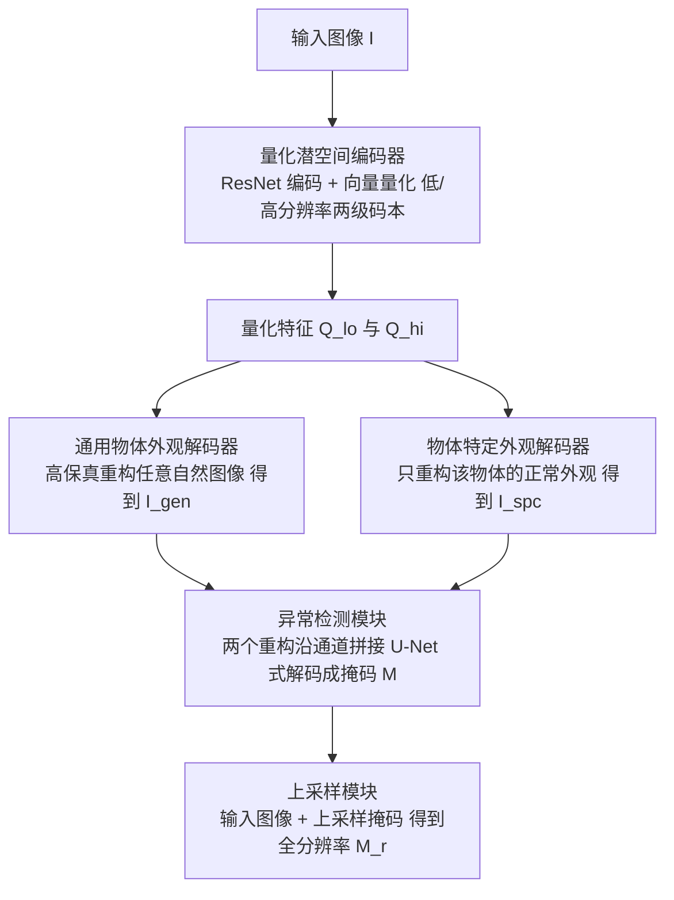

---
Title | paper DSR
-- | --
Created @ | `2026-11-24T08:14:29Z`
Updated @| `2026-11-24T09:21:40Z`
Labels | ``
Edit @| [here](https://github.com/junxnone/aiwiki/issues/745)

---
# DSR 双子空间重投影

- **DSR**：A Dual Subspace Re-Projection Network for Surface Anomaly Detection，论文 [arXiv 2208.01521](https://arxiv.org/abs/2208.01521)（ECCV 2022），官方代码 [VitjanZ/DSR_anomaly_detection](https://github.com/VitjanZ/DSR_anomaly_detection)
- 类型：Segmentation
- 动机：判别式无监督方法（如 [DRAEM](/0744_paper_DRAEM)）依赖**外部数据集在图像层面合成异常**，但与正常区域很像的**近分布 (near-in-distribution) 异常**很难被逼真地合成，这类方法容易失败
- 核心思想：基于**量化特征空间**表示和**双解码器**架构，**避开图像级异常合成**。在不对异常外观做任何假设的前提下，通过**从学到的量化特征空间中采样**，在特征层面生成异常，从而**可控地**生成近分布异常
- 论文结果：在 KSDD2 上，异常检测 AP 比此前最佳方法高 10%，异常定位 AP 高 35%

## 原理

输入图像先被投影到量化潜空间，再由**两个分别专注于不同外观子空间的解码器并行解码**，最后异常检测模块比较两个重构：

图中：

- **量化潜空间编码器**：用 ResNet 编码器把图像投影到特征空间 $F$，再用码本 $K$ 做**向量量化 (VQ)**，每个特征向量 $F_{ij}$ 被替换成码本里最近的向量：

$$
Q_{i,j} = q(F_{i,j}) = \underset{e_l \in K}{\arg\min}\ \lVert F_{i,j} - e_l \rVert
$$

其中：$F_{i,j}$ 是位置 $(i,j)$ 的特征向量；$K = \{e_1, \dots, e_{N_K}\}$ 是码本，包含 $N_K$ 个码字向量 $e_l$；$Q_{i,j}$ 是量化后的特征。图像用**低/高分辨率两级码本** $(K_{lo}, K_{hi})$ 编码，得到 $Q_{lo}$ 和 $Q_{hi}$（分别比输入小 8 倍和 4 倍），两级 VQ 已被报告能产生更好的重构
- **通用物体外观解码器**：把 VQ 编码的自然图像的空间配置解码成图像 $I_{gen}$，目标是对任意自然图像的**高保真重构**（先上采样 $Q_{lo}$ 并与 $Q_{hi}$ 拼接，再经两个 ResNet 块和两个转置卷积上采样块）
- **物体特定外观解码器**：负责把局部视觉异常**恢复成该物体可行的正常外观**，即把允许的 VQ 特征空间配置限制到与正常外观一致的配置。它通过**子空间限制模块**（三次下采样及对应上采样的编码-解码卷积网络）把通用 VQ 表示变成非量化的物体特定配置 $\tilde{F}$，再 VQ 投影成 $\tilde{Q}$，最后用卷积解码器得到无异常重构 $I_{spc}$
- **异常检测模块**：把 $I_{gen}$ 和 $I_{spc}$ 沿通道拼接，用 U-Net 式结构解码成分割掩码 $M$（特征分辨率）；图像级分数用与 DRAEM 相同的做法：掩码经 $21\times21$ 均值滤波再全局最大池化
- **上采样模块**：把 $M$ 重采样到全分辨率，是一个 U-Net 式小网络，输入是图像 $I$ 与双线性上采样后的 $M$ 的拼接，输出最终掩码 $M_r$

## 特征空间的异常生成

这是 DSR 的核心。目的有两个：①为物体特定解码器学习**正常外观的子空间限制**；②让异常检测模块专门去检测相对于类内多样的正常外观有**微弱偏差**的异常。做法：

1. 把无异常图像 $I$ 编码为 VQ 表示 $Q$，并采样一个 **Perlin 噪声**生成异常掩码 $M_{gt}$（值为 1 表示异常像素）
2. 把 $Q$ 中对应异常位置的特征，替换为从码本 $K$ 里**采样**的特征
3. 无约束采样会使异常像素外观变化很大，得到平凡的分布外重构；而如果采到太相似的向量，又会造成误报。所以先定义一个相似度上界：对一张图，取 $n \sim \mathcal{U}[\lambda_s N_K, N_K]$，再把每个被标记的特征替换为码本中其**近邻**之一，均匀采样 $k \sim \mathcal{U}[\lambda_s N_K, n]$

其中：$N_K$ 是码本向量总数；$\lambda_s$ 是相似度上界参数，论文所有实验取 $0.05$，即**排除与原向量最相似的 5% 的码字**以避免产生误报，同时优先选择靠近待替换向量的特征，从而鼓励生成近分布异常。论文的消融实验表明 DSR 对 $\lambda_s$ 的取值是鲁棒的。

## 三阶段训练

**阶段 1**：在 ImageNet 上训练量化潜空间编码器、VQ 码本和通用物体外观解码器，学习自然图像的子空间。训练后这三部分固定。损失（VQ-VAE 式）：

$$
\mathcal{L}_{st1} = L_2(I, I_{gen}) + L_2\big(\text{sg}[F], Q\big) + \lambda_1 L_2\big(F, \text{sg}[Q]\big)
$$

其中：$L_2(\cdot)$ 是欧氏距离；$\text{sg}[\cdot]$ 是**停止梯度**算子，使其作用对象被当成常数；第一项是图像重构损失，第二项让码本向编码特征靠拢，第三项（权重 $\lambda_1$）让编码特征承诺靠近其量化结果。

**阶段 2**：在目标物体的图像上训练检测部分。无异常训练图经量化编码得到 $Q$，用上面的方法在特征层面生成异常 $Q_a$ 及掩码 $M_{gt}$，前向得到异常掩码 $M$。物体特定解码器和异常检测模块的损失：

$$
\mathcal{L}_{st2} = \mathcal{L}_{foc}(M_{gt}, M) + \lambda_2 L_2(\tilde{F}, Q) + \lambda_3 L_2(I, I_{spc})
$$

其中：$\mathcal{L}_{foc}$ 是 **Focal Loss**（见 [Focal Loss](/0284_ML_Arch_Func_LossFunction_FocalLoss)），监督分割掩码；$L_2(\tilde{F}, Q)$ 约束物体特定解码器输出的子空间配置 $\tilde{F}$ 与**无异常输入**的量化表示 $Q$ 一致（特征重构损失）；$L_2(I, I_{spc})$ 约束无异常输入图像与其物体特定重构一致（图像重构损失）；论文设 $\lambda_2 = 1$，$\lambda_3 = 10$。

**阶段 3**：训练上采样模块。检测网络训好后，生成带有**复制粘贴污渍**的图像，由检测网络输出低分辨率掩码；由于全分辨率掩码在粘贴污渍时就已知，上采样网络可以用 Focal Loss 训练。

## 实现细节

Name | 设置
-- | --
阶段 1 | ImageNet 上重构训练 200000 次迭代，batch size 32，学习率 0.0002
码本 | $K_{hi}$ 与 $K_{lo}$ 各有 4096 个维度为 128 的潜向量
阶段 2 | 100000 次迭代，batch size 8，学习率 0.0002，80000 次迭代后降为 1/10
阶段 3 | 20000 次迭代，学习率 0.0002，batch size 8
其他 | 所有实验中训练超参数和网络结构保持不变

表中是论文的训练设置。结论中还提到 DSR 的推理速度为 **58 FPS**，适合有实时要求的工业场景。

## 实验结果

- **KSDD2**（目前最具挑战的、含大量近分布异常的真实产线数据集；训练集 2085 张无异常图和 246 张异常图，测试集 894 张无异常、110 张异常；指标：图像级检测 $AP_{det}$、像素级定位 $AP_{loc}$）：完全无监督的 DSR 显著优于 MAD、PaDiM 和 DRAEM，图像级 AP 比此前最佳高 7.9 个百分点；DSR 还能方便地加入少量带标注的异常样本。下表是加入 $N$ 张带掩码标注的异常训练图后的结果（论文 Table 2）：

Method | N | 0 | 16 | 53 | 246
-- | -- | -- | -- | -- | --
[6] | $AP_{det}$ | 73.3 | 83.2 | 89.1 | 95.4
DSR | $AP_{det}$ | **87.2** | **91.4** | **94.6** | 95.2
[6] | $AP_{loc}$ | 1.0 | 45.1 | 52.2 | 67.6
DSR | $AP_{loc}$ | **61.4** | **71.2** | **81.6** | **85.5**

表中 $N=0$ 对应完全无监督，这时 DSR 的 $AP_{det}$ 为 87.2，定位 $AP_{loc}$ 为 61.4，远高于有监督方法 [6]（73.3 和 1.0）。只给 16 张异常图时 DSR 也明显领先，说明它适合异常样本很少的真实场景；异常图用到 246 张时，检测 AP 两者接近（95.4 vs 95.2）。

- **MVTec AD**：DSR 的图像级平均 AUROC 为 **98.2%**，像素级平均 AP 为 **70.2%**（15 类，论文 Table 3 和 4），达到 SOTA 水平；论文用像素级 AP 而不是 AUROC 来评估定位，因为 AP 对类别不均衡更鲁棒（见 [Anomaly Detection Metrics](/0711_ML_Metrics_Anomaly)）

**消融实验**（MVTec AD）：

Name | 结论
-- | --
特征级异常 vs 图像级异常（DSR vs DSR-img，后者像 DRAEM 一样用外部数据集合成图像级异常） | 特征级异常生成在检测和定位上都更好
码本采样方式（DSR vs DSR-random，随机均匀采样码字） | 随机采样性能显著下降，说明采样方法很重要：靠近原向量的采样才能生成近分布异常
相似度上界 $\lambda_s$ | 对取值鲁棒
重构损失成分 | 只用图像重构损失或只用特征重构损失，性能都明显下降；两者同时使用使图像级 AUROC 平均高约 2 个百分点
去掉上采样模块 | 定位性能下降，检测性能不变（图像分数来自低分辨率掩码 $M$）

表中说明：DSR 的收益主要来自「特征级、近分布」的异常采样方式，而不是网络结构本身。论文还指出更复杂的特征采样方式可能进一步改进。

## anomalib 实现

anomalib 的 README 说明 DSR 的基准结果尚未提供，指标见 [Anomaly Detection Metrics](/0711_ML_Metrics_Anomaly)。

## 特点与局限

- **优点**：特征级合成异常，**不依赖外部纹理数据集**，也不对异常外观做假设；近分布异常检测能力强（KSDD2）；可以方便地加入少量标注异常转为（弱）监督；推理 58 FPS
- **局限**：三阶段训练流程复杂；需要在 ImageNet 上预训练码本；论文的采样方式较简单，作者指出更复杂的采样可能进一步提升；anomalib 里暂无官方基准

## Reference
- [DSR – A Dual Subspace Re-Projection Network for Surface Anomaly Detection](https://arxiv.org/abs/2208.01521)
- [official code](https://github.com/VitjanZ/DSR_anomaly_detection)
- [anomalib - Dsr](https://github.com/openvinotoolkit/anomalib/tree/main/src/anomalib/models/image/dsr)

