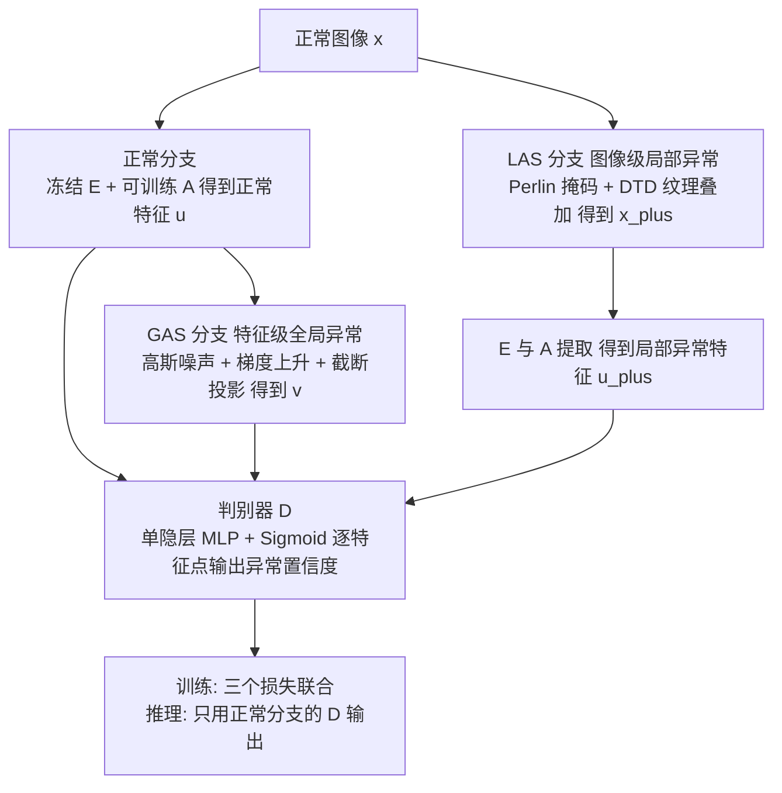

---
Title | paper GLASS
-- | --
Created @ | `2026-11-24T08:14:31Z`
Updated @| `2026-11-24T09:21:38Z`
Labels | ``
Edit @| [here](https://github.com/junxnone/aiwiki/issues/746)

---
# GLASS 梯度上升异常合成

- **GLASS**：A Unified Anomaly Synthesis Strategy with Gradient Ascent for Industrial Anomaly Detection and Localization（**G**lobal and **L**ocal **A**nomaly co-**S**ynthesis **S**trategy），论文 [arXiv 2407.09359](https://arxiv.org/abs/2407.09359)（ECCV 2024）
- 类型：Segmentation
- 动机：异常合成能有效提升无监督异常检测，但现有合成策略在**覆盖度**和**可控性**上有限，尤其对与正常区域非常相似的**弱缺陷 (weak defects)**
- 核心思想：一个统一框架，同时在**特征层面做全局异常合成 (GAS)**、在**图像层面做局部异常合成 (LAS)**，在流形 (manifold) 和超球面 (hypersphere) 分布假设的约束下合成覆盖面更广的异常；用**梯度上升**引导的高斯噪声和**截断投影**，以可控方式合成**近分布异常**
- 论文结果：MVTec AD 上检测 AUROC 达 **99.9%**；在 VisA、MPDD 上也达到 SOTA，并擅长弱缺陷检测
- 与 [DRAEM](/0744_paper_DRAEM)（图像级合成）、[DSR](/0745_paper_DSR)（特征级合成）相关；合成方法综述见 [Anomaly Synthesis](/0517_ML_Tasks_Image_Anomaly_Synthesis)

## 原理

训练时有三条分支，每条分支共享**特征提取器 $E_\phi$**、**特征适配器 $A_\varphi$** 和**判别器 $D_\psi$** 三个模块；推理时只用正常分支：

图中：

- **特征提取器与适配器**（3.1 节）：用冻结的预训练骨干 $\phi$ 提取多层特征 $\phi_{i,j} \in \mathbb{R}^{H_j \times W_j \times C_j}$，通过**自适应平均池化**聚合邻域（邻域大小 $p$）得到局部感知特征，再把各层上采样并拼接成 $t_i = E_\phi(x_i)$（通道数 $C = \sum_j C_j$）。**适配器** $A_\varphi$ 是单层感知机，输入输出节点数相同，用来缓解冻结骨干带来的**潜在领域偏差**，得到适配后的正常向量 $u_i^{h,w} = A_\varphi(t_i^{h,w})$
- **判别器**：单隐层 MLP + Sigmoid，对每个特征点直接输出异常置信度 $z_i^{h,w} \in \mathbb{R}$，是端到端训练的分割网络

### GAS：特征级全局异常合成

「全局」指在特征图的**所有点**上合成异常。

**分布假设**：假设所有正常特征点要么服从**流形**分布、要么服从**超球面**分布：

- 流形假设：正常特征点集合 $U \subseteq \mathbb{R}^C$ 位于低维局部线性流形上；偏离所有正常点距离超过 $r_1$ 的特征被视为异常：$N_a = \{\tilde{u} \mid \lVert \tilde{u} - u_j \rVert_2 > r_1,\ \forall u_j \in U\}$
- 超球面假设：正常特征点可以被一个紧致超球面包住，球心 $c = \frac{1}{\lvert U \rvert}\sum u$；到球心距离超过 $r_1'$ 的被视为异常：$N_a' = \{\tilde{u} \mid \lVert \tilde{u} - c \rVert_2 > r_1'\}$

GAS 用三步实现：**高斯噪声 → 梯度上升 → 截断投影**（前两步在两种假设下相同）。

**① 高斯噪声**：现实中异常分布未知，用高斯噪声模拟多样的异常：

$$
g_i^{h,w} = u_i^{h,w} + \varepsilon_i^{h,w}, \qquad \varepsilon_i^{h,w} \sim \mathcal{N}(\mu_g, \sigma_g^2)
$$

其中 $u_i^{h,w}$ 是适配后的正常特征点，$\varepsilon$ 是噪声（论文取均值为 0、标准差 0.015），$g$ 是高斯异常特征点。但这样合成是**无方向的**，对检测的训练效率不高。

**② 梯度上升**：沿使 GAS 分支损失 $L_{gas}$（式 6）**上升**的方向调整噪声，使合成的异常对判别器「更难」：

$$
\tilde{g}_i^{h,w} = g_i^{h,w} + \eta\,\frac{\nabla L_{gas}\big(g_i^{h,w}\big)}{\big\lVert \nabla L_{gas}\big(g_i^{h,w}\big) \big\rVert}
$$

其中 $\nabla L_{gas}$ 是损失对特征点的梯度，$\eta$ 是学习率；梯度被归一化，所以每步移动的距离由 $\eta$ 决定，与梯度大小无关。

**③ 截断投影（流形）**：梯度上升后的 $\tilde{g}$ 可能离正常特征太远或太近，因此限制梯度上升的距离范围。梯度上升距离 $\tilde{\varepsilon} = \tilde{g} - u$，截断后的距离：

$$
\hat{\varepsilon}_i^{h,w} = \frac{\alpha_i}{\lVert \tilde{\varepsilon}_i^{h,w} \rVert}\tilde{\varepsilon}_i^{h,w}, \quad \alpha_i = \begin{cases} r_1 & \lVert \tilde{\varepsilon}_i^{h,w} \rVert < r_1 \\ r_2 & \lVert \tilde{\varepsilon}_i^{h,w} \rVert > r_2 \\ \lVert \tilde{\varepsilon}_i^{h,w} \rVert & \text{otherwise} \end{cases}
$$

最终全局异常特征 $v_i^{h,w} = u_i^{h,w} + \hat{\varepsilon}_i^{h,w}$。其中 $r_1, r_2$ 是流形距离，是常数，通常 $r_2 = 2r_1$（论文取 $r_1 = 1$，$r_2 = 2$），即把距离钳制在 $[r_1, r_2]$ 内，合成的异常既不会和正常特征混在一起，也不会过远成为平凡的异常；算法在每隔 $n_{proj}$ 步做一次投影。

**截断投影（超球面）**：超球面假设下把梯度异常特征 $\tilde{g}$ 投影到 $r_1' < \lVert \tilde{g} - c \rVert < r_2'$ 的环形区域；来自 LAS 的局部异常特征 $u_{i+}$ 通常比 $\tilde{v}$ 离正常特征更远，所以被投影到更外层的 $r_2' < \lVert u_{i+} - c \rVert < r_3'$。其中 $r_1'$ 是超球面半径，迭代更新，经验上设为覆盖 **75% 的正常样本**，使正常样本更紧凑；上界通常取 $r_3' = 2r_2' = 4r_1'$。论文发现因为多数缺陷结构复杂，**流形假设略优于超球面假设**，并通过分析图像的**频谱图**为不同类别选择合适的分布假设（anomalib 里对应的是按类别设置的 `svd` 参数：0 为流形，1 为超球面）。

### LAS：图像级局部异常合成

局部异常能提供细致的异常纹理。论文在 Perlin 掩码 + DTD 纹理的常用做法上增加了多样性（三步）：

1. **异常掩码**：用 Perlin 噪声生成两个二值掩码 $m_1$、$m_2$，再由前景掩码 $m_f$（对正常样本二值化得到，异常一般出现在物体表面）与它们的交、并构造最终掩码 $m_i$：

$$
m_i = \begin{cases} (m_1 \wedge m_2) \wedge m_f & 0 \le p_m \le \alpha \\ (m_1 \vee m_2) \wedge m_f & \alpha < p_m \le 2\alpha \\ m_1 \wedge m_f & 2\alpha < p_m \le 1 \end{cases}
$$

其中 $p_m \sim U(0, 1)$ 是随机数，$\alpha = 1/3$，所以三种情况各占 1/3：分别是交集（小而细的异常）、并集（大而复杂的异常）、单个掩码。

2. **异常纹理**：随机从 DTD 纹理数据集选一张图，并从 $K = 9$ 种增强方法中随机取 3 种（类似 RandAugment）做增强
3. **叠加融合**：用透明度系数 $\beta \sim \mathcal{N}(\mu_m, \sigma_m^2)$ 调节掩码区域内**训练图像 $x_i$** 所占的比例，以模拟弱缺陷：

$$
x_{i+} = x_i \odot \bar{m}_i + (1 - \beta)\,x_i'' \odot m_i + \beta\,x_i \odot m_i
$$

其中 $x_i''$ 是增强后的异常纹理，$\bar{m}_i$ 是 $m_i$ 的取反；$\beta$ 越大，掩码区域内原图占比越大，缺陷越弱。论文取 $\beta \sim \mathcal{N}(0.5, 0.1^2)$ 并截断在 $[0.2, 0.8]$。之后 $x_{i+}$ 再经 3.1 节的 $E_\phi$ 和 $A_\varphi$ 得到局部异常特征 $u_{i+}$。

### 训练目标与推理

$$
L_n = \sum f_{BCE}(z_{i,n}, \mathbf{0}), \quad L_{gas} = \sum f_{BCE}(z_{i,gas}, \mathbf{1}), \quad L_{las} = \sum f_{Focal}(z_{i,las}, m_i), \quad L = L_n + L_{gas} + f_{ohem}(L_{las})
$$

其中：

- $z_{i,n} = D_\psi(u_i)$、$z_{i,gas} = D_\psi(v_i)$、$z_{i,las} = D_\psi(u_{i+})$：判别器分别对正常特征、全局异常特征和局部异常特征的输出
- $L_n$：对正常特征的二元交叉熵，真值全为 0（正常）；$L_{gas}$：对全局异常特征的二元交叉熵，真值全为 1（整幅特征图都是异常）；$L_{las}$：对局部异常特征的 **Focal Loss**（见 [Focal Loss](/0284_ML_Arch_Func_LossFunction_FocalLoss)），真值是异常掩码 $m_i$，用来处理局部异常二分类中的类别不均衡
- $f_{ohem}$：对 $L_{las}$ 使用**在线难例挖掘 (OHEM)**，筛选弱缺陷这类关键样本

推理时只走正常分支（图中不含 GAS 与 LAS 的实线）：$u_i = A_\varphi(E_\phi(x_i))$，判别器输出 $z_i = D_\psi(u_i)$。上采样并做高斯平滑得到像素级分数 $S_{AL} = f_{smooth}\big(f_{resize}^{H_0, W_0}(z_i)\big)$，**图像级分数 $S_{AD}$ 取 $z_i$ 中所有点的最大值**。

## 实现细节

Name | 设置
-- | --
骨干 | WideResNet50，融合 level2 和 level3 特征；邻域大小 $p = 3$
输入 | 缩放并中心裁剪到 288×288
GAS | 高斯噪声 $\varepsilon \sim \mathcal{N}(0, 0.015^2)$；GLASS-m（流形）：$r_1 = 1$，$r_2 = 2$；GLASS-h（超球面）；GLASS-j：按类别通过图像频谱图分析在两者中选择的混合版本。三个变体非常相似，多数实验默认用 GLASS-m
优化 | Adam，适配器 $A_\varphi$ 学习率 0.0001，判别器 $D_\psi$ 学习率 0.0002；640 个 epoch，batch size 8；NVIDIA Tesla A800
评估 | 图像级与像素级 AUROC，另加像素级 PRO（见 [Anomaly Detection Metrics](/0711_ML_Metrics_Anomaly)）

表中是论文的实验设置。论文还构造了弱缺陷测试集：MAD-man（5 个人分别从 MVTec AD 每类手工挑选弱缺陷样本）和 MAD-sys（对 5 个纹理类用 $\beta = \{0.1, 0.3, 0.5, 0.7\}$ 合成不同弱度的缺陷）；并发布了织物缺陷数据集 WFDD（3860 张正常、241 张异常）。

## 实验结果

- **数据集**：MVTec AD、VisA、MPDD，以及自建的 WFDD；弱缺陷测试集 MAD-man 和 MAD-sys
- **主要结果**：MVTec AD 检测 AUROC **99.9%**；VisA、MPDD 上达到 SOTA，且在弱缺陷检测上更突出。anomalib README 引用论文结果为 I-AUROC 99.9% 和 P-AUROC 99.3%

**消融实验**（论文 4.4 节）：

Name | 结论
-- | --
合成策略（把 GAS 拆成 Gaussian Noise、Gradient Ascent、Truncated Projection 三部分） | 只用 GAS（不含梯度上升和截断投影）在 MVTec AD 上优于 LAS，说明 GAS 有检测各类异常的优势；但 LAS 在更弱缺陷的 MAD-sys 上更好，说明 LAS 善于检测局部异常；**LAS 与 GAS 协同训练**带来明显提升，说明两者互补，覆盖面更广
骨干 | 论文 Table 5 对比了不同骨干设置

表中的结论：GAS 覆盖面广、LAS 对弱局部缺陷强，两者缺一不可，并且梯度上升加截断投影让合成更可控。

**anomalib 复现的结果**（README，Wide ResNet-50，MVTec AD 平均）：Image AUROC **0.972**，Pixel AUROC **0.965**。README 说明与论文 99.9% / 99.3% 的差距可能来自增强流程（Perlin 噪声填充、DTD 加载）的细微差异；复现需要 288×288 输入、按类别设置 `svd`、batch size 8、学习率 1e-4、100 个 epoch、seed 0，且每类最多 392 个样本。

## 特点与局限

- **优点**：全局（特征级）与局部（图像级）异常合成互补；梯度上升 + 截断投影使**近分布异常可控**；对**弱缺陷**效果好；推理时只走正常分支，速度快
- **局限**：训练复杂（三分支加共享判别器、640 个 epoch）；需要按类别选择分布假设（流形/超球面）；复现对增强细节敏感；依赖外部纹理（DTD）

## Reference
- [A Unified Anomaly Synthesis Strategy with Gradient Ascent for Industrial Anomaly Detection and Localization](https://arxiv.org/abs/2407.09359)
- [anomalib - Glass](https://github.com/openvinotoolkit/anomalib/tree/main/src/anomalib/models/image/glass)

