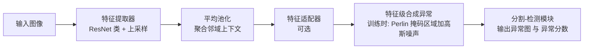

---
Title | paper SuperSimpleNet
-- | --
Created @ | `2026-11-24T08:14:33Z`
Updated @| `2026-11-24T08:14:33Z`
Labels | ``
Edit @| [here](https://github.com/junxnone/aiwiki/issues/747)

---
# SuperSimpleNet 统一监督与无监督的缺陷检测

- **SuperSimpleNet**：Unifying Unsupervised and Supervised Learning for Fast and Reliable Surface Defect Detection，ICPR 2024，论文 [arXiv 2408.03143](https://arxiv.org/abs/2408.03143)；扩展版发表于 JIMS 2025：[No Label Left Behind](https://link.springer.com/article/10.1007/s10845-025-02680-8)
- 类型：Segmentation
- 思路：由 SimpleNet 演化而来的**判别式**缺陷检测模型，特征级合成异常 + 分割-检测模块，既支持无监督也支持有监督（anomalib 目前只支持无监督）
- 官方代码 [blaz-r/SuperSimpleNet](https://github.com/blaz-r/SuperSimpleNet)

## 原理

SuperSimpleNet 由四个部分组成：



图中：

- 特征提取器是类 ResNet 网络，特征经上采样并**平均池化**以聚合邻域上下文
- **特征适配器**进一步把特征调整到异常检测任务（可选）
- 训练时，在 **Perlin 二值掩码**指定的区域给特征加上高斯噪声，作为特征级合成异常；推理时跳过这一步
- **分割-检测模块**同时输出像素级异常图和图像级异常分数；异常图被上采样到输入尺寸并经高斯滤波

合成异常的形式：

$$
\tilde{F} = F + M \odot \mathcal{E}, \qquad \mathcal{E} \sim \mathcal{N}(0, \sigma^2 I)
$$

其中：

- $F$：适配后的特征图；$M$：由 Perlin 噪声得到的二值掩码，决定哪些位置被「污染」；$\mathcal{E}$：均值 0、标准差 $\sigma$ 的高斯噪声；$\odot$ 为逐元素相乘
- $\tilde{F}$：加噪后的特征，被当作「异常特征」，其对应的掩码 $M$ 就是分割任务的标签
- $\sigma$：噪声强度，anomalib 说明默认的噪声标准差对应使用 torchvision V1 权重的 WideResNet50，改用其他权重时要重新检查

## 特点

Name | 说明
-- | --
统一监督范式 | 同一模型可以只用正常样本、也可以加入少量有缺陷样本，覆盖无监督到全监督
快速 | 结构简单，推理速度快（论文标题强调 Fast）
ICPR 与 JIMS 的区别 | 只在 `adapt_cls_features`：ICPR 版为 True（分类头特征经过适配），JIMS 版为 False（默认）
训练建议 | anomalib 建议训练 300 个 epoch，batch size 32，以获得稳定训练；较小的值也能运行，但结果可能不是最优

表中是 SuperSimpleNet 的特点：它是适合工业表面缺陷的轻量判别式模型，使用时要注意骨干权重版本。

## 使用与评估

```bash
anomalib train --model Supersimplenet --data MVTecAD --data.category <category>
```

anomalib README 在 MVTec AD 上给出了各类别结果（300 个 epoch，seed 0，默认参数，batch size 32），平均值如下：

Version | AUROC | AUPRO
-- | -- | --
ICPR | 0.980 | 0.914
JIMS | 0.975 | 0.916

表中分别是 ICPR 版和 JIMS 版的平均 AUROC 与 AUPRO：两个版本的整体水平接近，ICPR 版的 AUROC 稍高，JIMS 版的 AUPRO 稍高。AUPRO 的含义见 [Anomaly Detection Metrics](/0711_ML_Metrics_Anomaly)。验证过的骨干是使用 torchvision V1 权重的 WideResNet50（权重名以 `.tv_` 结尾，而不是 `tv2`）；有监督、弱监督、混合监督的训练请参考官方代码。指标含义见 [Anomaly Detection Metrics](/0711_ML_Metrics_Anomaly)。

## 优缺点

- **优点**：结构简单、速度快；无监督和有监督统一；工业表面缺陷效果好
- **缺点**：对骨干权重版本和噪声强度敏感；anomalib 目前只支持无监督设置；合成异常是特征级噪声，对逻辑类异常有限

## Reference
- [SuperSimpleNet: Unifying Unsupervised and Supervised Learning for Fast and Reliable Surface Defect Detection](https://arxiv.org/abs/2408.03143)
- [No Label Left Behind: A Unified Surface Defect Detection Model for all Supervision Regimes](https://link.springer.com/article/10.1007/s10845-025-02680-8)
- [official code](https://github.com/blaz-r/SuperSimpleNet)
- [anomalib - Supersimplenet](https://github.com/openvinotoolkit/anomalib/tree/main/src/anomalib/models/image/supersimplenet)

