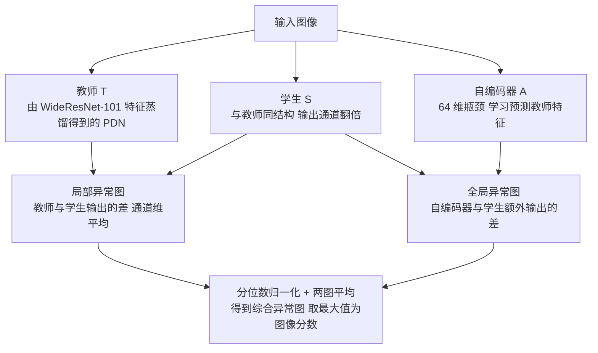

---
Title | paper EfficientAD
-- | --
Created @ | `2026-11-24T08:14:35Z`
Updated @| `2026-11-24T09:21:32Z`
Labels | ``
Edit @| [here](https://github.com/junxnone/aiwiki/issues/748)

---
# EfficientAD 毫秒级异常检测

- **EfficientAD**：Accurate Visual Anomaly Detection at Millisecond-Level Latencies，论文 [arXiv 2303.14535](https://arxiv.org/abs/2303.14535)（WACV 2024）
- 类型：Segmentation
- 动机：实时场景下，异常检测的**计算效率**和精度同样重要。参数量往往是延迟、吞吐和内存占用的**误导性指标**（论文指出 S–T 用的小网络参数少，但执行一次比 3100 万参数的 U-Net 更慢、占内存更多，因为缺少下采样）
- 核心思想：①一个极轻量的**特征提取器 PDN**（Patch Description Network），256×256 图像上耗时不到 0.8 ms；②**学生-教师**方法检测局部异常，并提出专门的训练损失；③用高效的**自编码器**检测**逻辑异常**；④用分位数把两张异常图校准后融合
- 论文结果：在三个数据集合集（共 32 个数据集：MVTec AD、VisA、MVTec LOCO）上同时刷新检测和定位的 SOTA；**延迟 2 ms、吞吐超过 600 张/秒**
- 属于师生类方法，对比 [STFPM](/0324_paper_STFPM)、[Reverse Distillation](/0749_paper_ReverseDistillation)

## 原理

图中：

- **PDN（Patch Description Network）**：只有 **4 个卷积层**，每个输出神经元的感受野是 33×33 像素，因此每个输出特征向量描述一个 33×33 的图像块。它是全卷积网络，可以对任意大小的图像一次前向得到所有特征向量。为提高效率，在第一、第二个卷积层后加了**步长平均池化**做早期下采样，这使得 256×256 图像的特征提取在 NVIDIA RTX A6000 上不到 **800 µs**
- **教师**：把深层预训练分类网络蒸馏到 PDN 里。为公平对比，使用与 PatchCore 相同的 WideResNet-101 特征，在 ImageNet 图像上最小化 PDN 输出与预训练特征的均方差。PDN 的另一个好处：特征向量**只依赖其 33×33 区域内的像素**，而预训练分类网络的特征有长程依赖，一处异常会影响远处特征，损害定位
- **学生**：因为 PDN 只要不到 1 ms，学生也直接使用 PDN 的结构，所以总延迟很低。学生被训练去预测教师在**正常图像**上的特征，测试时学生预测失败（与教师差异大）的位置就是异常
- **自编码器**：一个标准的卷积自编码器（编码器用步长卷积、解码器用双线性上采样），中间经过 **64 维**的瓶颈，**整幅图**编码再解码，用于检测逻辑异常；它被训练去预测教师的输出。**学生同时输出自编码器的预测**（输出通道数翻倍），用「自编码器输出与学生额外通道的差」作为全局异常图，原因见下文
- 局部异常图和全局异常图经分位数归一化后取平均，得到综合异常图，其最大值是图像级分数

## 难特征损失与损失函数

在标准的师生框架里，增加训练图像可以改善学生对教师的模仿，但也会让学生在**异常图像上**同样模仿得很好，反而降低检测性能；而故意减少训练图像又会丢失正常图像的重要信息。论文的目标是「让学生看到足够多的数据，使其能充分模仿正常图像，同时避免泛化到异常」。受在线难例挖掘 (OHEM) 启发，提出**难特征损失 (hard feature loss)**，只使用学生当前模仿得最差的那部分元素做反向传播：

$$
D_{c,w,h} = \big(T(I)_{c,w,h} - S(I)_{c,w,h}\big)^2, \qquad L_{hard} = \text{mean}\big\{ D_{c,w,h} \mid D_{c,w,h} \ge d_{hard} \big\}
$$

其中：

- $T(I), S(I) \in \mathbb{R}^{C \times W \times H}$：教师和学生对训练图像 $I$ 的输出，$C$ 为通道数，$(w, h)$ 为空间位置；$D_{c,w,h}$：对每个元素 $(c, w, h)$ 的平方差
- $p_{hard} \in [0, 1]$：挖掘因子；$d_{hard}$：$D$ 的所有元素的 $p_{hard}$ 分位数；$L_{hard}$ 是 $D$ 中不小于 $d_{hard}$ 的元素的均值。$p_{hard} = 0$ 就退化为原始 S–T 损失；论文取 $p_{hard} = 0.999$，平均而言相当于在 $D$ 的三个维度上各使用约 10% 的值做反向传播
- 推理时 2D 异常分数图 $M_{w,h} = C^{-1}\sum_c D_{c,w,h}$，即 $D$ 沿通道平均。用难特征损失可以避免正常图像上出现异常分数的离群值（误报）

除难特征损失外，再加一个**惩罚项**进一步阻止学生在**不属于正常训练图像**的图像上模仿教师：每个训练步从教师预训练数据集（ImageNet）中随机采一张图像 $P$，学生的损失为：

$$
L_{ST} = L_{hard} + \frac{1}{CWH}\sum_{c}\big\lVert S(P)_c \big\rVert_F^2
$$

其中 $S(P)_c$ 是学生对 ImageNet 图像 $P$ 的第 $c$ 个输出通道，$\lVert\cdot\rVert_F$ 是 Frobenius 范数。这一项迫使学生在与应用无关的图像上输出变小，阻止其把「模仿教师」泛化到分布外图像，也就是不让学生学会模仿异常。

**逻辑异常检测**：逻辑异常包括物体缺失、错位、多余，或违反几何约束（如螺丝长度）。按 MVTec LOCO 作者的建议用自编码器学习训练图像的逻辑约束。自编码器 $A$ 的训练损失：

$$
L_{AE} = \frac{1}{CWH}\sum_{c}\big\lVert T(I)_c - A(I)_c \big\rVert_F^2, \qquad L_{STAE} = \frac{1}{CWH}\sum_{c}\big\lVert A(I)_c - S'(I)_c \big\rVert_F^2
$$

$$
L = L_{AE} + L_{ST} + L_{STAE}
$$

其中：

- $A(I)$：自编码器在教师特征空间中的输出，目标是预测教师输出 $T(I)$；$S'(I)$：学生**额外的**输出通道，被训练去预测自编码器的输出
- 为什么学生要额外预测自编码器：自编码器在**正常图像**上的重构也不完美（如背景网格这种细粒度图案），直接用教师输出与自编码器重构的差作为异常图会产生误报。学生因为感受野只有 33×33，不受图像其它部分（如多出的一根电缆）影响，它会学到自编码器在**正常图像上的系统性重构误差**（如模糊），但学不到**异常图像上**的重构误差，因为异常不在训练集中。所以「自编码器输出与学生输出的差」适合作为全局（逻辑）异常图
- 总损失是三项之和；两张异常图都是对应两组输出的平方差沿通道平均

**异常图归一化**：局部异常图和全局异常图需要先归一化到相近尺度再平均，否则一张图里的噪声可能淹没另一张图里的准确检测。用验证图像（训练集里未参与训练的图像）估计正常图像的噪声尺度：对两种异常图分别计算所有像素异常分数的两个分位数 $q_a$、$q_b$，确定一个线性变换，把 $q_a$ 映射到 0、$q_b$ 映射到 0.1。用分位数使归一化对异常分数分布的形态鲁棒。映射目标值（0 和 0.1）对 AUROC 没有影响（AUROC 只与排序有关），选它们是为了得到适合标准 0~1 色标的图。

## 实验结果

- **对比方法**：AST、DSR、FastFlow、GCAD、PatchCore、SimpleNet、S–T，使用官方实现（FastFlow 用 anomalib 实现，并关闭了在测试集上调训练时长的早停）；论文还指出 SimpleNet 的官方做法是反复在测试集上评估并取最大值，这会高估性能，因此关闭；PatchCore 关闭了对输入图像中心 76.6% 区域的裁剪（该裁剪隐含了对异常位置的先验）
- 延迟用 batch size 1 测量、吞吐用 batch size 16 测量，硬件为 NVIDIA RTX A6000

**主结果**（论文 Table 1，每个数值是 MVTec AD、VisA、MVTec LOCO 三个数据集合集各自平均值的平均）：

Method | 图像检测 AU-ROC (%) | 定位 AU-PRO (%) | 延迟 (ms) | 吞吐 (img/s)
-- | -- | -- | -- | --
GCAD | 85.4 | 88.0 | 11 | 121
SimpleNet | 87.9 | 74.4 | 12 | 194
S–T | 88.4 | 89.7 | 75 | 16
FastFlow | 90.0 | 86.5 | 17 | 120
DSR | 90.8 | 78.6 | 17 | 104
PatchCore | 91.1 | 80.9 | 32 | 76
PatchCore (Ens) | 92.1 | 80.7 | 148 | 13
AST | 92.4 | 77.2 | 53 | 41
**EfficientAD-S** | **95.4** | 92.5 | **2.2** | **614**
**EfficientAD-M** | **96.0** | **93.3** | 4.5 | 269

表中每一行是一个方法。EfficientAD-S 与此前精度第二的 AST 比，**延迟降低 24 倍、吞吐提高 15 倍**，而检测 AU-ROC 高出 3 个百分点；EfficientAD-M 把两个精度指标都推到最高。结论是：不必在速度和精度之间取舍。论文还指出，若开启早停，EfficientAD 在 MVTec AD 上的图像级检测 AU-ROC 可以达到 **99.8%**。

两个规格的区别：**EfficientAD-S** 使用论文图 2 的 PDN 结构；**EfficientAD-M** 把教师和学生隐藏卷积层的卷积核数翻倍，并在第二个池化层后和最后一个卷积层后各插入一个 $1\times1$ 卷积。

**anomalib 复现的结果**（README，MVTec AD 15 类平均，seed 42）：

Model | Image AUROC | Image F1
-- | -- | --
EfficientAd-S | 0.982 | 0.970
EfficientAd-M | 0.975 | 0.966

表中是 anomalib 复现的 MVTec AD 图像级结果，其中小模型反而略好于中模型；数值低于论文开启早停时的 99.8%。anomalib 训练时要求 batch size 为 1。指标含义见 [Anomaly Detection Metrics](/0711_ML_Metrics_Anomaly)。

## 特点与局限

- **优点**：速度极快（2 ms 延迟，600+ img/s）；用难特征损失和 ImageNet 惩罚遏制学生泛化到异常；自编码器分支覆盖逻辑异常，局部与全局互补；精度在三个数据集合集上都领先
- **局限**：训练损失需要使用 ImageNet 图像做惩罚，训练流程比纯特征类方法复杂；教师需要先从 WideResNet-101 蒸馏；自编码器的瓶颈（64 维）和校准用的分位数会影响结果；anomalib 版本要求 batch size 为 1

## Reference
- [EfficientAD: Accurate Visual Anomaly Detection at Millisecond-Level Latencies](https://arxiv.org/abs/2303.14535)
- [anomalib - EfficientAd](https://github.com/openvinotoolkit/anomalib/tree/main/src/anomalib/models/image/efficient_ad)

