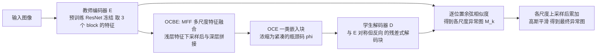

---
Title | paper ReverseDistillation
-- | --
Created @ | `2026-11-24T08:14:38Z`
Updated @| `2026-11-24T09:21:29Z`
Labels | ``
Edit @| [here](https://github.com/junxnone/aiwiki/issues/749)

---
# ReverseDistillation 反向蒸馏

- **Reverse Distillation**：Anomaly Detection via Reverse Distillation from One-Class Embedding，论文 [arXiv 2201.10703](https://arxiv.org/abs/2201.10703)（CVPR 2022）
- 类型：Segmentation
- 动机：在无监督异常检测中，学生网络只见过正常样本，所以遇到异常时应当与教师产生**不一致**的表示，这是知识蒸馏 (KD) 类方法的基本假设。但这在实践中**并不总成立**，原因有二：①教师和学生的**结构相同或相似**（论文称为 non-distinguishing filters）；②知识蒸馏时教师和学生有**相同的数据流**（输入同一张原图）。用更小的学生网络可以部分缓解，但浅层网络表示能力弱，又损害了检测和定位精度
- 核心思想：提出**反向蒸馏**范式：教师是**编码器**、学生是**解码器**（异构结构）；学生不直接接收原图，而是以教师的**低维一类嵌入**作输入，去**还原教师在多个尺度上的表示**；因此「反向」既指编码器与解码器的结构相反，也指蒸馏顺序相反：**先蒸馏高层表示，再到低层特征**
- 并引入**一类瓶颈嵌入 (OCBE)** 模块，进一步压缩特征，保留正常模式的必要信息而丢弃异常扰动
- 师生类方法，对比 [STFPM](/0324_paper_STFPM)、[EfficientAD](/0748_paper_EfficientAD)

## 为什么「反向」

- 把教师编码器看作**下采样滤波器**，学生解码器看作**上采样滤波器**：二者**结构不同**，避免了结构相同带来的「学生对异常也能复现教师」的问题
- 从回归的角度，反向蒸馏相当于让学生网络**预测教师的表示**；解码器只能看到低维嵌入，而嵌入只保留了正常模式所需的信息，异常的细节被压缩掉，所以解码器无法还原异常区域的教师特征，表示差异变大
- 论文强调：在知识蒸馏里**不能给编码器和解码器加跳连 (skip path)**，这类重构任务常见的做法在这里行不通，因为跳连会在推理时把异常信息泄漏给学生

## 原理

图中：

- **教师编码器 $E$**：在 ImageNet 上预训练，训练中**参数全部冻结**（避免师生收敛到平凡解）。论文的消融实验表明 ResNet 和 WideResNet 都是合适的骨干，主实验用 WideResNet50
- **学生解码器 $D$**：结构与 $E$ **对称但相反**。以 ResNet 为例，ResNet 的下采样是核大小 1、步长 2 的卷积，对应的解码块用核大小 2、步长 2 的**反卷积**；对称使其表示维度与教师相同
- **OCBE（一类瓶颈嵌入）**：由 **MFF**（多尺度特征融合块）和 **OCE**（一类嵌入块）组成，与解码器联合优化。直接把最后一个编码块的输出喂给解码器有两个问题：①教师是高容量模型，其高维描述子**冗余**很多，自由度过高，不利于学生解码出必要的无异常特征；②最后一个编码块偏语义和结构信息，在反向蒸馏顺序下，直接用它很难还原低层特征。解决办法：**OCE**（论文采用 ResNet 的第 4 个残差块，**可训练**）把高维表示投影到低维空间，把异常看作对正常模式的扰动，紧凑的嵌入相当于信息瓶颈，阻止异常扰动传给学生；**MFF** 在一类嵌入之前拼接多尺度表示，对齐方式是把浅层特征经过一个或多个步长为 2 的 $3\times3$ 卷积（后接 BatchNorm 和 ReLU）下采样，再用 $1\times1$ 卷积、BatchNorm 和 ReLU 得到丰富而紧凑的特征
- 多尺度蒸馏的动机：浅层提取颜色、边缘、纹理等局部低层描述，深层有更大的感受野，刻画区域/全局的语义和结构。所以低层特征相似度低说明**局部异常**，高层相似度低说明**区域/全局的结构离群**

**异常图与损失**（余弦相似度）：对教师第 $k$ 个编码块的特征 $f_E^k$ 和学生第 $k$ 个解码块的特征 $f_D^k$，沿通道维逐位置计算余弦相似度，得到 2D 异常图：

$$
M^k(h, w) = 1 - \frac{\big(f_E^k(h, w)\big)^\top \cdot f_D^k(h, w)}{\lVert f_E^k(h, w) \rVert\ \lVert f_D^k(h, w) \rVert}, \qquad \mathcal{L}_{KD} = \sum_{k=1}^{K}\Big\{\frac{1}{H_k W_k}\sum_{h=1}^{H_k}\sum_{w=1}^{W_k} M^k(h, w)\Big\}
$$

其中：

- $f_E^k = E^k(I)$：教师第 $k$ 个编码块的输出；$f_D^k = D^k(\phi)$：学生第 $k$ 个解码块以瓶颈嵌入 $\phi$ 为输入的输出；二者形状为 $C_k \times H_k \times W_k$；$(h, w)$ 是空间位置，$K$ 是使用的特征层数（论文用 3 层）
- $M^k(h, w)$ 是 1 减去两个特征向量的余弦相似度，即**余弦距离**，值越大该位置越异常。论文选余弦相似度作蒸馏损失，因为它在高、低维信息中都能更准确地刻画关系
- $\mathcal{L}_{KD}$：训练损失，对各层的异常图在空间上取平均，再对层求和，即训练时最小化学生与教师的距离

**推理时的异常分数**：把各尺度的 $M^k$ 用双线性上采样 $\Psi$ 到图像大小后累加：

$$
S_{AL} = \sum_{i=1}^{L}\Psi\big(M^i\big), \qquad S_{AD} = \max\big(S_{AL}\big)
$$

其中 $S_{AL}$ 是像素级异常图（再用 $\sigma = 4$ 的高斯滤波去噪）；图像级分数 $S_{AD}$ 取 $S_{AL}$ 的**最大值**：对有小面积异常的样本，取平均不公平；而正常样本的异常图里不会有显著的响应峰。

## 实验设置与结果

- **数据集**：MVTec AD（15 类，3629 张无异常训练图，1725 张测试图），一次训练一个类别；还在单类新颖性检测数据集上评估
- **训练设置**：主实验骨干 WideResNet50；Adam，$\beta = (0.5, 0.999)$，学习率 0.005，训练 200 个 epoch，batch size 16；高斯滤波 $\sigma = 4$；图像缩放到 256×256 等
- **指标**：检测用 AUROC；定位用像素 AUROC 和 **PRO**（PRO 对任意大小的异常区域同等对待）
- **检测结果**（MVTec AD，图像级 AUROC）：平均结果**超过当时的 SOTA 2.5%**；纹理类 **99.5%**、物体类 **98.0%**，均创新高；平均约 **98.5%**，与 anomalib 复现的 0.985 一致。论文用异常分数直方图显示正常（蓝）与异常（红）的分布几乎没有重叠，说明师生模型有很强的检测能力

**消融实验**（论文 4.3 节）：

Name | 结论
-- | --
瓶颈：预训练残差块 vs 加 OCE vs 加 OCE + MFF | 直接用预训练残差块的嵌入可能含有异常特征，降低师生的表示差异；可训练的 OCE 块浓缩特征码，MFF 块融合丰富特征，二者逐步提升检测和定位精度
教师骨干 | 更深更宽的网络通常表示能力更强，更利于精确检测；即便用 ResNet18 这类较小网络，反向蒸馏的效果仍然很好
使用哪些层的异常图（$M^1$、$M^2$、$M^3$、$M^{2,3}$、$M^{1,2,3}$） | 单层中 **$M^2$ 最好**，因为它兼顾局部纹理与全局结构；多尺度融合能覆盖更多类型的异常

表中结论：OCBE 是性能提升的关键；多层融合优于单层。

**anomalib 复现的结果**（README，MVTec AD 15 类平均，seed 42，Wide ResNet-50）：

Image AUROC | Pixel AUROC | Image F1
-- | -- | --
0.985 | 0.969 | 0.976

表中图像级 AUROC（0.985）高于 [PatchCore](/0535_paper_PatchCore)（0.980）和 [STFPM](/0324_paper_STFPM)（0.876~0.893）；像素级（0.969）略低于 PatchCore（0.980）。指标含义见 [Anomaly Detection Metrics](/0711_ML_Metrics_Anomaly)。

## 特点与局限

- **优点**：异构的「编码器教师 + 解码器学生」和反向蒸馏顺序，从结构和数据流上解决「学生也能复现异常」的问题；OCBE 的信息瓶颈抑制异常扰动；多尺度余弦距离定位；推理只需一次前向，速度较快；图像级精度高
- **局限**：需要训练解码器和 OCBE；瓶颈容量需要设计（太大会泄漏异常、太小丢失正常信息）；依赖预训练教师的特征质量；论文明确不能加跳连，限制了结构设计

## Reference
- [Anomaly Detection via Reverse Distillation from One-Class Embedding](https://arxiv.org/abs/2201.10703)
- [anomalib - ReverseDistillation](https://github.com/openvinotoolkit/anomalib/tree/main/src/anomalib/models/image/reverse_distillation)

