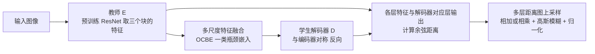

---
Title | paper ReverseDistillation
-- | --
Created @ | `2026-11-24T08:14:38Z`
Updated @| `2026-11-24T08:14:38Z`
Labels | ``
Edit @| [here](https://github.com/junxnone/aiwiki/issues/749)

---
# ReverseDistillation 反向蒸馏

- **Reverse Distillation**：Anomaly Detection via Reverse Distillation from One-Class Embedding，论文 [arXiv 2201.10703](https://arxiv.org/pdf/2201.10703v2.pdf)（CVPR 2022）
- 类型：Segmentation
- 思路：与 [STFPM](/0324_paper_STFPM) 相反，**学生是解码器**：教师（编码器）把图像压缩成低维的「单类嵌入」，学生（解码器）从这个嵌入**反向重构**教师各层的特征；正常样本重构得好，异常样本重构不出来
- 改进了传统师生结构中「教师与学生结构相同、输入相同」导致学生也能模仿异常的问题

## 原理

下图是 Reverse Distillation 的结构：



图中：

- 教师 $E$ 是 ImageNet 预训练的 ResNet，取三个 block 的特征；这些特征经过 **OCBE**（One-Class Bottleneck Embedding，一类瓶颈嵌入）的多尺度特征融合块拼接并压缩成一个低维表示
- 学生解码器 $D$ 与教师结构对称但方向相反，输入是瓶颈嵌入，输出与教师各层对应的特征；训练时用**余弦距离**强迫解码器各层的输出与教师对应层相似
- 测试时同样计算各层的余弦距离，上采样到图像尺寸后相加（或相乘）得到总的距离图，再经高斯模糊和 min-max 归一化得到最终的异常图

损失与异常图：

$$
\mathcal{L} = \sum_{k=1}^{K}\frac{1}{H_k W_k}\sum_{h, w}\Big(1 - \frac{f_E^{k}(h, w)^\top f_D^{k}(h, w)}{\lVert f_E^{k}(h, w) \rVert\,\lVert f_D^{k}(h, w) \rVert}\Big), \qquad A = \sum_{k=1}^{K}\text{Up}\big(M^{k}\big)
$$

其中：

- $k$：第 $k$ 个特征层（共 $K=3$ 层）；$H_k, W_k$：该层特征图的高和宽；$(h, w)$：空间位置
- $f_E^{k}(h,w)$：教师在第 $k$ 层位置 $(h,w)$ 的特征向量；$f_D^{k}(h,w)$：学生解码器对应层的输出；分式是两个向量的余弦相似度，$1 - \cos$ 即余弦距离
- $M^{k}(h, w) = 1 - \cos\big(f_E^k(h,w), f_D^k(h,w)\big)$：第 $k$ 层的距离图；$\text{Up}$：上采样到输入尺寸；$A$：融合得到的异常图（也可以使用逐元素相乘）

## 为什么「反向」

- 传统师生（如 [STFPM](/0324_paper_STFPM)）中学生与教师结构相似、输入相同，学生往往在异常区域也能模仿教师，造成漏检
- 反向蒸馏中，解码器只能看到教师编码后的**低维瓶颈嵌入**；瓶颈只保留正常模式所需的信息，异常的细节被压缩掉，所以解码器无法重构出异常区域的教师特征，差异变大
- 此外教师编码器与学生解码器结构不同、数据流方向不同，进一步降低了「学生学会了模仿异常」的可能

## 使用与评估

```bash
anomalib train --model ReverseDistillation --data MVTecAD --data.category <category>
```

anomalib README 中的结果（MVTec AD 15 类平均，seed 42）：

Backbone | Image AUROC | Pixel AUROC | Image F1
-- | -- | -- | --
Wide ResNet-50 | 0.985 | 0.969 | 0.976

表中该设置下图像级 AUROC 达到 0.985，高于 [PatchCore](/0535_paper_PatchCore)（0.980）和 [STFPM](/0324_paper_STFPM)（0.876~0.893）；像素级 AUROC（0.969）稍低于 PatchCore（0.980）。指标含义见 [Anomaly Detection Metrics](/0711_ML_Metrics_Anomaly)。

## 优缺点

- **优点**：解决了传统师生模型对异常「模仿过好」的问题；图像级精度高；推理只需一次前向，速度快
- **缺点**：需要训练解码器和瓶颈；对瓶颈容量敏感；仍依赖预训练教师的特征质量

## Reference
- [Anomaly Detection via Reverse Distillation from One-Class Embedding](https://arxiv.org/pdf/2201.10703v2.pdf)
- [anomalib - ReverseDistillation](https://github.com/openvinotoolkit/anomalib/tree/main/src/anomalib/models/image/reverse_distillation)

