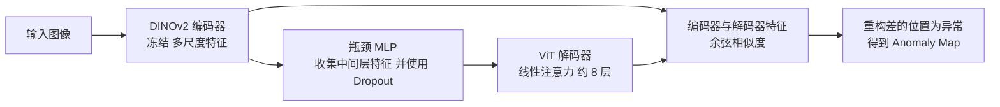

---
Title | paper Dinomaly
-- | --
Created @ | `2026-11-24T08:14:47Z`
Updated @| `2026-11-24T08:14:47Z`
Labels | ``
Edit @| [here](https://github.com/junxnone/aiwiki/issues/753)

---
# Dinomaly 基于 ViT 的特征重构

- **Dinomaly**：Vision Transformer-based Anomaly Detection with Feature Reconstruction，官方代码 [guojiajeremy/Dinomaly](https://github.com/guojiajeremy/Dinomaly)
- 类型：Segmentation
- 思路：用预训练 **DINOv2** 作为编码器，一个**瓶颈 MLP** 加 **Transformer 解码器**做特征重构；通过比较编码器和解码器的特征得到异常分数
- 只训练瓶颈 MLP 和解码器，编码器冻结；结构极简，却在多类别异常检测上很强，是 anomalib 里图像级精度最高的模型之一

## 原理

下图是 Dinomaly 的结构：



图中：

- **编码器**：预训练的 DINOv2 ViT，提取多个中间层的特征（如 ViT-Base 的 12 层中取 8 层）
- **瓶颈 MLP**：把这些中间层特征收集并压缩
- **解码器**：若干层 Transformer（通常 8 层），任务是重构被压缩的中间层特征，训练目标是最大化它与编码器特征的余弦相似度
- 推理时在多个尺度上比较编码器与解码器特征的余弦相似度，**重构得差的位置就是异常**

四个关键设计（来自 README）：

Name | 作用
-- | --
基础 Transformer 模型 | 预训练的 DINOv2 提供通用且有判别力的特征，使模型在各种图案上都有强表现
噪声瓶颈 (Noisy Bottleneck) | 启用 MLP 瓶颈中自带的 Dropout，随机丢弃神经元激活，相当于「伪特征异常」，迫使解码器只能还原正常特征，防止解码器连异常也重构得很好
线性注意力 (Linear Attention) | 解码器中使用线性注意力而不是 Softmax 注意力；线性注意力不容易强聚焦于局部，使注意力散布在整幅图像上，降低解码器把异常区域「原样转发」的可能，也更高效
宽松重构 (Loose Reconstruction) | 宽松约束：把多个编码器层作为一组整体来重构（如分为低语义组与高语义组），给解码器更多自由度；宽松损失：采用难样本挖掘的全局余弦损失，训练中把已重构得很好的特征点的梯度截断，避免模型对所有特征（包括可能对应异常的特征）都过于擅长重构

表中是 Dinomaly 的四个关键设计：它们共同的目的是**防止解码器「太会重构」**，因为重构类方法最大的问题是对异常也能重构。

损失与异常分数：

$$
\mathcal{L} = \frac{1}{G}\sum_{g=1}^{G}\frac{1}{\lvert \mathcal{H}_g \rvert}\sum_{(h,w) \in \mathcal{H}_g}\Big(1 - \cos\big(f_E^{g}(h,w),\ f_D^{g}(h,w)\big)\Big), \qquad A(h,w) = 1 - \cos\big(f_E(h,w),\ f_D(h,w)\big)
$$

其中：

- $g$：编码器层分组的编号，$G$ 为组数（如低语义组和高语义组）；$f_E^{g}$、$f_D^{g}$：该组编码器特征与解码器重构特征；$(h, w)$：Patch 位置
- $\mathcal{H}_g$：参与损失的位置集合，难样本挖掘后只包含**重构较差**的位置（已重构好的位置梯度被截断，不参与优化）
- $\cos(\cdot,\cdot)$：余弦相似度；$A(h,w)$：位置 $(h,w)$ 的异常分数，重构越差（相似度越低）分数越高
- 这里的公式是对 README 所述「宽松重构 + 难样本全局余弦损失」的概括，具体的难样本比例和分组方式以官方实现为准

## 使用与评估

```bash
anomalib train --model Dinomaly --data MVTecAD --data.category <category>
```

anomalib README 中的结果（MVTec AD 15 类平均，seed 42，`max_steps=5000`，batch size 16）：

Metric | 平均值
-- | --
Image AUROC | 0.997
Image F1 | 0.987
Pixel AUROC | 0.984
Pixel F1 | 0.670

表中 Image AUROC 达到 0.997，高于 [PatchCore](/0535_paper_PatchCore)（0.980）和 [Reverse Distillation](/0749_paper_ReverseDistillation)（0.985），在 anomalib 基准中是图像级最高的一个；Pixel F1 为 0.670，说明在像素级定位上仍有提升空间。指标含义见 [Anomaly Detection Metrics](/0711_ML_Metrics_Anomaly)。

## 优缺点

- **优点**：图像级精度极高；结构简单，只训练瓶颈和解码器；多类别场景下表现强；线性注意力使计算更高效
- **缺点**：依赖 DINOv2 这类大型 ViT，显存和推理开销大于小型 CNN 方法；像素级 F1 仍不高；对「宽松重构」等设计的超参数敏感

## Reference
- [Dinomaly (official code)](https://github.com/guojiajeremy/Dinomaly)
- [anomalib - Dinomaly](https://github.com/openvinotoolkit/anomalib/tree/main/src/anomalib/models/image/dinomaly)

