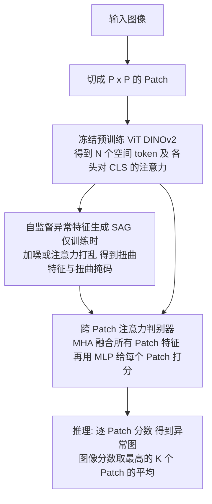

---
Title | paper GeneralAD
-- | --
Created @ | `2026-11-24T08:14:51Z`
Updated @| `2026-11-24T09:21:15Z`
Labels | ``
Edit @| [here](https://github.com/junxnone/aiwiki/issues/755)

---
# GeneralAD 跨领域的异常检测

- **GeneralAD**：Anomaly Detection Across Domains by Attending to Distorted Features，论文 [arXiv 2407.12427](https://arxiv.org/abs/2407.12427)，官方代码 [LucStrater/GeneralAD](https://github.com/LucStrater/GeneralAD)
- 类型：Segmentation
- 问题：现有异常检测方法往往只擅长**高层语义**或**低层工业**其中一个领域的基准，很少能跨领域。**语义异常**是与训练集含义不同的新事物（如自动驾驶里没见过的物体）；**工业异常**是保持语义不变的细微缺陷（如飞机零件上的裂纹）
- 核心思想：一个**判别式**框架，只需**极少的按任务调整**就能在**语义、近分布、工业**三种设置下工作。利用 Vision Transformer 在图像块上训练、**最后一层隐状态保持 Patch 结构**这一特点：用**自监督的异常特征生成模块**，通过对 Patch 特征做**加噪、打乱**等简单操作构造伪异常；再用**基于注意力的判别器**给每个 Patch 打分，既能做图像级检测，也能产生可解释的异常图
- 论文结果：在**十个数据集**上评估，六个达到 SOTA，其余相当（定位和检测任务）

## 方法

图中：

- **特征提取**：图像 $x \in \mathbb{R}^{3\times H\times W}$ 被分成 $N = \frac{H}{P}\times\frac{W}{P}$ 个 $P\times P$ 的 Patch，送入预训练编码器 $\mathcal{F}$，得到空间 token 和一个分类 token。因为分类 token 偏向语义任务，为了通用只使用空间 token $\mathcal{F}(x) = [f_1, \dots, f_N]$；另外提取各个注意力头 $i$ 的注意力图 $\mathcal{A}_i(x) = [a_1, \dots, a_N]$（每个 Patch 相对分类 token 的注意力值），以便利用更有信息的区域
- **自监督异常特征生成 (SAG)**：Patch 表示具有语义，能泛化到没见过的正常输入；但要细化泛化边界通常需要异常分布，这在设置里不可得。已有工作（如 FITYMI）用早期训练的扩散模型输出构造，成本高，也解决不了工业场景常见的结构性/逻辑性异常。SAG 接收 $\mathcal{F}(x)$ 和 $\mathcal{A}_i(x)$，在特征空间里**往随机位置加噪声，或把特征复制/打乱到被强烈关注的区域**，生成异常：$\mathcal{F}_\epsilon(x) = \text{SAG}(\mathcal{F}(x), \mathcal{A}_i(x))$；扭曲位置的图叫**扭曲掩码**
- **跨 Patch 注意力判别器**：对输入 $I$（可能是 $\mathcal{F}_\epsilon(x)$ 也可能是 $\mathcal{F}(x)$），先用**多头注意力 (MHA)** 融合所有 Patch 的信息，再用 MLP 计算每个 Patch 的异常分数；输入加上位置编码 $E_{pos}$，使判别器知道特征的位置

$$
F_{fused} = \text{MHA}\big(I + E_{pos}\big), \qquad P_{score} = \text{MLP}\big(\text{LN}(F_{fused})\big)
$$

其中：$I$ 是判别器输入（正常特征或扭曲特征）；$E_{pos}$：位置编码；$\text{MHA}$：多头注意力，让每个 Patch 看到所有其他 Patch，因此能发现**语义、结构或逻辑**上的不一致；$\text{LN}$：LayerNorm；$P_{score}$：每个 Patch 的异常分数。**训练目标**是 Patch 分数与扭曲掩码之间的交叉熵：被扭曲的 Patch 为 1，其余为 0。

### 三种扭曲策略

Name | 做法
-- | --
Noise All Patches | 给**所有** Patch 的特征加高斯噪声
Noise Random Patches | 给**随机选出的一部分** Patch 加高斯噪声
Attention Shuffle | 随机均匀选一个注意力头，选出其中注意力值最高（相对分类 token）的 $N$ 个 Patch（$N$ 在 1 到总数之间均匀采样），在特征空间里**打乱**它们

表中是 SAG 的三种扭曲策略：前两种构造类似语义/纹理变化的特征异常；注意力打乱构造**结构性/逻辑性**异常（重要的 Patch 位置被换掉）。不同基准使用不同策略：语义异常基准用 Noise All Patches（噪声 $\epsilon \sim \mathcal{N}(0, 0.25)$）；工业异常基准用 Noise Random Patches；含逻辑异常的 MVTec-LOCO 用 Noise Random Patches 加 Attention Shuffle。

**推理**：推理时关闭特征扭曲模块，用判别器做检测和定位。图像级分数取 Patch 分数中**最高的 $K$ 个的平均**：

$$
I_{score} = \frac{1}{K}\sum_{i=1}^{\text{Top-}K} P_{score}(i)
$$

其中 $P_{score}(i)$ 是第 $i$ 个 Patch 的分数；$K$ 取决于数据集里异常区域的大小：工业数据集的缺陷很小、正常与异常区域的差别可能很小，取 $K = 10$；语义数据集的异常通常覆盖整幅图，取 $K = 1369$（对 DINOv2 即所有 Patch）。

## 实现细节

Name | 设置
-- | --
特征 | DINOv2 最后一层特征，经 DINOv2 自带的 LayerNorm 归一化（对稳定训练很关键）；输入缩放到 518×518；**不做数据增强**，以保持通用性
判别器 | AdamW，初始学习率 0.0005，余弦退火（衰减因子 0.2）；MHA 4 个头；MLP 3 层，隐藏维度 2048，最后一层无偏置；注意力和 MLP 后的 dropout 为 0.1
训练轮数 | 语义异常（数据集大）20 个 epoch，每 250 张图评估一次；近分布与工业异常 160 个 epoch，每个 epoch 评估
推理速度 | 在 NVIDIA A100 上，DINOv2 的 small、base、large 版本分别约 154、52、17 帧/秒

表中是论文设置：论文给出三种大小的 DINOv2 骨干的结果。

## 实验结果

- **数据集（10 个，三类基准）**：语义异常 CIFAR-10、CIFAR-100、Fashion-MNIST、View（一个类为正常、其余类为异常，异常通常覆盖整幅图）；近分布异常 Aircraft-FGVC、Stanford Cars（细微偏差）；工业异常 MVTec-AD、MVTec-LOCO（含逻辑异常）、VisA、MPDD（缺陷只占图像的一小部分）
- **图像级检测（AUROC）**：平均而言，在语义异常基准上比 Transformaly 高约 1%，在近分布基准上高约 6%，并比 FITYMI（用外部数据和扩散模型）高约 1%；工业数据集上，MVTec-LOCO 上分别比 SimpleNet 和 ReContrast 高约 7% 和 3%，MVTec-AD 上与它们持平
- **与具体任务优化的方法比较**：这些对手各自针对特定任务集优化，而 GeneralAD 在所有基准上**一致地表现为领先或相当**，体现了通用性

**anomalib 集成的评估注意事项**（README 的复现记录）：2026-04-10，在 MVTec AD 的 `toothbrush` 类别上，anomalib 的集成在按上游评分方式配置评估后复现了上游结果。关键点：anomalib 默认的 `PostProcessor` 会在 `Evaluator` 计算 AUROC 之前把 `pred_score` 归一化并截断到 $[0, 1]$，该变换 $\big((s - \text{threshold}) / (\max - \min)\big) + 0.5$ 再 `clamp(0, 1)` 是**非单调**的，可能改变排序、从而改变 AUROC；而上游直接在原始判别器 logit 上算 AUROC，没有后处理。要复现上游结果，需要关闭后处理里的归一化。指标含义见 [Anomaly Detection Metrics](/0711_ML_Metrics_Anomaly)。

## 特点与局限

- **优点**：同一方法覆盖语义、近分布、工业三类异常；Patch 级判别，可解释；自监督的特征扰动生成伪异常，**不需要真实异常，也不需要昂贵的扩散模型**；判别器小，推理快（small 版本约 154 FPS）
- **局限**：伪异常是特征级扰动，与真实缺陷有差异；需要为不同基准选择不同的扭曲策略和 $K$（论文称「minimal per-task adjustments」，不是完全零调整）；依赖 DINOv2 特征；评估时后处理对排序的影响需要注意

## Reference
- [GeneralAD: Anomaly Detection Across Domains by Attending to Distorted Features](https://arxiv.org/abs/2407.12427)
- [official code](https://github.com/LucStrater/GeneralAD)
- [anomalib - GeneralAD](https://github.com/openvinotoolkit/anomalib/tree/main/src/anomalib/models/image/general_ad)

