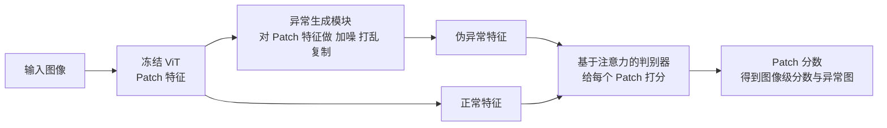

---
Title | paper GeneralAD
-- | --
Created @ | `2026-11-24T08:14:51Z`
Updated @| `2026-11-24T08:14:51Z`
Labels | ``
Edit @| [here](https://github.com/junxnone/aiwiki/issues/755)

---
# GeneralAD 跨领域的异常检测

- **GeneralAD**：Anomaly Detection Across Domains by Attending to Distorted Features，论文 [arXiv 2407.12427](https://arxiv.org/abs/2407.12427)，官方代码 [LucStrater/GeneralAD](https://github.com/LucStrater/GeneralAD)
- 类型：Segmentation
- 思路：一种**判别式**异常检测方法，只需很少的任务调整，就能同时适用于语义异常、近分布异常和工业缺陷三种场景；利用 **Vision Transformer 隐藏状态的 Patch 结构**，用**自监督的异常生成模块**在 Patch 特征上构造伪异常，并训练基于注意力的判别器对每个 Patch 打分

## 原理



图中：

- 冻结的 ViT 提取每个 Patch 的特征；**异常生成模块**对这些 Patch 特征做三类扰动构造伪异常：**噪声注入**、**打乱**（改变 Patch 间的位置关系）和**复制**（用其他 Patch 替换）
- **基于注意力的判别器**对每个 Patch 判断「是否被扰动」，训练目标是区分正常特征和伪异常特征
- 推理时判别器给每个 Patch 一个分数，既得到图像级的异常判定，也得到可解释的异常图

训练目标：

$$
\mathcal{L} = -\frac{1}{N}\sum_{i=1}^{N}\Big[y_i\log p_i + (1 - y_i)\log(1 - p_i)\Big]
$$

其中：

- $N$：Patch 总数；$y_i \in \{0, 1\}$：第 $i$ 个 Patch 的标签，被异常生成模块扰动过为 1，否则为 0；$p_i$：判别器预测第 $i$ 个 Patch 是异常的概率
- 这里写的是二元交叉熵的一般形式；论文的具体损失（如是否使用 Focal 等）请参考原文

## 特点

Name | 说明
-- | --
跨领域 | 语义、近分布、工业三种场景用同一套方法，少量调整
Patch 级判别 | 每个 Patch 一个分数，既能分类也能定位
自监督 | 伪异常由特征扰动构造，不需要真实异常
评估注意 | anomalib README 记录：默认的 `PostProcessor` 会把 `pred_score` 归一化并截断到 [0, 1]，这个变换可能改变排序从而影响 AUROC；复现论文结果时需要关闭归一化，与上游「直接在原始 logit 上算 AUROC」保持一致

表中最后一行是一个有价值的工程细节：这说明评估管线中的后处理（归一化 + 截断）不一定保持排序，复现论文数值时要注意关闭。指标含义见 [Anomaly Detection Metrics](/0711_ML_Metrics_Anomaly)。

## 使用

```bash
anomalib train --model GeneralAD --data MVTecAD --data.category <category>
```

README 记录：2026-04-10 在 MVTec AD 的 `toothbrush` 类别上，anomalib 的集成在按上游评分方式配置评估（关闭归一化）之后，复现了上游结果。README 未给出汇总的 benchmark 数值。

## 优缺点

- **优点**：同一方法覆盖三类异常场景；Patch 级判别可解释；自监督
- **缺点**：伪异常仍是特征级扰动，与真实缺陷有差异；依赖 ViT 特征；评估时要注意后处理对排序的影响

## Reference
- [GeneralAD: Anomaly Detection Across Domains by Attending to Distorted Features](https://arxiv.org/abs/2407.12427)
- [official code](https://github.com/LucStrater/GeneralAD)
- [anomalib - GeneralAD](https://github.com/openvinotoolkit/anomalib/tree/main/src/anomalib/models/image/general_ad)

