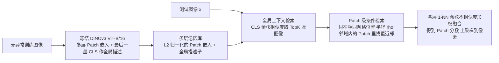

---
Title | paper RAD
-- | --
Created @ | `2026-11-24T08:14:55Z`
Updated @| `2026-11-24T09:21:11Z`
Labels | ``
Edit @| [here](https://github.com/junxnone/aiwiki/issues/757)

---
# RAD 检索式异常检测

- **RAD** - Retrieval-based Anomaly Detection，论文题为 *Is Training Necessary for Anomaly Detection?*，[arXiv 2601.22763](https://arxiv.org/abs/2601.22763)，官方代码 [longkukuhi/RAD](https://github.com/longkukuhi/RAD)
- 类型：Segmentation，**免训练**
- 问题：当前最先进的多类无监督异常检测 (MUAD) 方法都靠训练**编码器-解码器**去重构无异常特征。论文首先指出这类方法在「用重构残差检测异常」上存在内在的**保真度-稳定性两难 (fidelity-stability dilemma)**
- 核心思想：**完全放弃重构范式**。RAD 是免训练的方法：把无异常的特征存进记忆库，通过**多级检索**，把测试 Patch 与记忆库匹配来检测异常；论文还**理论证明**检索式分数是重构残差分数的上界
- 论文结果：在四个基准（MVTec-AD、VisA、Real-IAD、3D-ADAM）、标准和少样本设置下都达到 SOTA；在 MVTec-AD 上，**只用一张无异常图像**就能达到 **96.7%** 的像素 AUROC，而全数据下为 98.5%
- 与 [PatchCore](/0535_paper_PatchCore)、[AnomalyDINO](/0756_paper_AnomalyDINO) 同属记忆库方法，区别是：先**检索相似图像**，再在**位置相近**的局部范围内匹配 Patch；对比重构类的 [Dinomaly](/0753_paper_Dinomaly)

## 保真度-稳定性两难（重构方法的内在问题）

论文从表示空间的角度分析编码器-解码器方法：

- 当前 SOTA 重构方法冻结预训练编码器 $\Phi$，学习一个解码器 $\Psi_\theta$ 去近似反转一个会损失信息的瓶颈 $B$，目标是从被瓶颈处理后的表示重构编码器特征。为防止解码器简单复制 $\Phi(n)$，瓶颈会随机移除或扰动部分表示，使解码器必须从学到的正常模式推断缺失的信息。重构路径 $R_\theta(n) = \Psi_\theta\big(B(\Phi(n))\big)$，解码器在无异常 Patch 上训练：

$$
\theta^* = \arg\min_\theta \sum_{n \in \mathcal{D}^{patch}_{norm}} \ell_{rec}\big(\Phi(n),\ R_\theta(n)\big)
$$

其中 $\mathcal{D}^{patch}_{norm}$ 是无异常训练图像切出的 Patch 集合，$\ell_{rec}$ 是重构损失。

- 论文证明：①即使在无异常 Patch 上，最优的重构映射也通常**偏离恒等映射**，所以残差因不可避免的重构误差而**不为零**；②再研究「强制高保真地重构良性的特征变化」与瓶颈如何相互作用，推出一个把这一要求与解码器**局部增益**联系起来的下界，揭示了残差分数里**保真度与稳定性的根本权衡**：要保真（正常也重构得好）就需要解码器增益大，但这样异常也会被一并重构好，不稳定
- 而 RAD 的分数是到记忆库经验支撑集的距离：存下的每个正常嵌入 $z_i$ 的最近邻是它自己，所以 $S_{ret}(z_i) = 0$，**对无异常嵌入的经验重构误差为零**；$S_{ret}(z) := \min_{u \in \gamma}\lVert z - u\rVert$（$\gamma$ 为存下的正常嵌入集合）是「到集合的距离」函数，非负、仅在 $\gamma$ 上为 0、在特征空间 1-Lipschitz（引理 4.1），具有这些基本正则性的任何其他异常分数逐点都不大于它。所以对固定的编码器和数据，检索在稳定（非扩张）的特征空间分数里达到了最优的经验保真度，而编码器-解码器方法还要额外承担解码器的近似误差

## 方法

RAD 分三步：多层记忆库 → 全局上下文检索 → Patch 级条件检索与评分：

图中：

- **多层记忆库**（3.1）：不同编码器层给出互补的相似度信号。浅层和中层保留边缘和小的几何偏差等高频局部信息，对细微表面变化敏感；深层聚合更大感受野，对低层外观更不变，相似度反映语义与结构的一致性。在多类设置下这种互补性很关键：划痕、小凹陷适合浅/中层特征，较大的结构变化或错位适合深层语义特征。具体做法：对每张无异常图像 $x_i$，取最后一层的 [CLS] token 做 $\ell_2$ 归一化作为**全局描述子** $g(x_i)$；并存下选定层集合 $\mathcal{L}$ 中每一层所有经 $\ell_2$ 归一化的 Patch 嵌入 $z^{(\ell)}(x_i) \in \mathbb{R}^{d_\ell}$
- **全局上下文检索**（3.2）：朴素的做法是把测试 Patch 与记忆库中**所有**正常 Patch 比较。在 MUAD 下有两个问题：语义不相关类别的 Patch 可能成为最近邻（语义错配）；候选集随记忆库总量线性增长，计算量大。所以 RAD 先做粗粒度的全局检索，把记忆库过滤成少数语义兼容的参考图像
- **Patch 级条件检索**（3.3）：在检索到的子集上，对每一层独立做 Patch 检索和评分，最后融合

全局检索：用最后一层 [CLS] 特征的余弦相似度，选出最相似的 $K$ 张无异常图像：

$$
\text{sim}_i(x) := \langle g(x),\ g(x_i) \rangle, \qquad \mathcal{N}_K(x) := \text{TopK}\big(\{\text{sim}_i(x)\}_{i=1}^{N}\big)
$$

其中 $g(\cdot)$ 是 $\ell_2$ 归一化的 [CLS] 全局描述子，内积即余弦相似度；$\mathcal{N}_K(x)$ 是与 $x$ 最相似的 $K$ 张无异常图像的索引集合。之后所有层上的 Patch 比较都**限制**在 $\mathcal{N}_K(x)$ 的图像里。只用最后一层的 [CLS] 是因为它是语义丰富的全局摘要，能从异质记忆库里检索出全局相似的少数参考图，抑制不相关类别的特征；低、中层信息已由多层 Patch 记忆库处理，再加早期层的全局 token 只增加复杂度。

**空间条件（位置感知）**：异常检测里物体通常大致对齐，图像不同区域对应不同的功能部件（如螺丝与背景）。把测试 Patch 与任意位置的正常 Patch 匹配，可能配对到语义不相关的部件，扭曲异常分数。所以 Patch 匹配应**以其所在位置为条件**：一个 Patch 只与来自同一网格位置**局部邻域**内的无异常 Patch 比较。这样既保留粗略的空间语义，又对小的错位和视角变化保持鲁棒：

$$
\mathcal{P}_\rho(t) := \big\{n : \lVert (h_n, w_n) - (h_t, w_t) \rVert_\infty \le \rho\big\}, \qquad \mathcal{M}_\ell(x, t) := \big\{z^{(\ell)}_n : n \in \mathcal{P}_\rho(t),\ i(n) \in \mathcal{N}_K(x)\big\}
$$

其中：$t \leftrightarrow (h_t, w_t)$ 是测试 Patch 在 $H \times W$ 网格中的位置；$(h_n, w_n)$ 是记忆库中第 $n$ 个正常 Patch 的网格坐标；$\rho \in \mathbb{Z}_{\ge 0}$ 是邻域半径；$\mathcal{P}_\rho(t)$ 是 $t$ 周围 $\ell_\infty$ 半径为 $\rho$ 的无异常 Patch 集合；$i(n)$ 是 Patch $n$ 所属的图像索引；$\mathcal{M}_\ell(x,t)$ 是同时满足「**语义（来自检索到的图像）**」和「**空间（位置相近）**」对齐的候选集。

**多层评分**：对第 $\ell$ 层的测试 Patch 嵌入 $z^{(\ell)}_t(x)$，用 1-NN 余弦不相似度作为该层分数；再对各层加权融合：

$$
S_\ell(x, t) := 1 - \max_{z \in \mathcal{M}_\ell(x, t)}\big\langle z^{(\ell)}_t(x),\ z \big\rangle, \qquad S(x, t) := \sum_{\ell \in \mathcal{L}} w_\ell\, S_\ell(x, t),\quad w_\ell \ge 0,\ \sum_\ell w_\ell = 1
$$

其中：$\langle\cdot,\cdot\rangle$ 是 $\ell_2$ 归一化嵌入的内积；$S_\ell$ 越小，说明测试 Patch 在候选集里有很近的邻居，被检索到的正常特征充分「支持」；偏离局部无异常分布的 Patch 的 $S_\ell$ 更大；$w_\ell$ 是各层权重，每一层像一个在自己特征空间里的专家。融合后的 Patch 分数上采样到像素用于定位，图像级分数由池化得到。

## 实现细节与实验

Name | 设置
-- | --
编码器 | 冻结 DINOv3 ViT-B/16；从第 4、7、10、12 层（anomalib README 按 0 起算写作 3、6、9、11）取 Patch token 做多级匹配
邻域半径 $\rho$ | MVTec-AD 为 1，VisA 为 2，Real-IAD 为 0，3D-ADAM 为 1（适应不同程度的视角变化）
数据集 | MVTec-AD（15 类）、VisA（12 类，背景更杂乱、细微异常）、Real-IAD（151230 个样本，类内差异大）、3D-ADAM（RGB+3D 多相机扫描）
指标 | 7 个：图像级 AUROC / AP / F1-max，像素级 AUROC / AP / F1-max / AUPRO（见 [Anomaly Detection Metrics](/0711_ML_Metrics_Anomaly)）

表中是论文设置。注意 anomalib 说明：位置感知匹配按网格位置比较，所以拟合和推理的图像尺寸必须一致；不一致时用 `use_positional_bank=False`。

- **标准多类设置**（论文 5.2）：对比重构类 RD4AD、UniAD、DiAD、MambaAD、Dinomaly、OmiAD 和嵌入类 SimpleNet、DeSTSeg。RAD 在三个基准上均达 SOTA，**像素级定位提升尤其明显**：MVTec-AD 上比此前最优的 Dinomaly 在 P-AP / P-F1max 上高 6.3 / 2.1，图像级持平；VisA 上 P-AP / P-F1max 高 2.1 / 1.8；Real-IAD 上图像级高 1.9 / 1.3 / 0.2，像素级高 0.2 / 10.9 / 7.1 / 2.2。论文观察到趋势：**无异常训练集与测试集的比例越小，RAD 的优势越大**（MVTec-AD 2.1、VisA 4.0、Real-IAD 0.29），最数据稀缺的设置里增益最大，体现了数据效率和小样本鲁棒性。在 3D-ADAM（仅用 RGB）上比 Dinomaly 在 P-F1max / I-F1max 上高 12.5 / 2.3
- **少样本多类**（论文 5.3）：按 IIPAD 的多类 MVTec-AD 协议，每类至多 $Y$ 张无异常参考图。在像素 AUPRO 上，$Y \in \{1, 2, 4\}$ 时 RAD 比统一模型 Dinomaly 高 16.8 / 16.9 / 14.9，并超过所有少样本专用方法，比最强的 IIPAD 高 2.1 / 2.7 / 2.7；$Y = 1$ 时像素 AP / F1 分别高 29.5 / 25.7。结论：RAD 是即插即用的少样本检测器，没有任何少样本训练，也超过专用少样本方法
- **冷启动数据缩放**（论文 5.4）：用 Dinomaly 作对比，$\tau$ 是无异常数据使用比例。单类缩放里，$\tau = 0.05$ 时图像级检测已近乎饱和，$\tau$ 从 0.05 到 1.00 图像 AUROC 只提升 2.5，而像素级定位还会随数据增加而提升（Pixel AP 增加 5.1）；$\tau = 0.05$ 时相比 Dinomaly，Pixel AP、F1、AUPRO 分别提升 15.9、11.2、7.1。多类缩放中 $\tau = 0.05$ 时图像 AUROC 高 4.9、Pixel AP 高 16.8。**增量类缩放**：固定四个较难的类别（carpet、metal_nut、toothbrush、leather）并逐渐引入新类别 transistor：$\tau = 0.01$、只有两张 transistor 无异常图时，RAD 的 Pixel AUROC 已达 93.0（占其全量性能的 95.4%），相对 Dinomaly 的 Pixel AP 高 20.6，AUPRO 高 17.2。说明 RAD 对新类别「上线」时样本效率很高，只需极少几张无异常样本就能恢复大部分最终性能
- **编码器质量与分辨率**（论文 5.5）：RAD 免训练，性能由冻结编码器的质量和输入保真度决定。在 224×224 下，**DINOv3 的 P-AUPRO 最高**，其后依次是 DINOv2、iBOT、DINO、D-iGPT、MoCov3 等对比/混合型编码器，再是监督的 DeiT，掩码图像建模（MIM）预训练的 MAE、BEiT、BEiTv2 最低；排序与它们的 ImageNet 线性探测强度基本一致，说明 RAD 可以直接继承基础模型的进步；分辨率升到 448×448 时几乎所有编码器的 P-AUPRO 都提升，排序基本不变

## anomalib 实现要点

- RAD 免训练：拟合只是把记忆库填满，对无异常训练图像过一遍即可
- anomalib 里训练 Rad 时为每个类别建一个记忆库，对应论文的**单类设置**（论文 5.4 的单类缩放）；论文的主结果是**多类 (MUAD) 协议**下报告的，即一个数据集的所有类别共用一个记忆库
- 论文按数据集调整检索图像数 $K$ 和邻域半径 $\rho$
- 记忆库存放所有无异常 Patch 的嵌入并存进 checkpoint，所以 checkpoint 大小和占用内存与训练集规模成线性关系
- README 中的 benchmark 和架构图仍是 TODO

## 特点与局限

- **优点**：完全免训练；理论上检索分数是重构残差分数的上界（论文第 4 节）；全局检索缩小搜索范围并避免语义错配，位置感知抑制错误配对；少样本、冷启动、新类别上线时样本效率很高；能随编码器进步直接受益
- **局限**（论文 6 节）：①保存 Patch 特征记忆库带来**额外的存储成本**；②检索比单次前馈**多出延迟**；论文把这两点视为探索更高效存储与检索方法的契机。另外位置感知匹配要求图像尺寸一致，且依赖对象大致对齐

## Reference
- [Is Training Necessary for Anomaly Detection? (RAD)](https://arxiv.org/abs/2601.22763)
- [official code](https://github.com/longkukuhi/RAD)
- [anomalib - Rad](https://github.com/openvinotoolkit/anomalib/tree/main/src/anomalib/models/image/rad)

