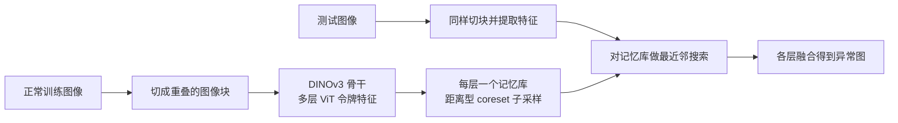

---
Title | paper SuperADD
-- | --
Created @ | `2026-11-24T08:14:57Z`
Updated @| `2026-11-24T08:14:57Z`
Labels | ``
Edit @| [here](https://github.com/junxnone/aiwiki/issues/758)

---
# SuperADD 免训练的类别无关异常分割

- **SuperADD**：Training-free Class-agnostic Anomaly Segmentation，CVPR 2026 VAND 4.0 Workshop 挑战赛（Industrial Track），论文 [arXiv 2605.14808](https://arxiv.org/abs/2605.14808)
- 类型：Segmentation
- 思路：从预训练 **DINOv3** 骨干中，对**重叠的图像块**提取多层 ViT 令牌特征，为每一层建立一个记忆库（用基于距离的 coreset 子采样），再通过对记忆库的**最近邻搜索**检测异常
- 推理方式与 [PatchCore](/0535_paper_PatchCore)、[AnomalyDINO](/0756_paper_AnomalyDINO) 类似，针对高分辨率的 MVTec AD 2 数据集

## 原理



图中：

- 为了处理高分辨率图像，先把图像切成**重叠的块**（`patch_size` 与 `patch_overlap`），对每个块提取特征
- 每一层特征各自有一个记忆库，并通过基于距离的 coreset 子采样压缩
- 推理时对每层做最近邻搜索，再融合得到异常图；训练过程只是建库，**不需要训练网络**

## 使用注意

- 作者使用了非常高的输入分辨率。要复现，把 MVTecAD2 图像缩放 0.625 倍并保持长宽比，参数设为 `patch_size=640`、`patch_overlap=128`，这会占用大量内存
- 作者使用了亮度增强（区间 [0.8, 1.2]），可以通过 anomalib 的数据增强加入 `ColorJitter` 实现
- **阈值问题**：MVTec AD 2 的验证集只有无异常图像，anomalib 默认的 F1 自适应阈值会退化为验证集分数的最大值，而这个最大值随输入分辨率增大，导致多块配置下 F1 分数和可视化异常图失真（AUROC 不受影响）。SuperADD 因此附带 `SuperADDPostProcessor`：阈值设为验证集异常分数的 **95% 分位乘以 1.421**，是一个只由正常图像算出、与分辨率无关的统计量，分位和系数可配置
- 论文还使用了额外的后处理（用多个阈值做形态学闭运算并填充闭合区域、评估时把特征图下采样 4 倍），anomalib 实现中没有包含这些步骤，所以数值会与论文有差异

阈值的形式：

$$
\theta = 1.421 \cdot \text{Percentile}_{95}\big(\{ s_i \}_{i \in \text{val}}\big)
$$

其中：$s_i$：验证集（全是正常图像）中各样本的异常分数；$\text{Percentile}_{95}$：95% 分位数；$1.421$：论文使用的缩放系数（README 引用「follows the original implementation」）；$\theta$：用作二值化判定的阈值。

## 使用

```bash
anomalib train --model SuperADD --data MVTecAD2 --data.category <category>
```

README 中没有给出 benchmark 数值。AUROC、F1 等指标见 [Anomaly Detection Metrics](/0711_ML_Metrics_Anomaly)。

## 优缺点

- **优点**：无需训练；适合高分辨率输入；多层记忆库；阈值与分辨率无关
- **缺点**：高分辨率配置内存占用高；复现论文需要 anomalib 之外的后处理；2026 年的新工作，没有 anomalib 官方基准

## Reference
- [SuperADD](https://arxiv.org/abs/2605.14808)
- [anomalib - SuperADD](https://github.com/openvinotoolkit/anomalib/tree/main/src/anomalib/models/image/super_add)

