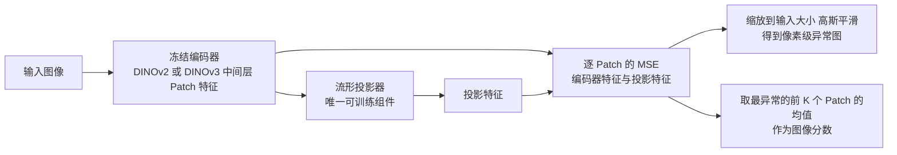

---
Title | paper FoundAD
-- | --
Created @ | `2026-11-24T08:15:01Z`
Updated @| `2026-11-24T08:15:01Z`
Labels | ``
Edit @| [here](https://github.com/junxnone/aiwiki/issues/760)

---
# FoundAD 基础视觉编码器即少样本异常检测器

- **FoundAD**：Foundation Visual Encoders Are Secretly Few-Shot Anomaly Detectors（Zhai 等），论文 [arXiv 2510.01934](https://arxiv.org/abs/2510.01934)，官方代码 [ymxlzgy/FoundAD](https://github.com/ymxlzgy/FoundAD)
- 类型：Segmentation
- 核心观点：**冻结的基础视觉编码器**（DINOv2 / DINOv3）已经包含足够的信息，只要在其上训练一个**轻量的流形投影器**，就能用很少的正常样本检测异常
- 投影器学习把编码器特征映射回**正常图像特征的流形**；推理时，投影特征与编码器输出偏差大（MSE 高）的 Patch 被判为异常

## 原理



图中：

- **冻结编码器**：预训练 ViT，从倒数第 `n_layer` 个块取中间层的 Patch 特征，从不更新
- **流形投影器**：唯一训练的部分；先把编码器特征嵌入到更小的内部维度，经过一叠使用**全局残差跳连**的 Transformer 块（每个块的输出加回**最初**的嵌入特征，而不是上一个块的输出），再投影回编码器的特征维度
- **少样本训练增强**：对少量训练图像做随机翻转/旋转（p=0.3）以及独立的颜色抖动、灰度、高斯模糊（p=0.3），之后再施加 CutPaste，以扩充很小的少样本集合的多样性（可用 `use_few_shot_augmentation=False` 关闭）
- **CutPaste 监督**：训练时用 CutPaste 风格的合成异常（剪切粘贴矩形块或旋转的「划痕」块，加颜色抖动）；每个 batch 有 50% 的概率，把**增强后（离开流形）**图像的特征送入投影器，目标仍是**干净图像**的特征，使投影器学会把偏离流形的输入纠正回流形
- **异常评分**：推理时计算编码器与投影器特征的逐 Patch MSE，缩放到输入分辨率并高斯平滑得到像素级异常图，取最异常的前 `K` 个 Patch 的均值作为图像级分数

$$
s(h, w) = \big\lVert f_E(h, w) - g_\phi\big(f_E(h, w)\big) \big\rVert_2^2, \qquad s_{img} = \frac{1}{K}\sum_{(h,w) \in \text{Top-}K} s(h, w)
$$

其中：

- $f_E(h,w)$：冻结编码器在位置 $(h,w)$ 的 Patch 特征；$g_\phi$：带参数 $\phi$ 的流形投影器，训练目标是把（可能被扰动的）特征映射回正常特征
- $s(h,w)$：Patch 的异常分数，即编码器特征与投影特征的 MSE；正常 Patch 在流形上，投影后几乎不变；异常 Patch 偏离流形，投影后变化大
- $\text{Top-}K$：分数最高的 $K$ 个 Patch 的集合；$s_{img}$：它们的均值，作为图像分数

## 与原论文实现的差异

anomalib 的实现有意在一点上与官方 FoundAD 仓库不同：

- **CutPaste 的放置位置**：官方实现对每个类别计算一个手工调整的前景分割掩码，把块限制在前景内；anomalib 版本把块放在**完全随机的位置**，牺牲少量的还原度，换取更简单、与数据集无关、不需要类别特定调参的增强
- README 指出，这一差异预计会造成与论文数值的差异

## 使用

```bash
anomalib train --model FoundAD --data MVTecAD --data.category <category>
```

评估指标见 [Anomaly Detection Metrics](/0711_ML_Metrics_Anomaly)；README 未给出汇总的 benchmark 数值，请参考论文。

## 优缺点

- **优点**：少样本；可训练参数少（只有投影器）；基础模型特征强；无需异常样本
- **缺点**：依赖大型 ViT；合成异常（CutPaste）与真实缺陷有差异；anomalib 实现的 CutPaste 随机放置会带来与论文的差异

## Reference
- [Foundation Visual Encoders Are Secretly Few-Shot Anomaly Detectors](https://arxiv.org/abs/2510.01934)
- [official code](https://github.com/ymxlzgy/FoundAD)
- [anomalib - FoundAD](https://github.com/openvinotoolkit/anomalib/tree/main/src/anomalib/models/image/foundad)

