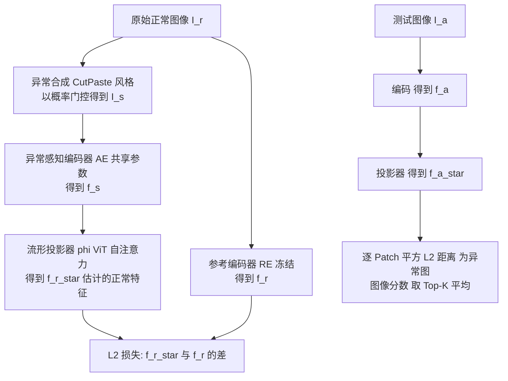

---
Title | paper FoundAD
-- | --
Created @ | `2026-11-24T08:15:01Z`
Updated @| `2026-11-24T09:21:04Z`
Labels | ``
Edit @| [here](https://github.com/junxnone/aiwiki/issues/760)

---
# FoundAD 基础视觉编码器即少样本异常检测器

- **FoundAD**：Foundation Visual Encoders Are Secretly Few-Shot Anomaly Detectors（Zhai 等），论文 [arXiv 2510.01934](https://arxiv.org/abs/2510.01934)，官方代码 [ymxlzgy/FoundAD](https://github.com/ymxlzgy/FoundAD)
- 类型：Segmentation
- 问题：少样本异常检测能简化工业安全检测，但样本有限时很难准确区分正常与异常特征，在**类别无关**条件下更难。基础视觉编码器的大规模预训练让它们学到了正常图像的一般分布
- 核心观察：图像中**异常量**与学到的**嵌入差异**直接相关。据此设计了少样本异常检测器 FoundAD：**学习一个到自然图像流形的非线性投影算子**，这个简单算子能表征并识别图像中的分布外区域
- 论文结果：支持多类检测；**参数量远少于**以往方法而性能有竞争力；用多种基础编码器（包括新的 DINOv3）评估，其中 DINOv3 效果最好；多类训练的单个模型甚至优于针对每类训练的某些方法
- 与同样基于 DINO 系特征的 [AnomalyDINO](/0756_paper_AnomalyDINO)、[Dinomaly](/0753_paper_Dinomaly) 相关；与 [WinCLIP](/0468_paper_WinCLIP) 这类依赖文本提示的少样本方法不同，FoundAD 不用文本

## 方法

整体架构的任务是把**异常图像或正常图像**的潜在表示**投影到基础模型学到的自然图像流形**，再把投影后的表示与原表示比较，**差异大就说明有异常**。关键部件有：异常合成模块、两个相同的编码器、一个投影器。

图中：

- **异常合成**：受 CutPaste 启发的**结构性异常合成**。论文观察到合成异常与真实异常在**像素层面**差别明显，但在**潜在空间**里这种差别变小，说明简单的合成策略就足以把异常特征推离自然图像流形，与投影器的训练目标一致。为提高合成的真实感，用自适应阈值二值化把异常限制在**前景**区域
- **两个编码器**：基础视觉编码器 $\theta$ 提取潜在表示：**异常感知编码器 (AE)** 处理合成的异常图像 $I_s$，**参考编码器 (RE)** 处理原始正常图像 $I_r$；两者**共享参数** $\theta$，保证特征提取一致、嵌入在同一潜空间，使合成图像里的正常 Patch 与原正常图像里的对应 Patch 保持接近，同时突出异常区域的差异
- **流形投影器 (Manifold Projector)**：位于 AE 之后的非线性模块，只需**少样本监督**就能把异常感知特征映射向自然图像流形。因为特征是 token 化的，用**自注意力 ViT** 实现；每个 Transformer 块使用残差连接 $x_{out} = \text{Attn}(x_{in}) + x_{in}$ 来稳定训练并保留输入信息。给定异常图像 $I_s$，编码器给出偏离正常嵌入 $f_r$ 的嵌入 $f_s = \theta(I_s)$，投影器 $\phi$ 输出修正后的嵌入 $f_r^*$，使它与流形上的正常特征 $f_r$ 对齐。与「重构」图像的方法（如 AnomalySD）不同，FoundAD **完全在潜空间**里操作，大幅降低计算量

**训练**：每次迭代给定原始正常图像 $I_r$，用阈值 $\sigma$ 独立地「门控」是否做异常合成：

$$
z \sim \text{Bernoulli}(1 - \sigma), \quad I_s = (1 - z)\,I_r + z\,\text{Syn}(I_r), \quad f_s = \theta(I_s),\ f_r = \theta(I_r), \quad f_r^* = \phi(f_s)
$$

$$
\mathcal{L} = D(f_r^*, f_r) = \frac{1}{N}\sum_{i=1}^{N}\big(f_{r,i}^* - f_{r,i}\big)^2
$$

其中：

- $z$ 是伯努利变量，以概率 $1 - \sigma$ 取 1（做合成）、概率 $\sigma$ 取 0（保持原图，即正常输入）；$\text{Syn}(\cdot)$ 是上述异常合成操作；论文取 $\sigma = 0.5$
- $f_s$、$f_r$：合成图和原图的嵌入；$f_r^*$：投影器把 $f_s$ 映射得到的「估计的正常特征」；$N$：嵌入的 Patch 数；$\mathcal{L}$ 是 L2 损失，让投影后的特征逼近参考的正常特征
- 当 $z = 0$ 时输入就是正常图像，投影器要学会「对正常特征几乎不变」，这一半正是后面「正常 Patch 投影前后差异小」的来源

**推理**：对测试图像 $I_a$，用 AE 提取嵌入 $f_a = \theta(I_a)$，投影器给出 $f_a^* = \phi(f_a)$。逐 Patch 异常分数是特征与其投影后版本的**平方 L2 距离**；图像级异常分数取**最高的 Top-K 个** Patch 分数的平均；像素级异常图由 Patch 分数上采样到原图分辨率得到：

$$
S_{patch} = \frac{1}{N}\sum_{i=1}^{N}\big(f_{a,i}^* - f_{a,i}\big)^2, \qquad S_{image} = \frac{1}{K}\sum_{i=1}^{K}S_{patch,i}
$$

其中 $f_{a,i}$ 是测试图像第 $i$ 个 Patch 的嵌入，$f_{a,i}^*$ 是其投影；$K$ 是参与平均的最高分 Patch 数，论文对 MVTec-AD 取 10、VisA 取 6。正常 Patch 本来就在流形上，投影几乎不变；异常 Patch 偏离流形，被投影器拉回流形，变化大，分数高。

## 实验

- **数据集**：遵循 IIPAD 的协议，在 MVTec-AD（5354 张高分辨率图，15 类，测试 1725 张）和 VisA（12 类，10821 张图，9621 张正常、1200 张异常）上评估；每个少样本设置做三种不同的样本组合（不同随机种子）取平均
- **指标**：图像级 AUROC、AUPR，像素级 AUROC、PRO；涉及假阳性率的曲线面积只算到 FPR = 0.3（见 [Anomaly Detection Metrics](/0711_ML_Metrics_Anomaly)）
- **对比方法**：少样本多类方法 FastRecon、AnomalySD、IIPAD；单类方法 WinCLIP、InCTRL、AnomalyCLIP、PromptAD、LogSAD，以及经典的 SPADE、PatchCore（结果引自 IIPAD）；其中一些单类全样本方法（SPADE、PatchCore）被改造成多类单模型少样本设置
- **实现**：报告基于预训练 **DINOv3 ViT-B** 的结果；输入缩放到 512×512×3；投影器是 **6 层**的 ViT；Adam，权重衰减 $1\times10^{-4}$，学习率 0.001；单张 RTX 3090，batch size 8；合成阈值 $\sigma = 0.5$
- **模型大小与速度**：投影器有 **11.8M 可训练参数**；以 DINOv3 为骨干时 FoundAD 共 **97.8M** 参数，平均推理时间 **128.7 ms/图**

**不同编码器的对比**（论文 Table 3，1-shot，MVTec-AD，I-AUROC %）：

Encoder | DINOv3 | DINOv2 | DINO-SigLIP | DINO | SigLIP | CLIP | WideResNet
-- | -- | -- | -- | -- | -- | -- | --
是否有文本预训练 | 否 | 否 | 是 | 否 | 是 | 是 | 否
I-AUROC | **96.1** | 95.2 | 92.5 | 88.3 | 87.8 | 79.0 | 73.1

表中说明：自监督的 DINO 系编码器（尤其 DINOv3、DINOv2）效果最好，WideResNet 最差；带文本的 CLIP 类编码器并不占优。论文还做了不同 DINOv3 层（图 6）和不同投影器设计（表 4）的消融。

## 失败案例

- 测试的螺丝与训练样本**朝向不同**：FoundAD 没有 RegAD 那样的空间变换对齐机制，没能识别出异常
- 缺引脚的晶体管能被**定位**，但**精确分割失败**。论文归因于：①投影器只在正常数据上训练，缺少异常形态学的先验；②投影器受 I-JEPA 启发，是**非生成式**的，限制了它补全异常掩码的能力
- 外观变化严重的 VisA 类别（如蜡烛 candle）等也会失败

## anomalib 实现

anomalib 的 FoundAD 实现与论文有一处**有意的差异**：论文对每个类别（MVTec-AD / VisA 逐类手工调整）计算一个前景分割掩码，把 CutPaste 的块限制在前景；anomalib 里把块放在**完全随机的位置**，用一点还原度换取更简单、与数据集无关、不需要类别特定调参的增强。README 指出这一差异预计会造成与论文数值的差异；README 同时说明在训练数据增强上，还对少样本图像做了翻转/旋转、颜色抖动、灰度或高斯模糊（p=0.3）后再叠加 CutPaste，可以用 `use_few_shot_augmentation=False` 关闭，且「每个 batch 有 50% 概率把离开流形的增强图特征送入投影器、目标仍是干净图特征」，对应上面的 $\sigma = 0.5$。

## 特点与局限

- **优点**：只需少量正常样本；**可训练参数少**（投影器 11.8M）；完全在潜空间操作，比重构图像的方法计算量低；不依赖文本提示或推理时的支持图像；多类统一模型；基础模型特征强（DINOv3 最好）
- **局限**：没有空间对齐机制，物体朝向变化会失败；投影器非生成式，对缺失类异常的**精确分割**能力有限；合成异常（CutPaste）与真实缺陷有差异；依赖大型 ViT 编码器；anomalib 实现的随机放置会带来与论文的差异

## Reference
- [Foundation Visual Encoders Are Secretly Few-Shot Anomaly Detectors](https://arxiv.org/abs/2510.01934)
- [official code](https://github.com/ymxlzgy/FoundAD)
- [anomalib - FoundAD](https://github.com/openvinotoolkit/anomalib/tree/main/src/anomalib/models/image/foundad)

