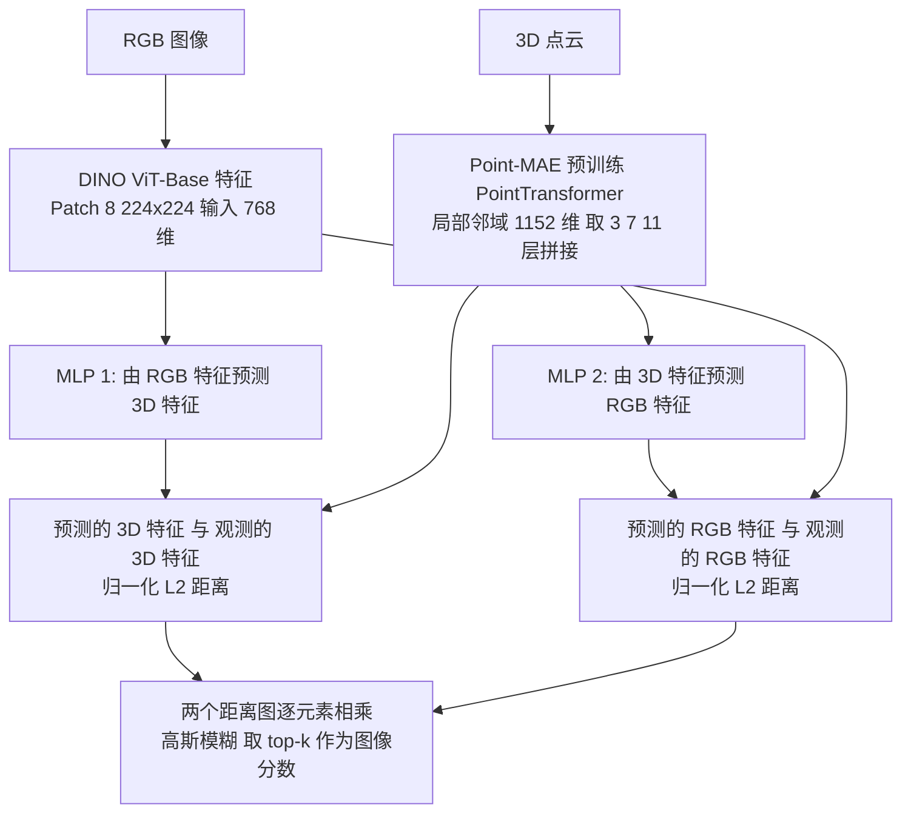

---
Title | paper CFM
-- | --
Created @ | `2026-11-24T08:15:06Z`
Updated @| `2026-11-24T08:15:06Z`
Labels | ``
Edit @| [here](https://github.com/junxnone/aiwiki/issues/762)

---
# CFM 跨模态特征映射

- **CFM**：Multimodal Industrial Anomaly Detection by Crossmodal Feature Mapping，CVPR 2024，论文 [arXiv 2312.04521](https://arxiv.org/abs/2312.04521)，官方代码 [CVLAB-Unibo/crossmodal-feature-mapping](https://github.com/CVLAB-Unibo/crossmodal-feature-mapping)
- 类型：Segmentation
- 思路：一种轻量的**多模态**异常检测方法，同时使用 **RGB 图像**和 **3D 点云**；训练两个小 **MLP**，一个**从 RGB 预测 3D 特征**，一个**从 3D 预测 RGB 特征**；只用正常样本训练，学习正常数据上的跨模态一致性
- 与基于记忆库的多模态方法（M3DM、3D-ADS）不同，CFM 不需要记忆库

## 原理



图中：

- 两个主干（DINO ViT-Base 提 RGB 特征，Point-MAE 预训练的 PointTransformer 提 3D 特征）都冻结，只训练两个映射 MLP
- 正常数据上，RGB 与 3D 的特征相互**可预测**；异常位置，观测到的特征与跨模态预测的特征**不一致**
- 对每个空间位置：分别计算 RGB 方向和 3D 方向「预测特征」与「观测特征」的**归一化 L2 距离**，然后**逐元素相乘**（只有两个模态都不一致的位置分数才高，放大共同出现的异常），再做高斯模糊；图像级分数取 top-k

$$
A(h, w) = d_{rgb}(h, w) \cdot d_{3d}(h, w), \qquad d_{rgb} = \frac{\lVert g_{3d \to rgb}(f_{3d}) - f_{rgb} \rVert_2}{\text{norm}}, \quad d_{3d} = \frac{\lVert g_{rgb \to 3d}(f_{rgb}) - f_{3d} \rVert_2}{\text{norm}}
$$

其中：

- $f_{rgb}$、$f_{3d}$：同一位置的 RGB 特征和 3D 特征；$g_{rgb \to 3d}$、$g_{3d \to rgb}$：两个映射 MLP
- $d_{rgb}$：由 3D 预测出的 RGB 特征与观测的 RGB 特征的距离；$d_{3d}$：由 RGB 预测出的 3D 特征与观测 3D 特征的距离；分母 $\text{norm}$ 为归一化项（使两个方向的尺度可比）
- $A(h,w)$：两者逐元素相乘，作为异常图；相乘使得仅在一个模态内的偶然误差被抑制

## 使用

CFM 需要带 RGB 和深度/点云的多模态数据集（如 MVTec 3D-AD），一次训练一个类别：

```bash
anomalib train --model anomalib.models.CFM --data anomalib.data.MVTec3D --data.category bagel --data.train_batch_size 1 --trainer.devices 1
# 也可用配置文件
anomalib train -c examples/configs/model/cfm.yaml --data anomalib.data.MVTec3D --data.category bagel --data.train_batch_size 1
```

README 没有给出 benchmark 数值，评估指标见 [Anomaly Detection Metrics](/0711_ML_Metrics_Anomaly)。

## 特点

Name | 说明
-- | --
多模态 | 同时使用外观（RGB）和形状（3D），互补
轻量 | 只训练两个小 MLP，两个主干冻结
无记忆库 | 不像 M3DM / 3D-ADS 需要保存大量特征
跨模态一致性 | 用「互相预测」建模正常数据，异常是不一致
数据要求 | 需要对齐的 RGB 与 3D 数据

表中是 CFM 的特点：它把异常检测变成「跨模态预测」任务，思想简单有效。

## 优缺点

- **优点**：轻量；多模态互补；无记忆库；只用正常样本
- **缺点**：需要多模态数据与对齐；两个模态不一致才有高分，只在单一模态可见的异常可能被抑制；依赖预训练的 RGB 与 3D 主干

## Reference
- [Multimodal Industrial Anomaly Detection by Crossmodal Feature Mapping](https://arxiv.org/abs/2312.04521)
- [official code](https://github.com/CVLAB-Unibo/crossmodal-feature-mapping)
- [anomalib - CFM](https://github.com/openvinotoolkit/anomalib/tree/main/src/anomalib/models/image/cfm)

