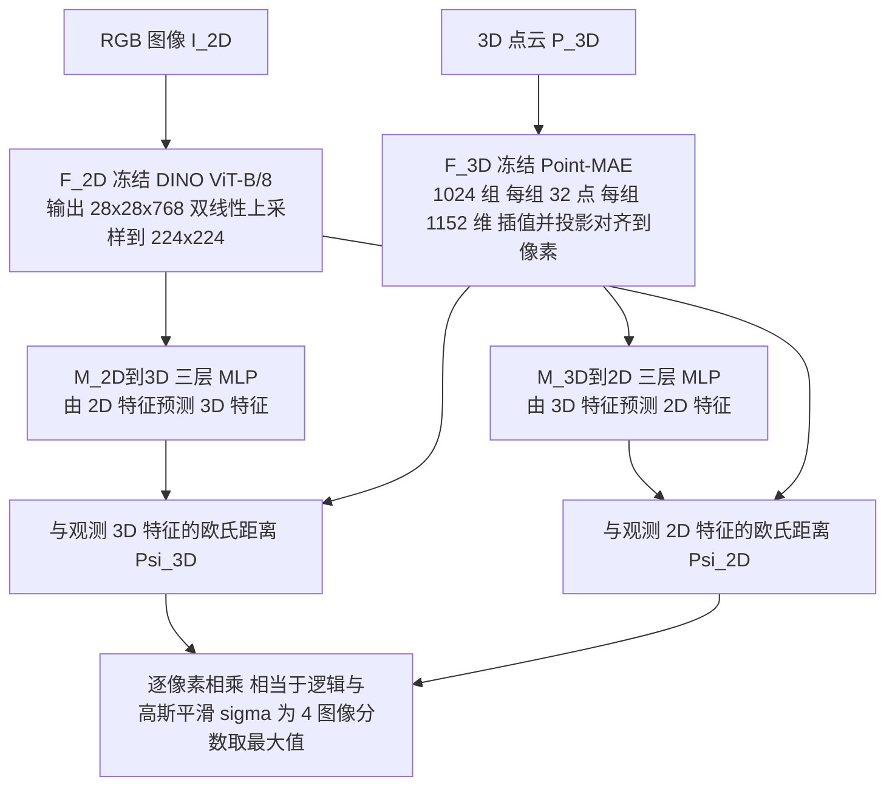

---
Title | paper CFM
-- | --
Created @ | `2026-11-24T08:15:06Z`
Updated @| `2026-11-24T09:20:59Z`
Labels | ``
Edit @| [here](https://github.com/junxnone/aiwiki/issues/762)

---
# CFM 跨模态特征映射

- **CFM**：Multimodal Industrial Anomaly Detection by Crossmodal Feature Mapping，CVPR 2024，论文 [arXiv 2312.04521](https://arxiv.org/abs/2312.04521)，官方代码 [CVLAB-Unibo/crossmodal-feature-mapping](https://github.com/CVLAB-Unibo/crossmodal-feature-mapping)
- 类型：Segmentation，**多模态**（RGB 图像 + 3D 点云）
- 动机：利用点云和图像一起定位异常的方法（BTF、M3DM 等）在工业制造中应用受限，因为用了**记忆库**，导致**内存占用和推理时间大幅增加**
- 核心思想：一个**轻量、快速**的框架，在正常样本上**学习把特征从一个模态映射到另一个模态**，推理时通过**找出观测特征与映射特征之间的不一致**来检测异常
- 论文结果：在 MVTec 3D-AD 上，标准和少样本设置都达到 SOTA 的检测和分割性能，同时推理比以往多模态方法更快、占用内存更少；另提出**层剪枝**技术，在性能略有损失的情况下进一步提升内存和时间效率

## 方法

整体由三部分组成：(i) 一对冻结的特征提取器 $\mathcal{F}_{2D}$、$\mathcal{F}_{3D}$；(ii) 一对特征映射网络 $\mathcal{M}_{2D\to3D}$、$\mathcal{M}_{3D\to2D}$；(iii) 聚合模块。

图中：

- **特征提取与对齐**：对 2D 图像每个像素、3D 点云每个点提取特征，两个提取器都在大型外部数据集上预训练并**保持冻结**。2D 部分：图像 $I_{2D}$（$H\times W\times C$）经 $\mathcal{F}_{2D}$ 得到较小的特征图，再**双线性上采样**得到每个像素位置的特征 $E_{2D}$。3D 部分：点云（$N\times3$）经 $\mathcal{F}_{3D}$ 得到 $N_f$ 个特征向量（许多 3D 提取器只为子集点估计特征，$N_f < N$），每个点的特征取与其中心最近的三个特征向量的**加权和**得到 $E'_{3D}$。然后根据**像素配准**的 3D 数据（标准多模态异常检测设置），把 $E'_{3D}$ 投影到 2D 图像平面得到 $H\times W\times D_{3D}$ 的 $E_{3D}$（没有对应 3D 特征的像素置 0），最后做 $3\times3$ 平滑。最终得到逐像素对齐的两个特征图 $E_{2D}$、$E_{3D}$
- **跨模态特征映射**：用两个**轻量 MLP** 作为映射函数 $\mathcal{M}_{2D\to3D}$（把 $D_{2D}$ 维特征映射为 $D_{3D}$ 维）和 $\mathcal{M}_{3D\to2D}$（反向）。每个网络**逐像素位置独立处理**：

$$
\hat{E}^i_{3D} = \mathcal{M}_{2D\to3D}\big(E^i_{2D}\big), \qquad \hat{E}^i_{2D} = \mathcal{M}_{3D\to2D}\big(E^i_{3D}\big)
$$

其中 $i$ 是像素位置，$E^i_{2D}$、$E^i_{3D}$ 是该位置观测到的 2D、3D 特征，$\hat{E}^i_{3D}$、$\hat{E}^i_{2D}$ 是由另一模态**预测**出的特征；没有 3D 点的像素，对应的预测特征也置 0。

**训练**：两个映射网络在数据集的所有**正常样本**上联合优化，最小化各模态输入特征与预测特征之间的**余弦距离**，逐像素损失为：

$$
\mathcal{L}^i = \Big(1 - \frac{E^i_{2D}\cdot\hat{E}^i_{2D}}{\lVert E^i_{2D}\rVert\,\lVert\hat{E}^i_{2D}\rVert}\Big) + \Big(1 - \frac{E^i_{3D}\cdot\hat{E}^i_{3D}}{\lVert E^i_{3D}\rVert\,\lVert\hat{E}^i_{3D}\rVert}\Big)
$$

其中前一项让 $\mathcal{M}_{3D\to2D}$ 预测的 2D 特征与真实 2D 特征相似，后一项让 $\mathcal{M}_{2D\to3D}$ 预测的 3D 特征与真实 3D 特征相似。

### 原理示意（论文图 3 的玩具例子）

训练时观察到：平坦的 3D 表面上是红色 2D 图案，弯曲的 3D 表面上是蓝色 2D 图案，两个映射网络学会预测这种关系。推理时：

Case | 现象
-- | --
只有 2D 异常（弯曲表面出现黄色图案） | $\mathcal{M}_{3D\to2D}$ 预测蓝色图案的 2D 特征，但观测到黄色；$\mathcal{M}_{2D\to3D}$ 收到训练时没见过的输入，很难输出弯曲表面的 3D 特征，所以 2D 和 3D 都出现预测与观测的不一致
只有 3D 异常（正常 2D 图案出现在异常 3D 表面上） | 两个预测都与观测不一致
两种模态都异常 | 两个输入训练时都没见过，两个跨模态预测都不太可能与观测匹配
**多模态异常**：各模态单独都符合正常分布，但**共现关系异常**（如弯曲表面上出现红色图案） | $\mathcal{M}_{2D\to3D}$ 输出平坦块的 3D 特征，$\mathcal{M}_{3D\to2D}$ 输出蓝色块的 2D 特征，两个预测都与观测不一致；这正是必须用多模态检测的情形

表中说明：这种范式对**各种异常**（单模态异常和多模态共现异常）都有较高敏感度。

**一对多映射的问题**：由于正常样本的变化，两个模态间的映射可能不唯一（如既有红色的平坦面，也有红色的弯曲面），$\mathcal{M}_{2D\to3D}$ 很难学出红色块对应的正确 3D 特征（一对多）；而 $3D \to 2D$ 通常是多对一，$\mathcal{M}_{3D\to2D}$ 可以预测。所以**只有两个预测都与观测不一致才判为异常**，可以避免误检。论文进一步利用 **Transformer 提取的高度上下文化的 2D 和 3D 特征**来缓解一对多：一个上下文化的 2D 特征（如被蓝色和紫色块包围的红色块）倾向于对应某个特定的上下文化 3D 特征（如紧挨着波纹表面区域右侧的平坦块）。因此 $\mathcal{F}_{2D}$、$\mathcal{F}_{3D}$ 都采用 Transformer。

### 聚合

测试时得到两对「提取/预测」特征图 $(E_{2D}, \hat{E}_{2D})$、$(E_{3D}, \hat{E}_{3D})$。先对所有特征向量做 $\ell_2$ 归一化，再用差异函数 $\mathcal{D}$（论文取欧氏距离）逐像素比较得到各模态的异常图，最后用聚合函数 $\mathcal{A}$ 合成：

$$
\Psi_{2D} = \mathcal{D}\big(E_{2D}, \hat{E}_{2D}\big), \quad \Psi_{3D} = \mathcal{D}\big(E_{3D}, \hat{E}_{3D}\big), \quad \Psi = \Psi_{2D}\cdot\Psi_{3D}
$$

其中 $\Psi_{2D}$、$\Psi_{3D}$ 是两个模态各自的异常图，$\Psi$ 是**逐像素乘积**得到的最终异常图。乘积可以理解为**逻辑与**：只有当两个模态的分数都高时，该像素的异常分数才高，即异常检测需要**两个模态共同佐证**，兼顾对所有类型异常的敏感性和对误检的鲁棒性。最终异常图用 $\sigma = 4$ 的高斯核平滑；样本级（图像级）异常分数取 $\Psi$ 的**最大值**。

## 层剪枝

两个冻结提取器都是由 $m$ 层 Transformer 编码器组成，不同层的特征区别在于对原始输入做了多少次自注意力处理，越深的层上下文化程度越高。论文观察到：学习**较浅层**特征之间的映射，能在对效果影响有限的情况下，大幅减少内存需求、提升推理速度。做法：在两个冻结提取器里选一个中间层 $l$，丢弃第 $l+1$ 层到最后一层，于是跨模态网络 $\mathcal{M}^l_{2D\to3D}$、$\mathcal{M}^l_{3D\to2D}$ 在两个编码器的第 $l$ 层之间做映射。例如论文的 **Ours-T**（$l=1$）在第一层之后裁剪；参考模型则在最后一层之间学映射。论文指出 Small 架构的内存需求不到完整模型的一半，仍保持 MVTec 3D-AD 上的 SOTA；Tiny 架构几乎快一倍，且优于 BTF 和 AST。

## 实现与实验

Name | 设置
-- | --
2D 提取器 | 冻结的 **DINO ViT-B/8**（ImageNet 预训练）：224×224 输入，输出 28×28×768
3D 提取器 | 冻结的 **Point-MAE**（ShapeNet 预训练）：对点云用最远点采样得到 1024 组（每组 32 点），每组特征维度 1152
映射网络 | 各三层线性层（除最后一层外接 GeLU）；$\mathcal{M}_{2D\to3D}$ 每层单元数 768、960、1152；$\mathcal{M}_{3D\to2D}$ 为 1152、960、768
训练 | 两个网络联合训练 250 个 epoch，Adam，学习率 0.001
背景 | 与 M3DM 等一致：对点云用 RANSAC 拟合平面，距平面小于 0.005 的点视为背景并丢弃
数据集 | **MVTec 3D-AD**：10 类工业物体，2656 训练样本、294 验证样本、1197 测试样本；**Eyecandies**：合成数据集，10 类食物，10k 训练样本、1k 验证、4k 测试；都提供 RGB 图像和像素配准的 3D 信息
指标 | 图像级 I-AUROC，像素级 P-AUROC，AUPRO；论文除标准的 FPR 积分阈值 0.3（**AUPRO@30%**）外，还计算更严的 0.01（**AUPRO@1%**），因为 0.3 对真实工业应用可能过松、允许太多假阳性（见 [Anomaly Detection Metrics](/0711_ML_Metrics_Anomaly)）

表中是论文设置：特征提取器与 M3DM 相同，映射网络只有三层线性层，所以非常轻量。

- **MVTec 3D-AD**：在检测和分割上都是最佳，**三个平均指标**（I-AUROC、AUPRO@30%、AUPRO@1%）都超过此前的 SOTA M3DM，也在大多数单独类别上领先；论文指出与 M3DM 相比 CFM 给出**明显更锐利**的异常图，与真值缺陷分割的吻合更好，这也解释了 AUPRO@1% 上更大的差距
- **Eyecandies**：与 M3DM 相当，各有两个指标领先；论文指出 P-AUROC 指标几乎饱和，AUPRO@1% 仍有很大提升空间
- **速度与内存**：论文强调推理速度比 M3DM、BTF 等**快得多**、占用内存更少（图 1 以 NVIDIA 4090 GPU 的帧率为速度指标，对比 AUPRO@30%）
- **少样本**：在提出的多模态少样本基准上也取得 SOTA

## anomalib 实现

anomalib 的 CFM 需要同时包含 RGB 和深度/点云的多模态数据集（如 MVTec 3D-AD），一次训练一个类别，README 示例训练时 `train_batch_size` 为 1；README 没有给出 benchmark 数值。

## 特点与局限

- **优点**：轻量，只训练两个小 MLP，提取器冻结；**不需要记忆库**，内存和推理开销远小于 M3DM；多模态互补，能检出单模态异常与共现异常；可剪枝进一步提速；少样本也有效
- **局限**（论文结论）：**只能用于多模态**，不能用于纯 2D 或纯 3D 异常检测，因为训练和测试时都需要两种模态的数据；还需要 RGB 与 3D 数据像素对齐

## Reference
- [Multimodal Industrial Anomaly Detection by Crossmodal Feature Mapping](https://arxiv.org/abs/2312.04521)
- [official code](https://github.com/CVLAB-Unibo/crossmodal-feature-mapping)
- [anomalib - CFM](https://github.com/openvinotoolkit/anomalib/tree/main/src/anomalib/models/image/cfm)

