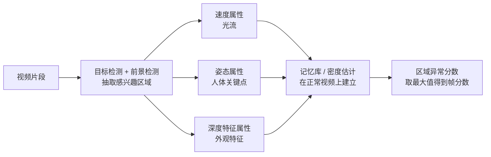

---
Title | paper AIVAD
-- | --
Created @ | `2026-11-24T08:15:10Z`
Updated @| `2026-11-24T08:15:10Z`
Labels | ``
Edit @| [here](https://github.com/junxnone/aiwiki/issues/764)

---
# AIVAD 基于属性表示的视频异常检测

- **AI-VAD**：Attribute-based Representations for Accurate and Interpretable Video Anomaly Detection，作者 Tal Reiss、Yedid Hoshen，论文 [arXiv 2212.00789](https://arxiv.org/pdf/2212.00789.pdf)
- 类型：视频异常检测（anomalib `models/video/ai_vad`，目录没有 README，下面依据源码文档）
- 思路：先用**目标检测**和**前景检测**从视频帧中抽取感兴趣区域，再为每个区域计算**基于属性的表示**，包括**速度**、**姿态**和**深度特征**，然后对这些属性做密度估计，异常即属性分布中的离群点
- 好处是**可解释**：可以指出是哪一个属性（速度、姿态、外观）异常

## 原理



图中：

- 用目标检测（人、车等）和前景检测从视频中提取感兴趣的区域
- 对每个区域计算三类**属性**：**速度**（运动）、**姿态**（人体关键点）、**深度特征**（外观）；这些是低维、语义明确的描述
- 训练时只用正常视频，基于这些属性建立记忆库（anomalib 的 `AiVad` 基于 `MemoryBankMixin`），推理时对每个区域的属性做密度估计，离正常分布远的属性分数高
- 区域分数取最大值得到帧级异常分数

典型使用（源码示例，Avenue 数据集）：

```python
from anomalib.models.video import AiVad
from anomalib.data import Avenue
from anomalib.data.utils import VideoTargetFrame
from anomalib.engine import Engine

datamodule = Avenue(clip_length_in_frames=2, frames_between_clips=1, target_frame=VideoTargetFrame.LAST)
model = AiVad()
engine = Engine()
engine.fit(model=model, datamodule=datamodule)
```

## 特点

Name | 说明
-- | --
属性表示 | 速度、姿态、外观三类低维属性，每一类对应一种可解释的异常（动作异常、姿态异常、物体异常）
密度估计 | 用正常视频的属性分布判断离群
无需标签 | 只用正常视频训练
依赖检测器 | 依赖目标检测、姿态估计和光流，这些组件的质量决定上限

表中是 AI-VAD 的特点：它把视频异常转化为「区域属性的离群」，兼顾精度与可解释性，代价是流水线中有多个预训练模块。评估指标见 [Anomaly Detection Metrics](/0711_ML_Metrics_Anomaly)（视频异常检测常用帧级 AUROC）。

## 优缺点

- **优点**：可解释；无需训练复杂网络；对人、车等目标的行为异常有效
- **缺点**：只关注检测到的目标，对场景整体异常（如突发的光照变化）不敏感；依赖多个预训练模型；流水线较复杂

## Reference
- [AI-VAD: Attribute-based Representations for Accurate and Interpretable Video Anomaly Detection](https://arxiv.org/pdf/2212.00789.pdf)
- [anomalib - ai_vad](https://github.com/openvinotoolkit/anomalib/tree/main/src/anomalib/models/video/ai_vad)

