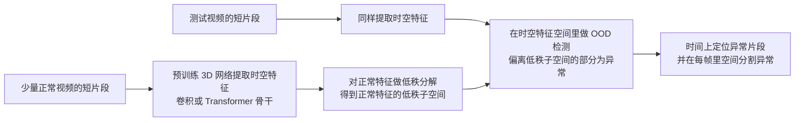

---
Title | paper FUVAS
-- | --
Created @ | `2026-11-24T08:15:13Z`
Updated @| `2026-11-24T09:20:52Z`
Labels | ``
Edit @| [here](https://github.com/junxnone/aiwiki/issues/765)

---
# FUVAS 少样本无监督视频异常分割

- **FUVAS**：Few-shot Unsupervised Video Anomaly Segmentation via Low-Rank Factorization of Spatio-Temporal Features，ICASSP 2025（作者：Jiang Jiaxiang、Ndiour Ibrahima J.、Subedar Mahesh、Tickoo Omesh，Intel）；论文发表在 [IEEE Xplore](https://ieeexplore.ieee.org/document/10887597/)，**没有找到 arXiv 版本**，我这边也没法访问 IEEE 全文，所以下面的内容依据论文摘要和 anomalib 的 README/用法，**没有逐节核对论文细节**（方法的具体公式、超参数、实验数字请以论文为准）
- 类型：视频异常**分割**（anomalib `models/video/fuvas`）
- 要解决的问题（摘要）：**低数据**场景下的视频异常检测。FUVAS 是一种**快速、少样本、无监督**的 VAD 方法：既要找到**时间上**的异常，又要在每一帧里把异常在**空间上分割**出来
- 做法（摘要）：从**预训练的 3D 深度网络**提取特征；然后在**短视频片段的时空特征空间**里做**分布外 (OOD) 检测**，使用**低秩分解 (low-rank factorization)**；方法适用于**任意 3D 骨干**，卷积结构和 Transformer 结构都可以（anomalib README 也说明 FUVAS 支持基于 Transformer 的骨干和基于 CNN 的骨干）
- 与基于属性的 [AI-VAD](/0764_paper_AIVAD) 不同：AI-VAD 以检测到的「目标 + 速度/姿态/外观属性」为中心；FUVAS 直接对**短片段的时空特征**建模，输出像素级的异常分割

## 方法思路（依据摘要和标题的概括）

图中：

- 用冻结的**预训练 3D 网络**从**少量**正常视频的短片段里提取时空特征（时间维和空间维一起），而不是逐帧提取
- 对正常特征做**低秩分解**，用一个低维子空间概括「正常」的时空模式
- 测试时在同一特征空间里做**分布外检测**：偏离该子空间的特征被判为异常；因为特征保留了空间位置，所以能在帧内**分割**出异常区域，同时在时间上定位异常片段

低秩子空间残差的一般形式（这是「低秩子空间 + 残差」思想的通用写法，**不一定是论文里的具体公式**）：

$$
r(x) = \big\lVert (I - U U^\top)(x - \mu) \big\rVert_2
$$

其中：$x$ 是测试特征向量；$\mu$ 是正常特征的均值；$U$ 的列是低秩分解（如 PCA/SVD）得到的正常子空间的正交基；$UU^\top$ 是到该子空间的投影；$r(x)$ 是偏离子空间的残差范数，越大越异常。这与 [FRE](/0742_paper_FRE)（特征重构误差）、[DFM](/0740_paper_DFM) 的 PCA 重构分数是同一类思想：正常特征大部分落在低维子空间内，异常特征的残差大。论文具体采用的分解方式和异常分数，请参考原文。

## anomalib 实现要点（README）

- FUVAS 放在 anomalib 的**视频模型**里，示例在 **UCSD Ped2** 视频数据集上训练：创建 `UCSDped` 数据模块和 `Fuvas` 模型，交给 `Engine` 训练
- 同时支持基于 Transformer 的骨干和基于 CNN 的骨干
- README 没有给出 benchmark 数值；视频异常检测常用**帧级 AUROC** 等指标（见 [Anomaly Detection Metrics](/0711_ML_Metrics_Anomaly)）

## 特点与局限

- **优点**：少样本（少量正常视频即可）；无监督，不需要异常标注；快（摘要强调 fast）；对 3D 骨干的结构不敏感，卷积或 Transformer 都可以；既能时间定位又能空间分割
- **局限**：线性子空间对复杂的正常模式表达有限（基于「低秩分解」这一类方法的一般局限，论文可能给出了具体的缓解方式，未核对）；依赖预训练 3D 骨干的特征质量；论文只有摘要可用，我没能核对其实验设置和数字

## Reference
- [FUVAS: Few-shot Unsupervised Video Anomaly Segmentation via Low-Rank Factorization of Spatio-Temporal Features (ICASSP 2025)](https://ieeexplore.ieee.org/document/10887597/)
- [anomalib - fuvas](https://github.com/openvinotoolkit/anomalib/tree/main/src/anomalib/models/video/fuvas)

