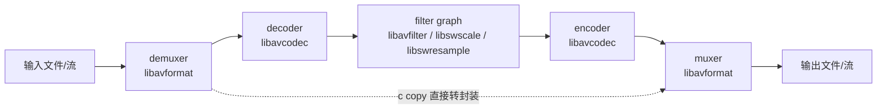

---
Title | Media Tools FFmpeg
-- | --
Created @ | `2026-11-25T16:19:35Z`
Updated @| `2026-11-25T16:19:35Z`
Labels | ``
Edit @| [here](https://github.com/junxnone/aiwiki/issues/774)

---
# FFmpeg

FFmpeg 是跨平台的音视频处理工具集，包含转码、转封装、滤镜、取流、播放和探测。本文整理它的结构和日常最常用的命令。

## 组成

下图展示 `ffmpeg` 命令内部处理一个文件的流水线，对应 [Video Container](@@VCT@@) 中的解封装/封装和 [Video Codec](@@VC@@) 中的编解码：



图中：

- 主路径为：解封装 → 解码 → 滤镜 → 编码 → 封装；每一步由一个库负责
- 虚线表示 `-c copy`：不解码也不编码，数据包直接从 demuxer 送到 muxer，速度快且无损
- 滤镜阶段完成缩放、裁剪、改帧率、像素格式转换 (`libswscale`)、音频重采样 (`libswresample`) 等

可执行程序与库：

名称 | 作用
-- | --
`ffmpeg` | 转码和处理的主程序
`ffprobe` | 探测媒体信息，见 [MediaInfo](@@MI@@)
`ffplay` | 简易播放器，常用于测试流
`libavformat` | 容器格式与协议 (mp4/mkv/rtsp/http 等)
`libavcodec` | 编解码器
`libavfilter` | 滤镜框架
`libswscale` / `libswresample` | 图像缩放与像素格式转换 / 音频重采样

表中：前三个是命令行程序，后四个是其依赖的库，自己写程序调用 FFmpeg 时就是链接这些库。

## 命令格式

```
ffmpeg [全局选项] {[输入选项] -i 输入文件} ... {[输出选项] 输出文件} ...
```

- 选项写在 `-i` 之前作用于输入，写在输出文件名之前作用于该输出
- `-c:v`/`-c:a` 指定视频/音频编码器，`-c copy` 表示直接复制
- `-y` 覆盖输出文件，`-n` 不覆盖
- `-v error` 只显示错误，减少日志

## 常用命令

### 查看信息

```
ffprobe -v error -show_format -show_streams in.mp4
ffmpeg -codecs        # 列出支持的编码
ffmpeg -encoders      # 列出编码器
ffmpeg -pix_fmts      # 列出像素格式
```

### 转码与转封装

```
ffmpeg -i in.avi -c:v libx264 -crf 23 -preset medium -c:a aac out.mp4   # 转码
ffmpeg -i in.mkv -c copy out.mp4                                        # 转封装
```

- `-crf` 为恒定质量，x264 取 $0\sim51$，默认 23，越小画质越高；`-preset` 从 `ultrafast` 到 `veryslow`，越慢压缩率越高
- 低延迟编码常加 `-tune zerolatency`

### 缩放、裁剪、帧率

```
ffmpeg -i in.mp4 -vf scale=1280:-2 out.mp4                # 宽 1280，高按比例，且保持偶数
ffmpeg -i in.mp4 -vf crop=640:480:100:50 out.mp4          # 宽:高:x:y
ffmpeg -i in.mp4 -r 15 out.mp4                            # 改帧率
```

- 缩放使用的插值方法可以用 `scale=...:flags=bicubic` 指定，原理见 [Resize](/0347_Media_Image_Resize)

### 截取与抽帧

```
ffmpeg -ss 00:01:00 -to 00:01:30 -i in.mp4 -c copy clip.mp4   # 截取 1:00~1:30
ffmpeg -i in.mp4 -vf fps=1 frame_%04d.png                      # 每秒抽 1 帧
ffmpeg -i in.mp4 -frames:v 1 first.png                         # 只取第一帧
```

- `-ss` 放在 `-i` 前速度快，但配合 `-c copy` 只能从最近的关键帧开始；需要精确到帧时放在 `-i` 后并重新编码

### 音频

```
ffmpeg -i in.mp4 -vn -c:a copy out.aac                          # 提取音轨
ffmpeg -i in.wav -ar 16000 -ac 1 out_16k.wav                   # 重采样为 16 kHz 单声道
ffmpeg -f s16le -ar 48000 -ac 2 -i in.pcm out.wav              # 裸 PCM 转 WAV
```

- 采样率、声道数、PCM 格式名的含义见 [Audio Basics](@@AB@@)

### 原始图像 (yuv) 与像素格式

```
ffmpeg -f rawvideo -pix_fmt nv12 -s 1920x1080 -framerate 30 -i in.yuv out.mp4   # yuv 转 mp4
ffmpeg -i in.mp4 -pix_fmt yuv420p out.yuv                                       # 解码为 I420 裸数据
```

- 读取裸 yuv 没有文件头，必须手动给出像素格式 `-pix_fmt`、尺寸 `-s` 和帧率；像素格式 (`nv12`、`yuv420p` 等) 的含义见 [YUV](/0121_Media_Image_Color_Model_YUV)

### 取流与推流

```
ffmpeg -rtsp_transport tcp -i rtsp://ip:554/stream -c copy out.mp4     # 录制 RTSP
ffmpeg -re -i in.mp4 -c copy -f flv rtmp://server/live/key              # 推 RTMP
ffplay -rtsp_transport tcp rtsp://ip:554/stream                         # 播放 RTSP
```

- 协议差异与延迟见 [Video Streaming](@@VS@@)

### 硬件加速

```
ffmpeg -hwaccel vaapi -hwaccel_output_format vaapi -i in.mp4 -c:v h264_vaapi out.mp4
```

- 详见 [Video HWCodec](@@VH@@)

## FFmpeg 与 GStreamer 的区别

维度 | FFmpeg | GStreamer
-- | -- | --
定位 | 命令行工具 + 库，偏离线处理 | pipeline 框架，偏实时/嵌入式
使用方式 | 一行命令描述输入输出 | 用 `!` 连接 element，见 [gst-launch](/0110_Media_Tools_GStreamer_gstlaunch)
灵活性 | 滤镜丰富，自定义 pipeline 较难 | 可任意拼接 element、多分支、动态改 pipeline
典型场景 | 转码、截取、批处理 | 摄像头取流、实时处理、播放器

表中：两者功能有重叠，也可以互相配合 (GStreamer 的 `libav` 插件内部就是 FFmpeg 的编解码器)；批处理文件首选 FFmpeg，实时视频链路首选 GStreamer。

## Reference
- [FFmpeg Documentation](https://ffmpeg.org/documentation.html)
- [FFmpeg Wiki](https://trac.ffmpeg.org/wiki)
- [FFmpeg Filters Documentation](https://ffmpeg.org/ffmpeg-filters.html)

