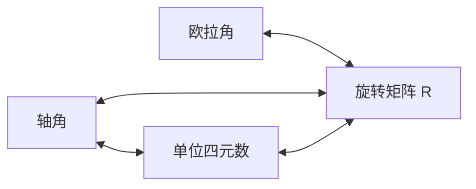

---
Title | RL Robot Rotation
-- | --
Created @ | `2026-11-25T16:22:06Z`
Updated @| `2026-11-25T16:22:06Z`
Labels | ``
Edit @| [here](https://github.com/junxnone/aiwiki/issues/777)

---
# Rotation

三维旋转的四种常用表示（旋转矩阵、欧拉角、轴角、单位四元数）、它们之间的转换，以及各自适用的场景。所属总览见 [RL Robot](https://github.com/junxnone/aiwiki/issues/458)。

## 表示方式对比

下图展示四种表示之间的转换关系：旋转矩阵是「枢纽」，其余三种都可与它互转。

图中：

- 节点：四种表示，$R$ 为 $3\times3$ 旋转矩阵
- 双向箭头：两种表示之间存在解析转换公式
- 关键结论：旋转矩阵是通用的中间形式，做点变换、复合最方便；四元数与轴角之间转换最直接

| 表示 | 参数个数 | 优点 | 缺点 |
| --- | --- | --- | --- |
| 旋转矩阵 | 9（6 个约束） | 无奇异，可直接乘向量与复合 | 冗余，数值漂移后需重新正交化 |
| 欧拉角 | 3 | 直观、参数最少 | 万向锁，依赖旋转顺序 |
| 轴角 | 4（3 + 1） | 几何意义清晰 | 复合不便，$\theta\to0$ 时轴不确定 |
| 单位四元数 | 4（1 个约束） | 无奇异，插值方便 | 双重覆盖，$q$ 与 $-q$ 等价 |

表中：

- **参数个数**：括号内为独立约束数，如旋转矩阵 9 个元素受 6 个正交约束，剩 3 个独立自由度
- 四种表示描述同一个对象 $SO(3)$，自由度都是 3

## 旋转矩阵

$$
SO(3) = \left\{ R \in \mathbb{R}^{3\times 3} \;\middle|\; R^{\top}R = I,\ \det R = 1 \right\}
$$

其中：

- $R$：$3\times3$ 旋转矩阵，列向量是新坐标系的三个基轴在原坐标系中的表示
- $R^{\top}R=I$：列向量两两正交且为单位长度，所以 $R^{-1}=R^{\top}$，求逆几乎零成本
- $\det R=1$：排除镜像（反射）
- $I$：$3\times3$ 单位矩阵

绕坐标轴的基本旋转：

$$
R_x(\theta)=\begin{bmatrix}1&0&0\0&\cos\theta&-\sin\theta\0&\sin\theta&\cos\theta\end{bmatrix},\quad
R_y(\theta)=\begin{bmatrix}\cos\theta&0&\sin\theta\0&1&0\-\sin\theta&0&\cos\theta\end{bmatrix},\quad
R_z(\theta)=\begin{bmatrix}\cos\theta&-\sin\theta&0\\sin\theta&\cos\theta&0\0&0&1\end{bmatrix}
$$

其中：

- $\theta$：旋转角，弧度，右手系下逆时针为正
- 下标 $x,y,z$：旋转所绕的轴；该轴方向的分量保持不变（对应行列中的 $1$）

复合与顺序：

- 绕**固定（世界）坐标系**依次旋转 $A$ 再 $B$：$R=R_B R_A$（左乘）
- 绕**自身（动）坐标系**依次旋转 $A$ 再 $B$：$R=R_A R_B$（右乘）
- 旋转不满足交换律：一般 $R_A R_B\neq R_B R_A$

## 欧拉角与万向锁

按固定顺序绕三个轴依次旋转，例如 $Z$-$Y$-$X$（外旋）：

$$
R = R_z(\psi)\,R_y(\theta)\,R_x(\phi)
$$

其中：

- $\psi$（yaw 偏航）、$\theta$（pitch 俯仰）、$\phi$（roll 横滚）：依次绕 $z$、$y$、$x$ 的转角
- 顺序：不同顺序（共 12 种）得到不同结果，使用前必须约定

万向锁：当 $\theta=\pm\pi/2$ 时，第一、第三个旋转轴重合，只剩 2 个自由度，$\psi$ 与 $\phi$ 只有它们的和（或差）有意义，无法单独确定。表现为姿态接近该点时，欧拉角剧烈跳变、角速度奇异。

## 轴角与 Rodrigues 公式

欧拉旋转定理：任意三维旋转等价于绕某一单位轴 $\hat{\omega}$ 转一个角度 $\theta$。

$$
R = I + \sin\theta\,[\hat{\omega}]_\times + (1-\cos\theta)\,[\hat{\omega}]_\times^2
$$

其中：

- $\hat{\omega}\in\mathbb{R}^3$：单位旋转轴，$\lVert\hat{\omega}\rVert=1$
- $\theta$：绕该轴的旋转角，弧度
- $[\hat{\omega}]_\times=\begin{bmatrix}0&-\omega_3&\omega_2\\omega_3&0&-\omega_1\-\omega_2&\omega_1&0\end{bmatrix}$：反对称矩阵，满足 $[\hat{\omega}]_\times v=\hat{\omega}\times v$
- $I$：单位矩阵

反向求解（由 $R$ 得轴角）：

$$
\theta=\arccos\frac{\operatorname{tr}(R)-1}{2}
$$

其中：

- $\operatorname{tr}(R)$：矩阵的迹（对角线元素之和）
- 当 $\theta=0$ 时轴任意；当 $\theta=\pi$ 时需单独处理符号

## 单位四元数

$$
q = w + x\,i + y\,j + z\,k,\quad w^2+x^2+y^2+z^2=1
$$

与轴角的关系：

$$
q = \left(\cos\frac{\theta}{2},\ \sin\frac{\theta}{2}\,\hat{\omega}\right)
$$

其中：

- $w$：实部（标量部）；$(x,y,z)$：虚部（向量部）
- $i,j,k$：虚部基，满足 $i^2=j^2=k^2=ijk=-1$
- $\hat{\omega},\theta$：对应旋转的单位轴和转角
- 半角 $\theta/2$：所以 $q$ 与 $-q$（转角相差 $2\pi$）表示同一旋转，称双重覆盖

用四元数旋转向量 $v$：

$$
v' = q\,\tilde{v}\,q^{*},\quad \tilde{v}=(0,\ v)
$$

其中：

- $\tilde{v}$：把向量 $v$ 看作实部为 0 的纯四元数
- $q^{*}=(w,-x,-y,-z)$：$q$ 的共轭，对单位四元数即其逆

复合 $q=q_2 q_1$（先 $q_1$ 后 $q_2$）只需 16 次乘法，比矩阵乘法省，且不会累积正交性误差（只需重新归一化）。

球面线性插值 Slerp：

$$
\operatorname{Slerp}(q_0,q_1;t)=\frac{\sin((1-t)\Omega)}{\sin\Omega}q_0+\frac{\sin(t\Omega)}{\sin\Omega}q_1,\quad \cos\Omega=q_0\cdot q_1
$$

其中：

- $t\in[0,1]$：插值参数，$t=0$ 得 $q_0$，$t=1$ 得 $q_1$
- $\Omega$：两四元数在四维单位球面上的夹角
- 作用：以匀角速度沿最短弧平滑过渡姿态；若 $q_0\cdot q_1<0$，先取 $-q_1$ 以走短路径

## 选择建议

- 存储、插值、传感器融合（IMU）：单位四元数
- 点/向量变换、与齐次矩阵结合：旋转矩阵
- 人机交互、可视化：欧拉角（注意避开万向锁）
- 优化、求导、李群方法：轴角（旋转向量 $\theta\hat{\omega}$）

## Reference

- [入门机器人需要的基础知识](https://zhuanlan.zhihu.com/p/655770237)

