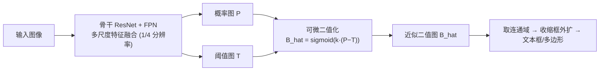

---
Title | ML Tasks Image OCR DBNet
-- | --
Created @ | `2026-11-25T16:23:51Z`
Updated @| `2026-11-25T16:23:51Z`
Labels | ``
Edit @| [here](https://github.com/junxnone/aiwiki/issues/778)

---
# DBNet

DBNet（Differentiable Binarization，2019，AAAI 2020）是基于分割的场景文本检测方法：网络预测每个像素属于文本的概率图，再通过"二值化"得到文本区域。传统分割方法的二值化是固定阈值（如 0.5），不可导，只能放在后处理里；DBNet 把二值化做成**可微**的近似函数，放进网络里一起训练，让网络自己学出每个像素的自适应阈值。这样后处理极其简单，推理很快，对弯曲、任意形状文本也有效，是 PaddleOCR（PP-OCR）检测模块的基础。上游的两阶段流程参见 [OCR](0200_ML_Tasks_Image_OCR)。

## 结构

下图展示 DBNet 的训练和推理数据流，重点看"概率图 + 阈值图 → 近似二值图"这一步：

图中：

- **骨干 + FPN**：骨干网络（论文用 ResNet-18/50）提取多尺度特征，自顶向下融合并统一上采样到输入的 1/4 大小，拼接成一份特征。
- **概率图 $P$**：每个像素属于文本（收缩后的文本区域）的概率。
- **阈值图 $T$**：每个像素的自适应二值化阈值，在文本边界附近取值最高。
- **可微二值化**：用 $P$ 和 $T$ 计算近似二值图 $\hat{B}$，整个过程可导，所以阈值图能被训练。
- **推理**：只需要概率图（或近似二值图）阈值化后取连通域，再把"收缩"的区域向外扩张还原成完整文本框；阈值图分支在推理时可以省掉。

## 可微二值化

标准二值化是不可导的阶跃函数：

$$
B_{i,j} = \begin{cases} 1, & P_{i,j} \ge t \\ 0, & \text{其他} \end{cases}
$$

DBNet 用带放大系数的 sigmoid 近似它：

$$
\hat{B}_{i,j} = \frac{1}{1 + e^{-k\,(P_{i,j} - T_{i,j})}}
$$

其中：

- $(i,j)$：特征图上的像素坐标
- $P_{i,j}$：概率图在该像素的值，$[0,1]$
- $T_{i,j}$：阈值图在该像素的值，由网络学习得到，取代固定阈值 $t$
- $t$：传统方法的固定阈值（如 0.5）
- $\hat{B}_{i,j}$：近似二值图，取值在 $(0,1)$，$P > T$ 时趋近 1，否则趋近 0
- $k$：放大因子，论文取 50；$k$ 越大越接近阶跃函数，同时 $P-T$ 靠近 0 时梯度被放大，对难分的边界像素和错误预测的像素提供更强的梯度，这是它有助于训练的原因

## 标签生成

下面两步都用到 Vatti clipping 算法对多边形做内缩/外扩，偏移量为：

$$
D = \frac{A\,(1 - r^{2})}{L}
$$

其中：

- $A$：多边形（文本实例）的面积；$L$：多边形的周长
- $r$：收缩比例，论文取 0.4
- $D$：多边形边向内（或向外）移动的距离，面积越大、周长越小的文本移动越多，因此不同大小的文本收缩程度成比例

两类标签：

- **概率图标签**：把真值多边形按 $D$ 向内收缩，得到的收缩区域内为 1，其余为 0。收缩可以把相邻、粘连的文本实例分开。
- **阈值图标签**：把真值多边形按 $D$ 向外扩张，得到扩张后的环形带；带内每个像素的标签是它到真值多边形边界的（归一化）距离，边界处最大，远离边界逐渐变小。

推理时则反向操作：取到收缩区域后，用偏移量 $D' = A' r' / L'$（论文 $r'=1.5$）向外扩张还原。其中 $A'$、$L'$ 分别是收缩区域的面积和周长，$r'$ 是扩张比例。

## 损失函数

$$
L = L_s + \alpha\,L_b + \beta\,L_t
$$

其中：

- $L_s$：概率图的损失，二值交叉熵；$L_b$：近似二值图的损失，也是二值交叉熵，两者都用 1:3 的难例挖掘平衡正负样本（文本像素远少于背景）
- $L_t$：阈值图的损失，扩张区域内预测值和标签之间的 L1 距离
- $\alpha, \beta$：权重，论文分别取 1 和 10

## 特点与局限

- 后处理简单，速度快：ResNet-18 版本可以达到实时。
- 能处理弯曲和任意形状文本，输出多边形。
- 局限：对极端密集、重叠的文本以及非常长的文本行，收缩-扩张仍然可能出错；其后继者 DBNet++ 加入了自适应尺度融合模块来缓解多尺度问题。
- 常与 [CRNN](0196_ML_Tasks_Image_OCR_CRNN) 或 SVTR 这类识别器串联成完整 OCR 流水线。

## Reference

- [paper - 2019 - Real-time Scene Text Detection with Differentiable Binarization](https://arxiv.org/abs/1911.08947)
- [paper - 2022 - Real-Time Scene Text Detection with Differentiable Binarization and Adaptive Scale Fusion (DBNet++)](https://arxiv.org/abs/2202.10304)
- [MhLiao/DB - Github](https://github.com/MhLiao/DB)
- [PaddleOCR - Github](https://github.com/PaddlePaddle/PaddleOCR)

