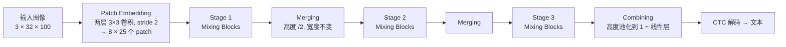

---
Title | ML Tasks Image OCR SVTR
-- | --
Created @ | `2026-11-25T16:23:53Z`
Updated @| `2026-11-25T16:23:53Z`
Labels | ``
Edit @| [here](https://github.com/junxnone/aiwiki/issues/779)

---
# SVTR

SVTR（Scene Text Recognition with a Single Visual Model，2022，IJCAI）是纯视觉 Transformer 的文字识别模型。[CRNN](0196_ML_Tasks_Image_OCR_CRNN) 这类方法是"视觉模型（CNN）+ 序列模型（BiLSTM）+ CTC"，序列模型负担着速度和部署成本；SVTR 的思路是把文字图像切成小块，用局部和全局两种混合注意力直接建模字符内部和字符之间的关系，**只用一个视觉模型 + CTC** 就能识别，不再需要 RNN 或单独的语言/序列模块，在精度和速度上都有优势。PP-OCRv3 的识别模块就是它的轻量化改造（SVTR_LCNet）。总览见 [OCR](0200_ML_Tasks_Image_OCR)。

## 结构

下图展示 SVTR 的三阶段结构以及特征图尺寸的变化：

图中：

- **输入图像**：固定高度（32）、宽度按比例缩放的文字行图像，示意用 $32 \times 100$。
- **Patch Embedding**：用两层步长为 2 的 $3 \times 3$ 卷积（逐步重叠地）把图像切成 patch 并映射为向量，比"一次性切不重叠大块"的 ViT 做法保留了更多局部细节；输出特征图大小约为输入的 1/4。
- **三个 Stage**：每个 stage 由若干 Mixing Block 堆叠而成，Mixing Block 按局部（Local）或全局（Global）两种方式混合 token。
- **Merging**：stage 之间用步长 $2 \times 1$ 的卷积把**高度减半、宽度保持不变**，这样特征图越来越"扁"，每个 stage 的通道数逐步增加；保持宽度是因为宽度方向对应字符序列，需要保留分辨率。
- **Combining**：最后把高度方向池化到 1，经线性层和非线性激活，每个位置输出字符类别概率，交给 [CTC](0189_ML_Tasks_Image_OCR_CTC) 解码。
- 关键结论：整个网络里没有循环结构，全部是卷积和注意力，可并行计算。

## 两类 Mixing Block

- **Local Mixing（局部混合）**：在固定大小的窗口内（论文取 $7 \times 11$ 左右）做自注意力。文字的局部笔画、偏旁部首关系主要在近邻范围内，这类似于字符内部、相邻笔画之间的关系建模，计算量也比全局小。
- **Global Mixing（全局混合）**：在整张特征图上做自注意力，建模字符与字符之间的长程依赖，作用相当于"序列模型"，用来取代 BiLSTM 的上下文建模。
- 组合方式：浅层 stage 以局部混合为主，深层 stage 多用全局混合，并配有 LayerNorm 和 MLP；不同大小的版本（SVTR-T/S/B/L）通过通道数、层数、注意力头数区分。

标准自注意力的计算为：

$$
\mathrm{Attn}(Q,K,V) = \mathrm{softmax}\!\left(\frac{QK^{\top}}{\sqrt{d}}\right) V
$$

其中：

- $Q, K, V$：由 token 经线性变换得到的查询、键、值矩阵，行数为参与计算的 token 数
- $d$：键/查询向量的维度，除以 $\sqrt{d}$ 避免内积过大使 softmax 饱和
- softmax 逐行归一化后给出每个 token 对其他 token 的关注权重
- Local Mixing 只让每个 token 与窗口内的 token 计算注意力，Global Mixing 则与所有 token 计算

## 特点与局限

- 优点：结构简单，不需要 RNN，推理并行度高，对不规则（弯曲、不均匀）文本的鲁棒性较好；在英文和中文数据集上都有竞争力。
- 局限：与 CTC 解码绑定，同样缺少显式的语言建模（后续 SVTRv2 等工作通过语义引导等方式改进）；需要较大规模数据（合成数据 + 真实数据）预训练才能发挥效果。

## Reference

- [paper - 2022 - SVTR: Scene Text Recognition with a Single Visual Model](https://arxiv.org/abs/2205.00159)
- [PaddleOCR - Github](https://github.com/PaddlePaddle/PaddleOCR)

