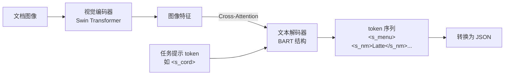

---
Title | ML Tasks Image OCR Donut
-- | --
Created @ | `2026-11-25T16:23:58Z`
Updated @| `2026-11-25T16:23:58Z`
Labels | ``
Edit @| [here](https://github.com/junxnone/aiwiki/issues/781)

---
# Donut

Donut（Document Understanding Transformer，Naver Clova，2021/2022，ECCV 2022）是第一个被广泛采用的 **OCR-free** 文档理解模型：**不经过任何显式的文字检测与识别**，直接把文档图像输入，由模型端到端输出结构化结果（如收据里的菜品、价格字段，或 DocVQA 的答案）。传统流程"OCR → 解析"中 OCR 的错误会向下游传递，且 OCR 本身又慢又贵、不同语言要换模型；Donut 把这两步合成一个模型。总览见 [OCR](0200_ML_Tasks_Image_OCR)。

## 结构

下图展示 Donut 的编码-解码结构，以及它如何输出结构化结果：

图中：

- **视觉编码器**：用 Swin Transformer 把文档图像编码成一组特征向量；使用较高输入分辨率（如 $2560 \times 1920$）才能保证小字清晰可读。
- **文本解码器**：BART 结构的 Transformer 解码器，通过交叉注意力读取图像特征，自回归地生成 token。
- **任务提示 token**：解码器的第一个输入，用来指定要做什么任务（解析、问答、分类），同一模型可以通过换 prompt 完成不同任务。
- **输出 token 序列**：用成对的开始/结束特殊 token 表示字段结构（如 `<s_menu> ... </s_menu>`），解析后就是树状 JSON；所以输出的并不是纯文字，而是带层次结构的标记序列。
- 关键结论：图像里的"检测 + 读字 + 字段对应"全部由一个自回归解码器完成，没有显式的文字框这个中间产物。

## 训练

- **预训练：Reading Text**。任务是让模型按阅读顺序输出图像中的全部文字，用大量合成文档训练。训练数据来自作者提出的合成文档生成器 SynthDoG，可以生成英、中、日、韩等多种语言的带版式文档，用来学习"读字"这个基础能力，同时也支持多语言扩展；另外用到真实文档数据集（IIT-CDIP）。
- **微调**：在下游任务上微调，把任务目标统一成"输出某种 token 序列"：
  - 文档分类（如 RVL-CDIP）：输出类别 token；
  - 文档信息解析（如 CORD 收据）：输出字段层次的 token 序列，再转成 JSON；
  - 文档问答（如 DocVQA）：输入问题，输出答案文本。

## 特点与局限

- 优点：不依赖外部 OCR 引擎，流程简单；训练时用统一的"生成 token"目标，下游任务只改 prompt 和数据；速度和准确率在当年的文档理解基准上都有竞争力。
- 局限：
  - 高分辨率输入使训练和推理成本高；
  - 自回归生成可能出现**幻觉**（输出图像上没有的字）和漏字，长文档更明显；
  - 输入分辨率固定，对超大页面或密集小字有上限；
- 后续的 Nougat（面向学术文档的 OCR-free 方法）、GOT-OCR2.0、DeepSeek-OCR 等沿用了"图像直接生成文本"的路线，但换用更强的视觉-语言基础模型。

## Reference

- [paper - 2021 - OCR-free Document Understanding Transformer](https://arxiv.org/abs/2111.15664)
- [clovaai/donut - Github](https://github.com/clovaai/donut)
- [Hugging Face - Donut](https://huggingface.co/docs/transformers/model_doc/donut)
- [paper - 2021 - TrOCR](https://arxiv.org/abs/2109.10282)

