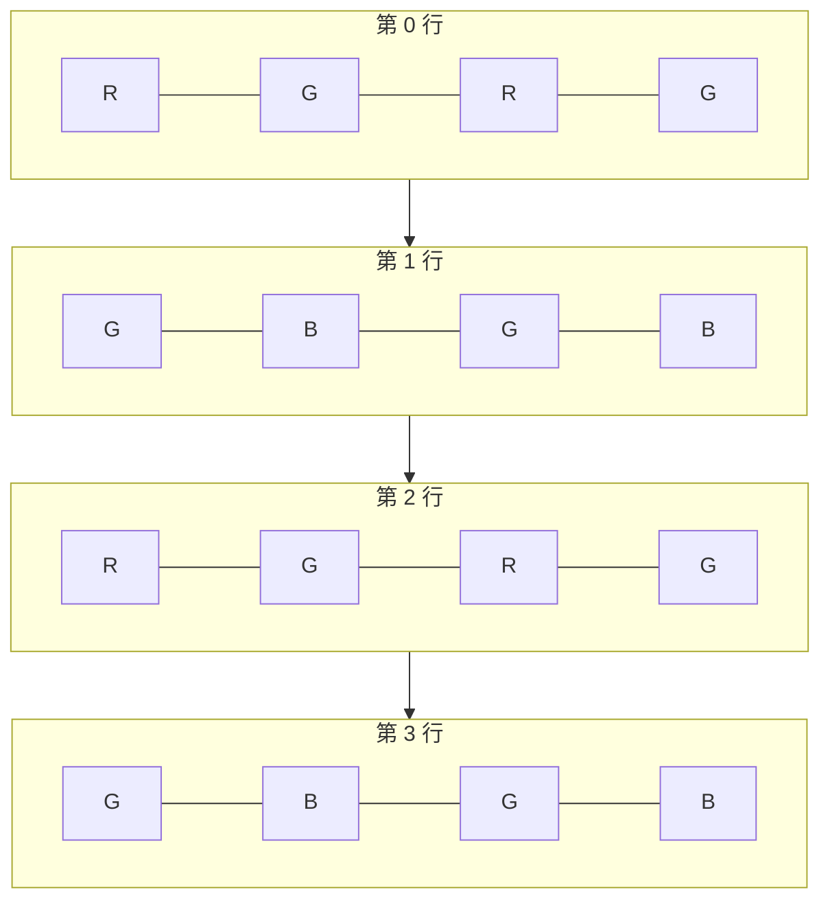

---
Title | Media Image Bayer
-- | --
Created @ | `2026-11-25T16:28:08Z`
Updated @| `2026-11-25T16:28:08Z`
Labels | ``
Edit @| [here](https://github.com/junxnone/aiwiki/issues/784)

---
# Bayer

Bayer 滤色阵列 (CFA)：彩色传感器为什么只有一个通道，Bayer 排列方式，以及去马赛克 (demosaic) 怎样把 RAW 还原成 RGB。

## 为什么是 Bayer

- 传感器上的每个像素只能测光强，不能区分颜色
- 彩色相机的做法是在每个像素前盖一片红、绿或蓝的滤光片，每个像素只记录一种颜色，这层滤光片叫 CFA (Color Filter Array)
- 最常见的排列由 Bryce Bayer 提出：每个 $2\times2$ 单元里 1 个红、2 个绿、1 个蓝；绿色占一半，因为人眼对绿光最敏感，也是亮度的主要来源，见 [Color Model](/0125_Media_Image_Color_Model)
- 结果：相机输出的 RAW 图像每个位置只有一个颜色分量，必须通过插值补全另外两个，这一步叫去马赛克 (demosaic)

下图是 RGGB 排列的 $4\times4$ 区域，及每个位置缺失的分量：



图中：

- 每个方块是一个传感器像素，字母是它前面滤光片的颜色，也是这个位置唯一测到的分量
- 偶数行是 `R G R G`，奇数行是 `G B G B`，整个阵列由 `R G / G B` 这个 $2\times2$ 单元重复铺满
- 红色像素位置缺 G 和 B，蓝色像素位置缺 R 和 G，绿色像素位置缺 R 和 B；去马赛克就是估计这些缺失值
- 绿色像素数量是红或蓝的两倍，所以绿色通道的空间分辨率最高

## 四种排列

名称 | 左上角 $2\times2$ (行优先) | 说明
-- | -- | --
RGGB | `R G / G B` | 最常见
BGGR | `B G / G R` | 与 RGGB 相反
GRBG | `G R / B G` | 第一行从 G 开始
GBRG | `G B / R G` | 同上，R/B 互换

表中：名称按左上角 $2\times2$ 从左到右、从上到下读出的颜色命名。命名对应像素格式 `BayerRG8`、`BayerBG8`、`BayerGR8`、`BayerGB8`，见 [像素格式](/0119_Media_Image_Camera_PixelFormat)；`8/10/12` 表示每像素位数。选错排列会导致颜色整体偏色，例如红蓝互换。

## 去马赛克

最简单的是双线性插值：用邻近同色像素平均。以 RGGB 为例，在红色像素位置 $(i,j)$ 估计 G 和 B：

$$
\hat G_{i,j}=\frac{G_{i-1,j}+G_{i+1,j}+G_{i,j-1}+G_{i,j+1}}{4},\qquad
\hat B_{i,j}=\frac{B_{i-1,j-1}+B_{i-1,j+1}+B_{i+1,j-1}+B_{i+1,j+1}}{4}
$$

其中：

- $(i,j)$：行、列坐标，这里该位置本身测得的是 R
- $G_{i\pm1,j}, G_{i,j\pm1}$：上下左右四个邻居，在 RGGB 里它们都是绿色像素
- $B_{i\pm1,j\pm1}$：四个对角邻居，在 RGGB 里它们都是蓝色像素
- $\hat G,\hat B$：估计出来的缺失分量；$R$ 就是该像素测得的值

问题：边缘处对不同颜色用平均会产生伪影：

- 拉链效应 (zipper)：边缘处出现交替的亮暗点
- 伪彩色 (false color) 和摩尔纹：高频细节处出现不存在的颜色

改进方法会沿边缘方向插值，或利用颜色之间的相关性：

方法 | 思路 | 特点
-- | -- | --
双线性 | 邻近同色平均 | 最快，伪影明显
VNG (Variable Number of Gradients) | 按梯度选择方向 | 质量较好，较慢
边缘感知 (EA) | 先插值绿色，再利用 G 与 R/B 的相关性 | 速度质量折中，OpenCV 提供 `_EA` 版本
AHD | 在水平/垂直两个方向插值后选更平滑的 | 质量高，常见于 RAW 处理软件
学习方法 | 神经网络联合去噪与去马赛克 | 质量最好，开销大

表中：从上到下质量逐渐提高、计算量逐渐增大；实际相机里的 [ISP](@@ISP@@) 通常用硬件实现边缘感知的方法。

## OpenCV 与 GStreamer

```python
import cv2
rgb = cv2.cvtColor(raw, cv2.COLOR_BayerRG2BGR)        # raw 为单通道 (H, W) uint8/uint16
rgb = cv2.cvtColor(raw, cv2.COLOR_BayerRG2BGR_EA)     # 边缘感知
```

- OpenCV 的常量名与我们习惯的 RGGB 命名可能不同，如 `COLOR_BayerBG2BGR` 对应的排列容易搞反，遇到偏色时先换一种常量试，具体对应关系请查阅 OpenCV 文档 `[待核实]`
- 对 16 bit RAW，`cvtColor` 仍可处理，但位深范围需要自己归一化
- GStreamer 里用 `bayer2rgb` 插件，见 [Plugins](/0143_Media_Tools_GStreamer_Plugins)，caps 为 `video/x-bayer,format=rggb`
- 色彩空间转换总览见 [色彩空间转换](/0120_Media_Image_Color_Space_Transform)

## 对图像质量的影响

- Bayer 传感器实际有效的彩色分辨率低于标称像素数，因为每个颜色分量都是靠插值得到的
- 工业检测里常用黑白相机而不是彩色相机：没有 CFA，每个像素都是真实测量，分辨率和灵敏度更高，见 [Sensor](@@SEN@@)
- 若需要彩色又不想去马赛克，可以先对 RAW 缩小 (每 $2\times2$ 合成一个 RGB 像素) 再使用

## Reference
- [Bayer filter - Wikipedia](https://en.wikipedia.org/wiki/Bayer_filter)
- [Demosaicing - Wikipedia](https://en.wikipedia.org/wiki/Demosaicing)
- [OpenCV Color conversions](https://docs.opencv.org/4.x/de/d25/imgproc_color_conversions.html)
- [Pixel Format Naming Convention - GenICam](https://www.emva.org/wp-content/uploads/GenICam_PFNC_2_1.pdf)

