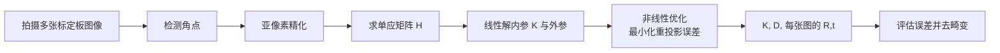

---
Title | Media Image Camera Calibration
-- | --
Created @ | `2026-11-25T16:28:43Z`
Updated @| `2026-11-25T16:30:41Z`
Labels | ``
Edit @| [here](https://github.com/junxnone/aiwiki/issues/787)

---
# Calibration

相机标定：用已知几何的标定板求出相机内参、畸变系数和每张图的外参。本文介绍张正友标定法的原理、重投影误差，以及 OpenCV 的标定流程和常见坑。内参和坐标系的定义见 [相机内参](/0547_Media_Image_Camera_相机内参) 和 [相机坐标系](/0548_Media_Image_Camera_相机坐标系)。

## 要解决的问题

- 需要知道：空间点和图像像素之间的对应关系，即内参矩阵 $K$、畸变系数 $D$，以及相机相对世界的外参 $R,t$
- 用途：去畸变、测量物体尺寸、三维重建、SLAM、机器人手眼标定
- 做法：拍摄多张已知尺寸的标定板 (棋盘格)，利用角点在世界坐标和图像坐标中的对应关系，求解未知参数

下图是标定的整体流程：



图中：

- 前三步是图像处理：从每张图找到棋盘格内角点，并用 `cornerSubPix` 精化到亚像素精度
- 中间两步是几何求解：每张图的标定板平面到图像平面是一个单应矩阵，利用其约束先线性求出初值
- `非线性优化` 同时调整 $K$、$D$ 和所有外参，使重投影误差最小，是最终结果的来源
- 最后用重投影误差评估质量，并可用 $K,D$ 对图像去畸变

## 原理 (张正友标定法)

标定板是平面，设世界坐标系建在板上，板上点的 $Z_w=0$。第 $i$ 张图中，板上点 $(X,Y)$ 到像素 $(u,v)$ 的映射为：

$$
s\begin{bmatrix}u\\v\\1\end{bmatrix}=K\begin{bmatrix}r_1&r_2&t\end{bmatrix}\begin{bmatrix}X\\Y\\1\end{bmatrix}=H\begin{bmatrix}X\\Y\\1\end{bmatrix}
$$

其中：

- $s$：任意尺度因子
- $K$：内参矩阵 ($3\times3$)，见 [相机内参](/0547_Media_Image_Camera_相机内参)
- $r_1,r_2$：旋转矩阵 $R$ 的前两列；$t$：平移向量；板平面 $Z_w=0$，所以 $r_3$ 不出现
- $H=K[r_1\ r_2\ t]$：单应矩阵 ($3\times3$)，可由 4 个以上的角点对应用最小二乘估计

旋转矩阵的列向量满足正交且模长为 1，即 $r_1^\top r_2=0$，$\|r_1\|=\|r_2\|$。把 $r_1=K^{-1}h_1$，$r_2=K^{-1}h_2$ 代入：

$$
h_1^\top K^{-\top}K^{-1}h_2=0,\qquad
h_1^\top K^{-\top}K^{-1}h_1=h_2^\top K^{-\top}K^{-1}h_2
$$

其中：

- $h_1,h_2$：$H$ 的前两列
- $K^{-\top}K^{-1}$：只含内参的对称矩阵，每张图提供 2 个关于它的线性方程
- 未知的内参 (5 个：$f_x,f_y,c_x,c_y$ 和 skew) 需要多张图叠加方程才能解出：不同姿态下至少 3 张图 (若 skew 设为 0，2 张图即可)；实际使用 15~30 张以提高稳定性

线性解之后用非线性优化最小化重投影误差：

$$
\min_{K,D,\{R_i,t_i\}}\ \sum_{i=1}^{N}\sum_{j=1}^{M}\left\|\,m_{ij}-\pi\!\left(K,D,R_i,t_i,P_j\right)\right\|^2
$$

其中：

- $N$：图像张数；$M$：每张图的角点数
- $m_{ij}$：第 $i$ 张图中第 $j$ 个角点的检测位置 (像素)
- $P_j$：该角点在标定板坐标系中的三维坐标 (已知，由方格尺寸决定)
- $\pi(\cdot)$：投影函数，先用外参把 $P_j$ 变到相机系，再按针孔模型加畸变，最后用 $K$ 得到像素坐标
- 整个式子是检测位置与重投影位置之差的平方和

## 评价指标

$$
\text{RMS}=\sqrt{\frac{1}{NM}\sum_{i,j}\left\|m_{ij}-\hat m_{ij}\right\|^2}
$$

其中：

- $\hat m_{ij}$：用标定结果把 $P_j$ 重新投影到图像上得到的像素位置
- RMS：均方根重投影误差，单位像素；通常小于 0.5 像素算较好，大于 1 像素说明数据或模型有问题
- OpenCV 的 `calibrateCamera` 返回的第一个值就是这个 RMS
- 注意：RMS 低不代表参数一定正确，若角点分布集中、倾角单一，也可能 RMS 很低但焦距估计不准；要同时检查标定板覆盖和参数合理性

## OpenCV 流程

```python
import cv2, numpy as np
pattern = (9, 6)                 # 内角点数 (列, 行), 不是方格数
square = 0.025                   # 方格边长 (米)
objp = np.zeros((pattern[0]*pattern[1], 3), np.float32)
objp[:, :2] = np.mgrid[0:pattern[0], 0:pattern[1]].T.reshape(-1, 2) * square

objpoints, imgpoints = [], []
for f in files:
    gray = cv2.imread(f, cv2.IMREAD_GRAYSCALE)
    ok, corners = cv2.findChessboardCorners(gray, pattern)
    if not ok: continue
    corners = cv2.cornerSubPix(gray, corners, (11, 11), (-1, -1),
                (cv2.TERM_CRITERIA_EPS + cv2.TERM_CRITERIA_MAX_ITER, 30, 0.001))
    objpoints.append(objp); imgpoints.append(corners)

rms, K, D, rvecs, tvecs = cv2.calibrateCamera(objpoints, imgpoints, gray.shape[::-1], None, None)
undist = cv2.undistort(img, K, D)
```

- `pattern` 是棋盘格的内角点数，如 10×7 方格对应 9×6 内角点
- `objp` 的单位决定了外参平移 $t$ 的单位；这里是米
- `rvecs` 是旋转向量，用 `cv2.Rodrigues` 转成旋转矩阵
- 大批量去畸变用 `cv2.initUndistortRectifyMap` + `cv2.remap` 预先算好映射表更快，插值见 [Resize](/0347_Media_Image_Resize)

## 拍摄建议

- 15~30 张，标定板在画面中的位置、距离、倾斜角要有变化，尤其要覆盖图像四角 (畸变最大处)
- 标定板必须平整，打印后贴在硬板上；方格尺寸要实测
- 相机固定焦距、固定光圈，标定后不能再调对焦或变焦，否则内参会变
- 图像要清晰、无运动模糊，曝光合适，见 [Exposure](/0789_Media_Image_Camera_Exposure)
- 标定的分辨率必须与实际使用的分辨率一致；裁剪或缩放后内参要相应换算 ($f,c$ 随缩放比例变化)

## 其他相机

场景 | 做法
-- | --
鱼眼相机 | 使用 `cv2.fisheye.calibrate`，畸变模型为 4 参数
双目相机 | 先各自标定，再用 `cv2.stereoCalibrate` 求两相机间的外参，再做立体校正
手眼标定 | 求相机与机械臂末端之间的变换，使用 `cv2.calibrateHandEye`
RGB-D | RGB 与深度分别标定，再标定二者之间的外参

表中：`场景` 为需要不同处理的相机类型，`做法` 给出对应的 OpenCV 接口。

## Reference
- [A Flexible New Technique for Camera Calibration - Zhang, 2000](https://www.microsoft.com/en-us/research/publication/a-flexible-new-technique-for-camera-calibration/)
- [Camera Calibration - OpenCV Tutorial](https://docs.opencv.org/4.x/dc/dbb/tutorial_py_calibration.html)
- [Camera Calibration and 3D Reconstruction - OpenCV](https://docs.opencv.org/4.x/d9/d0c/group__calib3d.html)

