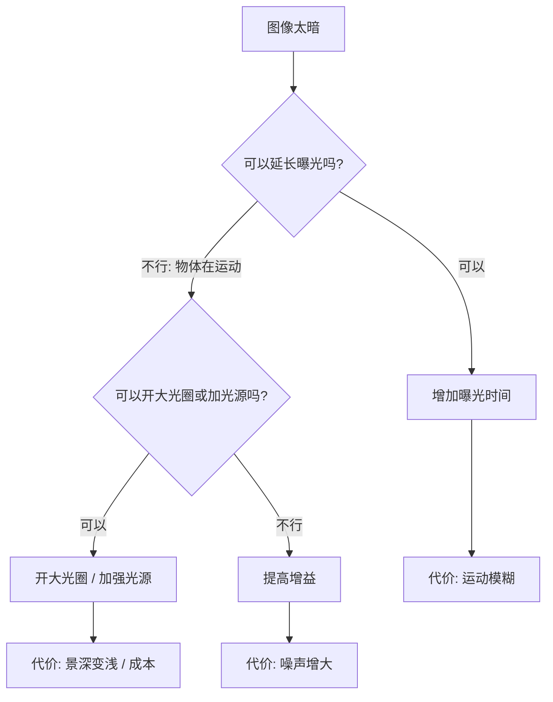
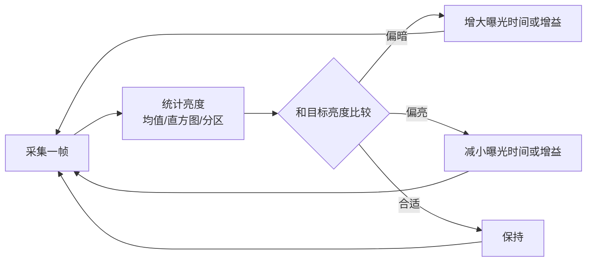

---
Title | Media Image Camera Exposure
-- | --
Created @ | `2026-11-25T16:29:06Z`
Updated @| `2026-11-25T16:29:06Z`
Labels | ``
Edit @| [here](https://github.com/junxnone/aiwiki/issues/789)

---
# Exposure

相机曝光：曝光时间、增益、光圈三者如何共同决定图像亮度，运动模糊和噪声的取舍，自动曝光，白平衡，以及工业相机里的相关参数。

## 曝光三要素

- 曝光时间 (Exposure Time)：传感器收光的时长，越长越亮，运动模糊越大
- 增益 (Gain)：对信号放大，不增加真实的光信息，同时放大噪声
- 光圈 (Aperture)：镜头进光量，越大越亮，景深越浅 (工业镜头常手动固定)

下图说明三者之间的取舍：

图中：

- 从上到下是调整图像亮度时的决策顺序：优先通过不损失画质的手段提亮，实在不行才加增益
- 右侧列出每种做法的代价：延长曝光造成运动模糊，开大光圈使景深变浅，提高增益使噪声变大
- 最推荐的做法是加强光源，既不模糊也不增噪；这也是机器视觉项目里首先要把光源做好的原因

## 公式

图像亮度近似与曝光量成正比：

$$
\text{Brightness}\propto E\cdot t\cdot g,\qquad E\propto\frac{1}{N^2}
$$

其中：

- $E$：传感器上的照度；$N$：光圈数 (f-number，如 f/2.8 中的 2.8)，$N$ 越小光圈越大
- $t$：曝光时间；$g$：增益 (线性倍数)
- 光圈数每增大 $\sqrt2$ 倍 (如 f/2 到 f/2.8)，进光量减半

增益用 dB 表示：

$$
G_{dB}=20\log_{10}(g)
$$

其中：

- $g$：线性增益倍数；$G_{dB}$：增益 (dB)
- $6\text{ dB}$ 约对应 $2$ 倍，$12\text{ dB}$ 约 $4$ 倍

曝光时间导致的运动模糊：

$$
\text{blur}\ (\text{px})=v\cdot t_{exp}
$$

其中：

- $v$：物体在图像上的运动速度 (像素/秒)，可由物体实际速度除以物方分辨率得到，见 [Sensor](@@SEN@@)
- $t_{exp}$：曝光时间 (秒)
- 例：传送带上物体在图像中速度为 $5000\text{px/s}$，要求模糊不超过 $1$ 像素，则曝光时间不能超过 $0.2\text{ms}$；这类场景需要全局快门和频闪光源，见 [定拍 vs 飞拍](/0038_Media_Image_Camera_定拍飞拍)

## 增益与噪声

- 增益在模拟域放大时同时放大信号和读出噪声，信噪比 (SNR) 不会因为放大而提高
- 同样的亮度目标，用较长曝光比用高增益得到的图像更干净；因此在运动模糊允许的前提下，应优先增加曝光时间
- 增益过高会使暗部充满噪点；曝光过长或过强会使亮部饱和 (过曝)，信息丢失无法恢复
- 过曝判断：看直方图是否在 255 处堆积，见 [Histogram](/0342_Media_Image_Histogram)

## 自动曝光

自动曝光 (AE) 是一个闭环控制，在 [ISP](@@ISP@@) 的 3A 统计中完成：

图中：

- 每帧统计亮度，与目标亮度 (如灰度均值 $\approx118$) 比较，不一致就调节曝光参数并作用于下一帧，所以 AE 会有几帧的收敛延迟
- 测光方式 (全局平均、中心加权、区域测光) 决定统计时看哪部分，对逆光场景影响很大
- 画面中有大面积高亮或暗区时，自动曝光可能被带偏，机器视觉中通常关闭 AE，使用固定曝光，保证每次拍摄一致

## 工频闪烁

- 使用 50 Hz/60 Hz 交流电的灯光亮度实际以 100 Hz/120 Hz 闪烁
- 曝光时间如果不是闪烁周期的整数倍，各帧或各行接收到的光量不同，出现画面明暗条纹或帧间亮度波动
- 做法：曝光时间取 $1/100\text{s}$ (50 Hz 地区) 或 $1/120\text{s}$ (60 Hz 地区) 的整数倍，或改用直流/高频驱动的光源

## 白平衡

- 光源色温不同，同一物体颜色偏黄或偏蓝；白平衡对 R、B 通道乘增益来校正，原理见 [ISP](@@ISP@@)
- 自动白平衡 (AWB) 适合日常；机器视觉用固定增益或一次性白平衡 (Once)，使用标准白板标定，保持结果稳定

## 工业相机相关特征

使用 [GenICam](/0106_Media_Image_Camera_GenICam) 的 SFNC 标准名称，不同厂商相机的名称基本一致：

特征名 | 含义 | 常见取值
-- | -- | --
`ExposureTime` | 曝光时间，单位 μs | 数十~数万
`ExposureAuto` | 自动曝光 | `Off`/`Once`/`Continuous`
`Gain` | 增益，单位 dB | 0 ~ 厂商上限
`GainAuto` | 自动增益 | `Off`/`Once`/`Continuous`
`BalanceWhiteAuto` | 自动白平衡 | `Off`/`Once`/`Continuous`
`TriggerMode` / `TriggerSource` | 触发拍摄 | 外部硬件触发、软件触发
`AcquisitionFrameRate` | 采集帧率 | 受曝光时间限制：帧率不可能超过 $1/t_{exp}$

表中：左列为 SFNC 里的特征名，可通过 [Aravis](/0108_Media_Image_Camera_GenICam_Aravis) 的 `arv-tool-0.8` 等工具读写；`Once` 表示调整一次后固定，`Continuous` 表示持续自动调整。

## Reference
- [Exposure (photography) - Wikipedia](https://en.wikipedia.org/wiki/Exposure_(photography))
- [Rolling shutter - Wikipedia](https://en.wikipedia.org/wiki/Rolling_shutter)
- [GenICam SFNC](https://www.emva.org/standards-technology/genicam/genicam-downloads/)

