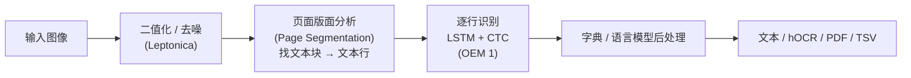

---
Title | ML Tasks Image OCR Tesseract
-- | --
Created @ | `2026-11-25T16:29:32Z`
Updated @| `2026-11-25T16:29:32Z`
Labels | ``
Edit @| [here](https://github.com/junxnone/aiwiki/issues/792)

---
# Tesseract

Tesseract 是最老牌的开源 OCR 引擎：1985–1994 年由 HP 实验室开发，2005 年 HP 开源，2006 年起由 Google 资助维护。早期版本走[传统 OCR](0199_CV_TOCR) 路线（二值化、连通域分析、字符切分、特征分类），**4.0（2018）起加入基于 LSTM 的识别引擎**，识别阶段变成和 [CRNN](0196_ML_Tasks_Image_OCR_CRNN) 同类的"整行识别 + [CTC](0189_ML_Tasks_Image_OCR_CTC)"。它支持 100 多种语言，命令行即用，是评测 CER/WER（见 [Metrics](0190_ML_Tasks_Image_OCR_Metrics)）时最常见的开源基线，也常用来给 [TextRecognitionDataGenerator](0187_ML_Tasks_Image_OCR_Tools_TextRecognitionDataGenerator) 生成的数据做参照。总览见 [OCR](0200_ML_Tasks_Image_OCR)。

## 处理流程

下图展示 Tesseract 的页面处理流程：



图中：

- **二值化与预处理**：由图像库 Leptonica 完成；输入图像质量（分辨率、对比度、倾斜、噪声）对结果影响很大，一般建议文字高度约 30 像素以上、先去倾斜。
- **版面分析**：把整页切成文本块、再切成文本行，具体策略由 PSM（Page Segmentation Mode）控制。
- **逐行识别**：LSTM 引擎读入文本行图像，输出每个位置的字符概率，经 CTC 解码得到文本，不再需要字符切分。
- **后处理**：用字典、语言模型修正低置信度结果。
- **输出**：纯文本、带位置的 hOCR / TSV、可搜索 PDF 等。
- 关键结论：它的检测部分（版面分析）仍是传统算法，只有识别是深度学习，因此对复杂版面、自然场景文字、手写体不如现代深度学习方案。

## 常用参数

**OEM（OCR Engine Mode）**——选择识别引擎：

OEM | 含义
-- | --
0 | 仅传统引擎（需要包含传统引擎的语言数据）
1 | 仅 LSTM 引擎
2 | 两者结合
3 | 默认，按可用情况自动选择

**PSM（Page Segmentation Mode）**——告诉引擎图像里是什么版面，选对常常比换模型更能提升精度：

PSM | 含义
-- | --
3 | 全自动页面分割（默认，不做方向检测）
6 | 假设是单个均匀文本块
7 | 假设图像是单行文本
8 | 假设图像是单个词
10 | 假设图像是单个字符

两张表的第一列是参数取值，第二列是含义；只列了最常用的几个，完整列表可用 `tesseract --help-psm` 查看。例如识别已经裁好的单行文本图（如检测器切出来的行），用 PSM 7 比默认模式更稳。

## 使用

```bash
# 识别英文，输出到 out.txt
tesseract page.png out -l eng

# 同时识别中文和英文，单行文本模式
tesseract line.png out -l chi_sim+eng --psm 7

# 输出带位置信息的 TSV
tesseract page.png out -l eng tsv
```

Python 里可以通过 `pytesseract` 包装库调用：

```python
import pytesseract
from PIL import Image

text = pytesseract.image_to_string(Image.open("page.png"), lang="eng", config="--psm 6")
```

语言数据（`.traineddata`）需要单独安装，常见有 `tessdata_fast`（速度快）、`tessdata_best`（精度高）等版本。

## 训练

LSTM 引擎用官方的 `lstmtraining` 工具训练或微调：准备"文本行图像 + 对应文本"的数据，可用已有的 traineddata 做微调以适应特定字体或场景。网络结构用 VGSL 规格字符串描述（例如卷积层、LSTM 层的堆叠）。需要大量文本行样本时，常用合成数据，见 [OCR Augmentation](0203_ML_Tasks_Image_OCR_Augmentation)。

## 特点与局限

- 优点：开源、跨平台、语言覆盖广、命令行和各种语言绑定都很方便；对扫描质量好的印刷体文档效果不错。
- 局限：
  - 依赖干净的输入，需要自己做预处理；
  - 对复杂版面、表格、自然场景文字、手写体效果较弱；
  - 现代方案（PaddleOCR 等）在中文和场景文字上通常更准。

## Reference

- [tesseract-ocr/tesseract - Github](https://github.com/tesseract-ocr/tesseract)
- [Tesseract 文档](https://tesseract-ocr.github.io/)
- [tessdoc - 使用与训练](https://tesseract-ocr.github.io/tessdoc/)
- [pytesseract - Github](https://github.com/madmaze/pytesseract)
- [基于 Tesseract 的英文文本识别](https://www.aiuai.cn/aifarm935.html)

