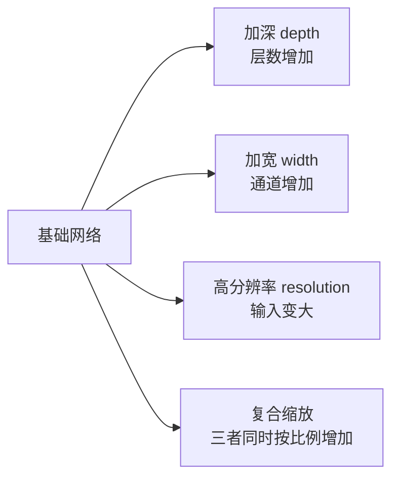

---
Title | ML Tasks Image Classification EfficientNet
-- | --
Created @ | `2026-11-26T01:28:37Z`
Updated @| `2026-11-26T01:30:09Z`
Labels | ``
Edit @| [here](https://github.com/junxnone/aiwiki/issues/801)

---
# EfficientNet

EfficientNet (ICML 2019)：用复合缩放 (compound scaling) 同时按比例放大网络的深度、宽度和输入分辨率，配合 NAS 搜出的基础网络 B0，得到一系列在精度与计算量之间取得良好平衡的模型 (B0~B7)。

## 复合缩放

此前提升精度通常只缩放一个维度：加深 ([ResNet](/0051_ML_Tasks_Image_Classification_ResNet))、加宽 (Wide ResNet) 或增大输入分辨率。EfficientNet 发现三者需要协调：

$$
d=\alpha^{\phi},\quad w=\beta^{\phi},\quad r=\gamma^{\phi},\qquad
\text{s.t.}\ \alpha\cdot\beta^2\cdot\gamma^2\approx2,\ \ \alpha,\beta,\gamma\ge1
$$

其中：

- $d$：深度系数 (层数倍数)；$w$：宽度系数 (通道数倍数)；$r$：分辨率系数 (输入边长倍数)
- $\phi$：用户指定的复合系数，控制总的资源预算；$\alpha,\beta,\gamma$：各维度的分配比例，由小网格搜索在 B0 上确定，论文得到 $\alpha=1.2,\ \beta=1.1,\ \gamma=1.15$
- 计算量 (FLOPs) 近似正比于 $d\cdot w^2\cdot r^2$ (深度线性、宽度和分辨率平方)，所以约束 $\alpha\beta^2\gamma^2\approx2$ 使 $\phi$ 每加 $1$，计算量约翻倍

下图说明三种单维缩放与复合缩放的差别：

图中：前三个分支各只放大一个维度，精度提升很快饱和；复合缩放同时放大三个维度，更宽的网络需要更大的感受野 (更深)、更高分辨率的输入也需要更多通道去捕获细节，因此效果更好。

## 基础网络 B0

- 由 NAS 搜索得到，搜索目标同时考虑精度和 FLOPs，结构类似 [MobileNet V2](/0043_ML_Tasks_Image_Classification_MobileNet_V2) 的 MBConv (倒残差 + 深度可分离卷积)，并在块里加入 [SE](/0800_ML_Tasks_Image_Classification_SENet) 注意力，激活函数用 Swish
- 全网络约 $5.3\text{M}$ 参数、$0.39\text{G}$ FLOPs，ImageNet top-1 $77.1\%$

模型 | 输入分辨率 | 参数量 | FLOPs | ImageNet top-1 `[待核实]`
-- | -- | -- | -- | --
B0 | 224 | 5.3 M | 0.39 G | 77.1%
B1 | 240 | 7.8 M | 0.70 G | 79.1%
B3 | 300 | 12 M | 1.8 G | 81.6%
B5 | 456 | 30 M | 9.9 G | 83.6%
B7 | 600 | 66 M | 37 G | 84.3%

表中：B1~B7 都是对 B0 用不同的 $\phi$ 缩放得到，输入分辨率逐级增大；同精度下，B1 比 ResNet-152 小 $7.6$ 倍、快 $5.7$ 倍，B7 的参数量只有当时最好的 GPipe 的 $1/8$ `[待核实]`。

## 后续

- EfficientNetV2：训练时渐进式增大分辨率，大量使用 Fused-MBConv，训练速度更快
- 缩放思想影响了检测 (EfficientDet)、YOLO 系列的 n/s/m/l/x 规格，见 [YOLO V5](/0379_ML_Tasks_Image_Detection_YOLO_V5)
- 局限：Swish 与 SE 对部分推理引擎不友好，需要量化时要核对，见 [Quantization](/0312_MO_Quantization)

## Reference
- [EfficientNet: Rethinking Model Scaling for Convolutional Neural Networks](https://arxiv.org/abs/1905.11946)
- [EfficientNetV2](https://arxiv.org/abs/2104.00298)

