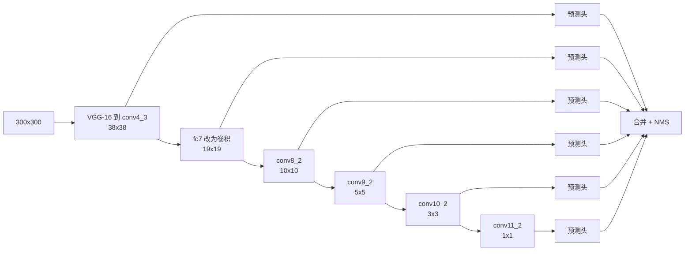

---
Title | ML Tasks Image Detection SSD
-- | --
Created @ | `2026-11-26T01:28:48Z`
Updated @| `2026-11-26T01:28:48Z`
Labels | ``
Edit @| [here](https://github.com/junxnone/aiwiki/issues/802)

---
# SSD

SSD (Single Shot MultiBox Detector，ECCV 2016)：单阶段检测器，在多个不同分辨率的特征图上，用一组预设的默认框 (default box) 同时预测类别和偏移，兼顾速度和精度。

## 结构

下图展示 SSD300 (输入 $300\times300$，以 VGG-16 为基础) 如何在 6 个尺度的特征图上做检测：

图中：

- 主干从左到右是特征图逐步变小：$38,19,10,5,3,1$；浅层特征图大，用于检测小目标，深层特征图小，用于检测大目标
- 每个特征图后接一个预测头 (一个 $3\times3$ 卷积)，对该图上每个位置的每个默认框同时输出 $C+1$ 个类别得分和 $4$ 个框偏移
- 所有尺度的预测拼在一起，经 NMS 得到最终结果，见 [Detection](/0152_ML_Tasks_Image_Detection)

## 默认框

$$
s_k=s_{min}+\frac{s_{max}-s_{min}}{m-1}(k-1),\qquad
w_k^a=s_k\sqrt{a},\quad h_k^a=\frac{s_k}{\sqrt a}
$$

其中：

- $m$：使用的特征图个数；$k=1,\dots,m$：第 $k$ 个特征图；$s_k$：该特征图上默认框相对输入图像边长的尺度，$s_{min}=0.2$，$s_{max}=0.9$，深层特征图尺度更大
- $a\in\{1,2,3,\tfrac12,\tfrac13\}$：长宽比；$w_k^a,h_k^a$：对应默认框的宽、高；$a=1$ 时还额外加一个尺度为 $s'_k=\sqrt{s_ks_{k+1}}$ 的框
- 每个特征图位置的默认框数为 $4$ 或 $6$ ($4,6,6,6,4,4$)，所以 SSD300 的默认框总数为：

$$
38^2\cdot4+19^2\cdot6+10^2\cdot6+5^2\cdot6+3^2\cdot4+1^2\cdot4=8732
$$

其中每一项是「特征图边长平方 × 每个位置的默认框数」，共 $8732$ 个，远多于 [YOLO](/0053_ML_Tasks_Image_Detection_YOLO) V1 的 $98$ 个框。

## 损失与匹配

$$
L=\frac1N\bigl(L_{conf}+\alpha\,L_{loc}\bigr)
$$

其中：

- $N$：匹配上真实框的默认框数 (正样本数)，为 $0$ 时损失取 $0$；$\alpha$：权重，取 $1$
- $L_{conf}$：softmax 交叉熵 (含背景类)；$L_{loc}$：只对正样本计算的 Smooth $L_1$ 损失，回归目标是相对默认框的偏移，编码方式见 [Detection](/0152_ML_Tasks_Image_Detection)
- 匹配规则：每个真实框先匹配到 IoU 最大的默认框，再把所有与真实框 $\mathrm{IoU}>0.5$ 的默认框也作为正样本
- 难负样本挖掘：负样本远多于正样本 (几千比几个)，按置信度损失把负样本从高到低排序，只取最难的一部分，使负:正约 $3:1$；[RetinaNet](@@RET@@) 的 Focal Loss 是解决同一问题的另一种方式

## 速度与精度

模型 | VOC07 mAP | FPS `[待核实]`
-- | -- | --
SSD300 | 74.3 | 46
SSD512 | 76.8 | 19
[Faster R-CNN](/0059_ML_Tasks_Image_Detection_FasterRCNN) | 73.2 | 7
[YOLO V1](/0054_ML_Tasks_Image_Detection_YOLO_V1) | 63.4 | 45

表中：数据来自 SSD 论文，在同一时期比较；SSD300 的速度与 YOLO V1 相当而精度明显更高，精度与 Faster R-CNN 相当而速度快约 $6$ 倍。多尺度特征图是它比 YOLO V1 更好的主要原因，这一思想后来被 [FPN](@@FPN@@) 进一步发展。

## 局限

- 浅层特征图 (如 conv4_3) 语义较弱，小目标检测效果一般；FPN 通过自顶向下的融合改善
- 依赖大量人工设计的默认框尺度和长宽比
- 数据增强很重要 (随机裁剪、颜色扰动、扩展)，论文中带来约 $8.8\%$ mAP 的提升 `[待核实]`

## Reference
- [SSD: Single Shot MultiBox Detector](https://arxiv.org/abs/1512.02325)

